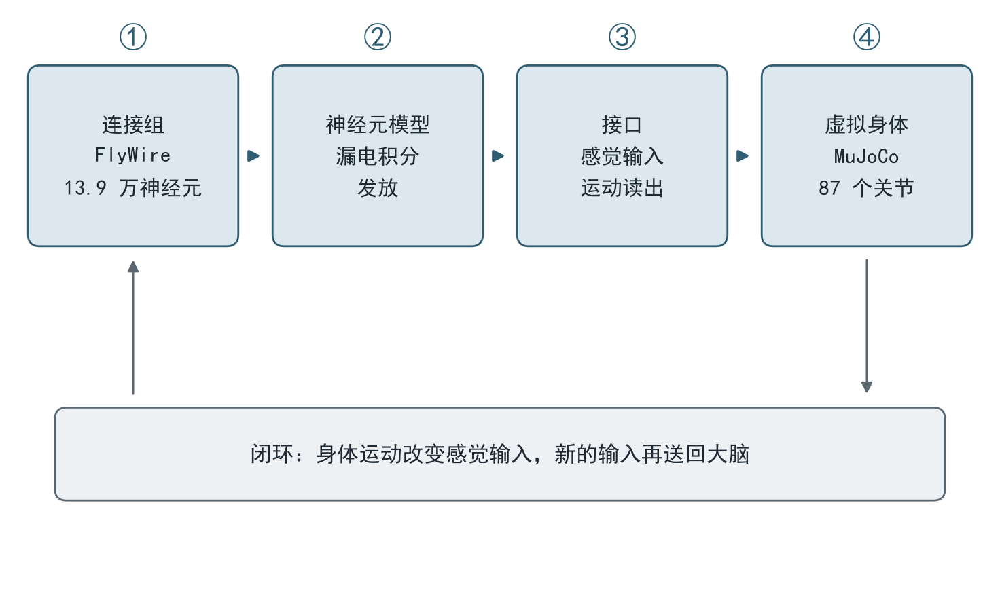
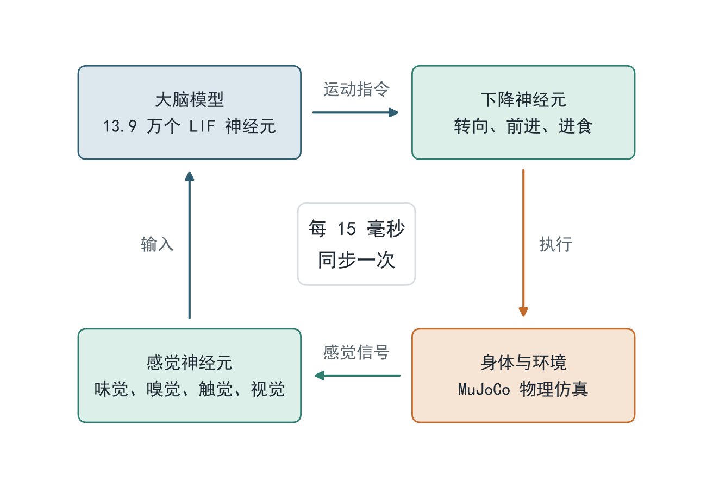

# 第 1 章　一只果蝇的脑被放进了虚拟身体

2026 年 3 月，一段几十秒的视频在社交网络上流传。画面里是一只果蝇，停在一个由多边形拼成的虚拟地面上。它的前方摆着几片切开的香蕉，空气里飘着看不见的气味。果蝇向前走，转向，再向前，走到香蕉旁边停下，伸出喙，开始进食。中途有一些灰尘落在它的触角上，它抬起前腿，把触角清理干净，然后继续赶路。

这段视频之所以引起讨论，不是因为画面精致。果蝇的模型粗糙，动作也说不上优雅。真正让人停下来的是画面之外的那句话，驱动这只果蝇的，是一份从真实大脑里逐突触测绘出来的接线图，而不是一段为它编写的动画脚本。

发布这段视频的是 Eon Systems，一家位于旧金山的公司。他们的说法是，这是第一次把完整的大脑仿真放进物理仿真身体里，让感觉、神经活动和运动首尾相接，形成闭环。公司创始人 Michael Andregg 在社交平台上写得更直接，我们上传了一只果蝇。

要理解这句话的分量，需要先把它拆开，看清里面到底有什么。

## 1.1 视频背后的四样东西

Eon 的做法可以用四样东西概括。第一样是连接组，也就是神经元之间谁连着谁、连了多少次的完整清单。这份数据来自 FlyWire 项目，一个由多国实验室共同完成的成年果蝇全脑测绘工程，2024 年发表在《自然》上，包含 139255 个神经元和大约 5000 万个突触连接。第二样是突触的符号，每个连接是兴奋性的还是抑制性的，这决定了信号传来时下游神经元是被推一把还是被按住。第三样是一个神经元模型，用来描述单个神经元如何把输入的电流累积成一次放电。第四样是一个身体，准确地说是一个由关节、肌肉、接触和力学构成的多体模型，跑在 MuJoCo 物理引擎里。

Andregg 在说明里强调了一个细节，这四样东西里没有任何一项是针对具体行为手工编写的。没有人写“看到香蕉就往前走”这样的规则，也没有人写“触角脏了就抬腿”。行为是从连接结构里长出来的。

这句话需要打一点折扣，后面会详细讨论。但它抓住了一个关键点，也就是大脑的接线方式本身携带了大量信息。过去几十年，神经科学更习惯从单个神经元或单个环路入手，一次讲清楚一个机制。全脑仿真走的是另一条路，先把结构完整地抄下来，再看功能能不能自己浮现。

“全脑仿真”这个词值得先界定一下，因为它在不同人口中指的是完全不同的东西。最窄的一种用法指整脑的连接组被完整测量出来，一个神经元不漏，一个突触不丢。稍宽一点的用法要求在这张接线图上跑动力学，让信号真的流动起来。再宽一层要求行为可比，也就是仿真出来的系统在给定输入下做出与真实动物类似的动作。最宽的一种用法，是把它当成“心智复制”的同义词，认为只要保真度足够高，里面的东西就有感受、有记忆、有自我。

这四层含义一层比一层强，验证难度也一层比一层高。Eon 的演示落在第二层和第三层之间，宣传语却常常被读成第四层。整本书想做的事情之一，就是让你在看到类似报道时，能立刻判断它站在哪一层。

## 1.2 这份大脑从哪里来

FlyWire 的数据不是从一只果蝇身上一次性拍出来的。它来自一张被切成数千个超薄切片的果蝇脑，每个切片厚度只有几十纳米，用电子显微镜逐张成像。切片本身会带来褶皱、破损和错位，图像里的细胞膜、突触和线粒体混在一起，需要算法把每一个神经元从像素堆里重建出来，再把跨越切片的片段接回完整细胞。

这件事的难度可以用一个数字感受。人眼在一张电子显微镜图像里分辨两个相邻的神经纤维已经吃力，而整个数据集有几十万张图像。早期线虫的连接组靠研究生一张一张看，用了十几年。果蝇的规模是线虫的四百多倍，如果不是自动分割和群体校对在这十年里成熟，这项工作根本无法完成。

FlyWire 的另一半工作是注释。重建出来的是形状，形状本身不告诉你这是哪种细胞。研究者把 139255 个神经元按形态、位置、投射目标分成几千种类型，再根据突触两侧的囊泡形态预测每个连接是兴奋还是抑制。这一步用到了机器学习，也用了大量人工校对。Eon 用的正是这套已经公开的数据。

在 FlyWire 之前，同一批人已经做过一次规模小一些的演练。2020 年，Janelia 研究园区的团队公布了果蝇半脑的突触分辨率图谱，覆盖中央脑的主要区域，约两万五千个神经元和两千万个突触。半脑图谱证明了两件事，自动重建可以做到突触级别，而且注释可以做得足够细，让每个神经元都有名字。全脑只是把这个流程放大，放大到需要全球几十个实验室一起校对的程度。

数据公开这件事本身也很关键。FlyWire 把连接矩阵、细胞类型注释、突触预测全部放到网上，任何人下载就能用。Eon 没有自己做电镜，也没有自己做分割，它站在一份已经开源的数据上。这一点在评价这次演示时经常被忽略，因为真正稀缺的资源不是模型代码，而是那几十万张图像和几千人年的校对。

## 1.3 神经元被简化成了什么

有了接线图，还需要一个动力学规则，规定电流如何在神经元里积累、什么时候放电、放电后如何恢复。

Eon 用的是漏电积分发放模型，英文缩写 LIF。这个模型把神经元看成一个小水桶，突触输入像水流进来，桶底有个洞让水慢慢漏掉。水位超过阈值，桶就翻倒一次，输出一个脉冲，然后水位归零，进入短暂的不应期。整个模型只有两三个参数，计算一次的成本极低。

这不是随意的选择。2024 年那篇《自然》论文里，Philip Shiu 和合作者用同样的简化模型跑完了整个果蝇中央脑，发现它能够预测真实果蝇在进食、理毛等行为中的神经活动，匹配度达到九成左右。换句话说，连接结构加上一个粗糙的神经元模型，已经能解释相当一部分感觉运动转换。更精细的模型当然更好，但代价会高几个数量级。

这也是全脑仿真最容易被误解的地方。外界常以为仿真就是把每个离子通道、每个树突分支都算一遍。实际上第一代全脑仿真做的事情要朴素得多，它赌的是结构比细节更重要。

那个模型的构造方式值得多说两句，因为它解释了为什么后来接上身体时能直接拿来用。Shiu 团队手里有连接矩阵，每个元素是一个数字，代表两个神经元之间有几个突触。他们把突触数量直接当成权重，把兴奋性连接的权重取正、抑制性取负，再给每种细胞类型配一组从文献里抄来的膜时间常数和阈值，网络就成型了。整个过程里几乎没有拟合，因为需要拟合的参数太多而数据太少。他们做的是另一种事，把结构放进去，看它自己会算出什么，再拿实验结果对照。

这个做法有一个隐含的信念，结构本身携带了足够多的信息，以至于参数的不精确可以被结构的精确抵消掉。九成的匹配度是支持这个信念的证据，但它只是一次检验，不是证明。

## 1.4 身体如何接上大脑

大脑不能直接指挥关节。在真实果蝇里，信号从大脑皮层样的结构往下走，经过下降神经元，进入胸神经节，再落到控制腿和翅膀的运动神经元上。这条通路非常复杂，仅下降神经元就有一千多个。

Eon 没有能力也没有必要完整复现这条通路。他们挑了一小组下降神经元作为控制手柄，比如与转向有关的 DNa01 和 DNa02，与前进速度有关的 oDN1，与喙部运动有关的 MN9。这些神经元在仿真大脑里的活动水平，被映射成虚拟身体的转向速度、前进速度和进食动作。下面的控制器再把这些低维指令翻译成关节力矩。

这个做法有一个容易被忽略的后果。视频里看起来连贯的行走，很大一部分来自身体模型自带的控制器。NeuroMechFly v2 是 2024 年公开的果蝇身体仿真框架，包含 87 个独立关节，网格来自真实果蝇的 X 射线显微断层扫描，其中的行走控制器经过模仿学习训练。Eon 接上的是这个已经会走路的身体，大脑负责决定往哪走、走多快、什么时候停。

用他们自己的比喻，这就像开车。你知道方向盘、油门和刹车的位置，就能预测车子大致会怎么动，不需要模拟发动机里每一次燃烧。下降神经元在这里扮演的就是方向盘和油门。

闭环这件事听起来抽象，其实只涉及一条时间线。虚拟世界更新一次，把落在触角上的灰尘、喙碰到的糖水、视野里的阴影翻译成一组感觉神经元的激活水平。大脑网络按这些输入积分若干步，读出下降神经元的放电率。放电率换算成速度指令，交给身体控制器，身体在物理引擎里前进十五毫秒，位置和姿态变了一点，于是触角上的光线、腿上的接触力也跟着变。新的感觉输入再回到大脑。这个循环每秒重复六十多次，行为就是在这条环路上一点点累积出来的。

十五毫秒这个数字不是随便定的，它大致对应果蝇视觉系统的一个采样周期。回路延迟太小，计算跟不上；延迟太大，身体会走得像在冰上滑。工程上这是一条必须折中的曲线，而真实果蝇用几亿年演化把它调到了一个很紧的位置。

## 1.5 哪些是数据，哪些是假设

到这里可以给出一个粗略的账目。

属于数据的有三样，神经元之间的连接、连接的强度（用突触数量近似）、连接的符号（兴奋或抑制）。这三样都来自电子显微镜重建和机器学习预测，有明确的测量来源，也有已知的误差。

属于模型假设的有两样，单个神经元的动力学被简化为 LIF，突触被简化为瞬时电流或电导。这两样是建模选择，不是测量结果。

属于工程拼接的有三样，感觉输入如何映射到具体的感觉神经元，下降神经元的放电率如何换算成转向速度，身体控制器用哪一套。这三样里有相当一部分是手工设定的，Eon 自己也承认这一点。

最后还有一片空白。真实果蝇有激素、有饥饿和饱腹状态、有学习和记忆。当前的仿真里几乎没有这些。LIF 模型没有可塑性，所以这只果蝇无法形成长期记忆。视觉输入虽然接进来了，但对行为的影响还很弱，用他们的话说，目前更接近装饰。

所以更准确的说法是，这是一次结构驱动的、低维接口的、行为数量有限的闭环演示。它证明了这条路能走通，但没有证明结构足以解释全部行为。

账目里最容易被低估的一项是误差。突触数量作为权重只是近似，因为一个连接上十个突触不代表强度是五个突触的两倍，突触本身有强弱、有位置差异、有释放概率。递质符号的预测准确率在八成到九成之间，剩下的一两成错误均匀撒在五千万个连接上，会让某些局部环路的兴奋抑制平衡整体偏移。神经元模型忽略树突，等于把每个细胞的空间结构抹掉，而果蝇的许多计算恰恰发生在树突上。

这三类误差不会互相抵消，它们会朝着同一个方向叠加，让网络偏离真实活动。模型还是能跑出行为，但跑出行为的原因可能和真实果蝇不完全一样。这一点在评估任何仿真时都成立，不是这次演示特有的问题。

## 1.6 为什么仍然值得认真对待

如果只看局限，这件事似乎被夸大了。但把时间轴拉长，它出现的位置很关键。

1986 年，White 和合作者用十几年时间手工重建了线虫的 302 个神经元。那是一个里程碑，也是一次警告，因为所有人都看到了规模问题。此后近三十年，连接组学几乎停在原地，果蝇全脑被认为是遥不可及的目标。

转折发生在成像、计算和算法同时进步的十年里。自动切片、自动分割、群体校对把重建成本压了下来，FlyWire 在 2024 年交出了完整成体果蝇脑。紧接着，2025 年有团队把这个连接组放上 12 片 Loihi 2 神经形态芯片，跑出了比传统数值仿真快几个数量级的模拟。2026 年初，Eon 把它接上了身体。

这三次进展分别解决的是数据、算力和闭环。三件事凑齐，才让一段看起来粗糙的视频变得有意义。

还有一层意义在方法上。神经科学长期依赖还原论，把一个环路切出来，用药物或电极刺激，观察反应。这种方法产生了大量知识，但很难回答一个整体性问题，也就是许多环路同时工作时，行为从哪里来。全脑仿真提供的是一种反向的验证方式，把结构完整地放进去，看哪些行为会自己出现，哪些不会。不会出现的部分，恰恰指向前一种方法看不见的东西。

这种反向验证还有一个副产品，它把“不知道”标了出来。传统研究里，一个没被研究过的环路只是空白，没人知道它缺什么。全脑模型里，一个环路如果参数不明、连接符号不确定，模型跑起来就会异常，异常的位置就是知识的缺口。这类缺口清单比一篇论文的讨论部分要具体得多，也更容易转成下一个实验的设计。

## 1.7 这本书要讲什么

接下来的十二章，会沿着这条线索往前走。

先讲清楚大脑由什么构成。神经元是什么，信号如何传递，环路如何组织。这部分不需要任何基础，读完至少能看懂论文里的示意图。

然后讲我们如何看见大脑。从光学显微镜到电子显微镜，从钙成像到电极阵列，每一种手段都在分辨率和视野之间做取舍。连接组学为什么难，难在什么地方，会在这一部分交代清楚。

再往后是连接组学的历史。线虫的 302 个神经元，果蝇的半脑图谱，直到 2024 年的全脑。这一段会把技术脉络和人物脉络放在一起讲，因为这项工作的推进方式很特别，它依赖大规模的群体协作，而不是某个实验室的单点突破。

最后回到仿真。计算神经科学的模型谱系，仿真器如何工作，身体和环境为什么重要，果蝇全脑仿真到底做到了哪一步，路线之争在哪里。读完这一部分，你应该能独立判断下一篇类似的新闻稿，知道它在说什么，也知道它没说什么。

至于数学细节，比如膜方程怎么推、网络稳定性怎么分析、参数怎么拟合，这一册只做点到为止的交代。目标是把地图画出来，让你知道每一块地形的位置和高度，不必一开始就下到沟里。

地图画完之后还有三个背景问题没回答。这条路是怎么一步步铺过来的，为什么第一个被完整复现的脑是果蝇而不是别的动物，以及一次演示的边界到底应该划在哪里。下面三节分别处理它们。

## 1.8 为什么是果蝇

全脑仿真第一次跑通闭环，选择果蝇不是偶然。

果蝇的脑足够小。十三万多个神经元，放在电镜里几年能扫完，放在计算机里几十张显卡能跑动。小鼠的七千万个神经元，扫描和仿真都要跨两个数量级，短期内看不到完整的可能。线虫更小，只有三百多个神经元，但它的行为太简单，跑通了也说明不了太多问题，一只只会前进和后退的虫子和一台会走路的机器之间，差距不只是神经元数量。

果蝇的行为足够丰富。它能走、能飞、能理毛、能觅食、能学习气味与惩罚的关联、能在两组矛盾的选择之间做决定。这些行为覆盖了感觉、运动、学习、决策几个层面，任何一层出问题，闭环都跑不起来。用一个行为贫乏的模型验证结构决定功能，说服力会弱很多。

果蝇的遗传工具足够成熟。GAL4/UAS 系统让研究者可以用一行基因构建体标记任意一群神经元，再用光遗传或温度敏感通道开关它们。这套工具积累了几十年，几乎每个细胞类型都有对应的品系。连接组给出结构，遗传工具给出干预手段，两者结合才能做因果验证。换成一个新的物种，光建立这套工具就要十年。

果蝇还便宜。一对果蝇在二十五度下十天一代，一个培养瓶能养几百只，一个实验室一年能养几十万只。实验成本低，意味着可以反复试错，可以做大样本的行为统计。神经科学里很多结论受限于样本量，果蝇在这方面有天然优势。

这几个条件同时满足的动物不多。斑马鱼幼鱼透明，可以活体成像，神经元数量也在十万量级，是另一个热门选择，但它的行为库比果蝇窄，遗传工具也没有果蝇细致。小鼠的遗传工具同样成熟，但脑太大，全脑连接组还遥遥无期。果蝇恰好落在能力与复杂度的交叉点上。

## 1.9 上传这个词的三种含义

媒体喜欢用“上传”这个词。它和前面说的四层含义有重叠，但多了一层隐含判断，也就是里面有一个可以被搬迁的“谁”。严格说，它至少对应三件不同的事。

第一种是结构复制。把神经元的连接、类型、递质全部测出来，建成一份数字档案。这是连接组学已经做到的事，FlyWire 就是一份果蝇脑的结构复制。它不含活动，也不含行为，像一张极其详细的地图。

第二种是功能等价。复制出来的系统在给定输入下产生与真实大脑相似的输出，包括神经活动和行为。Eon 的演示属于这一层，它让模型在虚拟身体里产生了觅食、理毛这些可观察的行为。功能等价有程度之分，行为像不像，神经活动像不像，对干预的反应像不像，每一层都可以单独打分。

第三种是身份延续。数字系统不仅行为像，还继承了原来的记忆、性格、主观体验，并且被认为是同一个人。这一层目前没有任何科学手段可以验证，甚至不清楚它在原则上是否可验证。把前两层的工作说成第三层，是这类新闻最常见的夸大。

区分这三层不是为了否定进展。结构复制和功能等价都是实打实的科学工作，前者花了四十年，后者刚刚开始。问题在于，公众讨论往往从第一层直接跳到第三层，中间的两级台阶被省略了。看懂这三层，就能判断一篇报道到底在说什么。

## 1.10 一次演示的边界

回到 2026 年 3 月的那段视频。它展示了什么，没有展示什么，可以列一张清单。

展示了三件事。第一，完整的连接组可以驱动一个闭环系统，从感觉输入到运动输出，不需要为每个行为单独编程。第二，结构本身携带了足够的信息，让模型在没有训练的情况下产生多种行为。第三，神经形态硬件和传统仿真都能跑这套模型，说明它在工程上是可复现的。

没有展示的，同样是三件事。

第一，没有展示学习。模型用的是固定的漏电积分发放网络，突触权重不随经验改变。果蝇能记住气味与电击的关联，能在一生中不断更新行为，这些能力在演示里都不存在。

第二，没有展示内部状态。饥饿、饱腹、恐惧、求偶，这些状态由神经调质和激素调控，会改变同一刺激下的行为选择。演示里的果蝇没有这些变量，它的行为更像一组固定的反射，而不是一个有动机的个体。

第三，没有展示完整的运动通路。身体的动作来自预先训练好的控制器，大脑只提供几个低维指令。真实果蝇的下降神经元有一千多个，共同编码运动的细节，演示里只用了其中几个作为开关。

这张清单不是挑刺。任何第一次演示都有边界，把边界画清楚，才能知道下一步该补什么。对读者来说，看到一个成果时先问三个问题，它复制了结构还是复制了功能，它有没有闭环，它的行为有多少来自模型、多少来自手工接口。这三个问题能过滤掉大部分夸大其词的说法。

## 1.11 仿真大脑与人工智能不是一回事

这段视频传开之后，最常见的联想是人工智能。两者都在计算机上运行，都表现出类似智能的行为，很容易被混为一谈，但它们的目标和路径几乎相反。

大语言模型从数据里学规律。给它足够多的文本，它通过调整几千亿个参数，学会预测下一个词，进而表现出对话、推理、写代码的能力。它的起点是行为，终点是内部表征，中间发生了什么，连训练它的人也说不清楚。

全脑仿真从结构出发。它不去学行为，而是把真实大脑的连接原样抄下来，让行为从结构里自己长出来。它的起点是结构，终点是行为，中间的动力学是可查的，每个神经元在哪、连到谁、什么时候放电，都能追溯到具体的细胞。

两条路各有各的难处。大模型的问题是解释性，它能做事，但说不清为什么。全脑仿真的问题是完备性，它抄得再细，也可能漏掉决定行为的关键变量，比如神经调质、激素、发育历史。一个从行为反推结构，一个从结构正推行为，短期内谁也替代不了谁。

有意思的是，两条路正在互相借工具。全脑仿真用机器学习做图像分割、突触预测、参数拟合；人工智能用神经科学的发现设计网络结构，比如注意力、记忆、稀疏编码。果蝇的连接组甚至被直接当成强化学习网络的架构先验，用来提高样本效率。这种交叉不意味着两者会合并，它说明大脑和智能之间的关系比“一个是另一个的实现”更复杂。

对读者来说，分清这两件事有一个实际好处。看到“人工智能复刻大脑”的说法时，可以追问一句，它用的是大脑的结构，还是大脑的术语。用了结构的，是全脑仿真；只借了术语的，通常只是营销。
