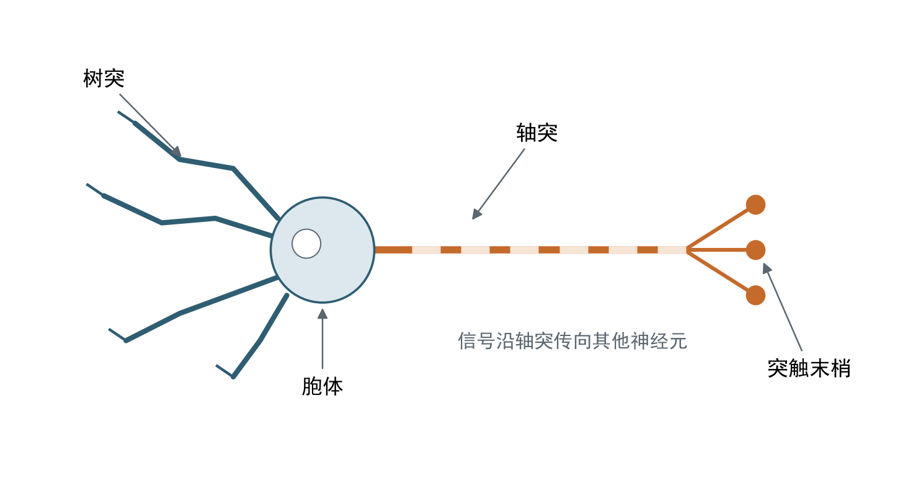

# 第 2 章　大脑的零件

果蝇的脑只有一粒小米大小，里面装着大约 13.9 万个神经元。人的脑重约 1.4 公斤，装着大约 860 亿个神经元。两者相差六十万倍，但把它们放在显微镜下，看到的基本构件是同一套。神经元、胶质细胞、突触、血管，以及填充其间的细胞外基质。

理解全脑仿真，第一步是弄清楚这些构件各自做什么。因为仿真里的每一个简化，针对的都是某一种构件。

## 2.1 一个神经元的形状

教科书上的神经元通常画成一个圆圆的胞体，伸出一丛树突，再拖一条长长的轴突，末端分叉。这个形象来自脊髓运动神经元，方便讲解，却容易让人以为神经元都长这样。

真实的情况要杂乱得多。果蝇脑里的神经元多数没有明显的树突主干，胞体偏在一边，所有输入输出都从同一根纤维上长出分支。这种形态叫单极神经元。人类大脑皮层的锥体神经元则是另一种极端，顶树突可以向上延伸一毫米，穿过好几层皮层，上面布满成千上万个突触。

形状不是装饰。树突的分支方式决定了它能接收哪些来源的输入，轴突的走行决定了它把信号送到哪里，纤维的粗细决定了信号传播的速度。一个神经元的功能，很大程度上写在它的几何形状里。

胞体是细胞的代谢中心，里面有细胞核、线粒体和合成蛋白质的机器。树突负责接收，表面分布着大量突触，把上游传来的化学信号转成电信号。轴突负责传输，起始段是动作电位产生的地方，之后信号沿着纤维一路传下去。轴突末端叫突触前终末，里面堆着装满神经递质的囊泡。

一个果蝇神经元的大小在几微米到几百微米之间。胞体直径通常只有 3 到 10 微米，比红细胞大不了多少。要在这样的尺度上追踪一根纤维的走向，光学显微镜已经不够用，这是后面要讲的电子显微镜登场的原因。

## 2.2 神经元不是唯一的细胞

脑里还有胶质细胞。这个名字容易让人以为是“胶水”，实际上它们参与的事情很多，包括维持细胞外的离子浓度、清除多余的神经递质、给轴突包上绝缘层、在损伤时做出反应。

人脑里胶质细胞的数量和神经元差不多，各占一半左右。果蝇脑里胶质细胞比例低一些，大约一成上下，种类也少，主要有星形胶质细胞样、皮层胶质和表面胶质几类。比例虽低，缺少它们神经元活不长，这一点在果蝇身上已经被遗传学实验反复验证。

胶质细胞对全脑仿真的意义在于，它提醒我们接线图并不等于全部。FlyWire 重建的是神经元之间的化学突触，胶质细胞与神经元之间的相互作用基本没有被纳入。这是一个已知的缺口，目前普遍认为它影响的是慢时间尺度的调节，而不是毫秒级的信号传递。这个判断是否成立，还需要更多实验。

## 2.3 突触，连接的物理形态

两个神经元相接的地方叫突触。最常见的是化学突触，结构可以分成三部分。

突触前一侧是膨大的终末，里面有几十到几百个囊泡，每个囊泡直径约 40 纳米，膜上镶着装神经递质的蛋白。突触后一侧是接收方的膜，上面密集分布着受体。两侧之间有一道 20 到 30 纳米的缝隙，叫突触间隙。

信号到达时，突触前膜去极化，电压门控钙通道打开，钙离子涌入，触发囊泡与膜融合，把递质释放到间隙里。递质扩散过去，结合到后膜受体上，受体构象改变，离子通道打开，产生一小股电流。整个过程从钙离子进入到电流出现，只需要几百微秒。

突触的强度通常用两点描述，一是连接的数量，同一个上游神经元可能在一个下游神经元上形成好几个突触；二是每个突触的效率，取决于受体数量和囊泡释放概率。FlyWire 记录的正是前者，每个连接对应多少个突触，这个数字被当成权重的近似。

还有一种电突触，也叫缝隙连接。两侧细胞膜上各有一组连接蛋白，直接拼成一个通道，离子可以自由穿过。电突触传递几乎没有延迟，方向性弱，常在需要同步放电的神经元群之间出现。果蝇的许多运动环路和视觉环路里都有电突触，但目前的连接组重建主要针对化学突触，电突触的系统性普查还在进行中。

## 2.4 递质决定了连接的符号

神经递质是突触传递的化学信使。不同的递质结合不同的受体，产生不同的效果。有的让后膜去极化，让下游更容易放电，叫兴奋性；有的让后膜超极化，让下游更难放电，叫抑制性。

哺乳动物最熟悉的组合是谷氨酸兴奋、γ-氨基丁酸抑制。果蝇的规则不太一样。果蝇脑里最主要的兴奋性递质是乙酰胆碱，谷氨酸在很多环路里反而起抑制作用，γ-氨基丁酸依旧是抑制性的。除此之外还有多巴胺、血清素、章鱼胺和组胺，这些递质不直接产生快速电流，而是调节神经元对输入的响应强度，影响动机、唤醒和学习的效率。

确定每个突触用哪种递质，是连接组学里最麻烦的步骤之一。电子显微镜图像里看不到递质分子，只能从突触的形态推断。2024 年的一项工作用机器学习，根据突触前囊泡的形状、大小和分布，把果蝇的每个突触分类成几种主要的递质类型，准确率在八成到九成之间。Eon 用的就是这套预测结果。预测会有错，错的比例不大，但在 5000 万个连接上累积起来，足以影响某些环路的整体平衡。

## 2.5 一张数量表

把这一章的数字集中放在一起，能更直观地感受尺度。

| 对象 | 果蝇 | 小鼠 | 人 |
| --- | ---: | ---: | ---: |
| 神经元数量 | 约 13.9 万 | 约 7000 万 | 约 860 亿 |
| 突触数量 | 约 5000 万 | 约 1000 亿 | 约 100 万亿 |
| 平均每个神经元的突触数 | 约 360 | 约 1400 | 约 1200 |
| 脑重 | 约 1 毫克 | 约 0.4 克 | 约 1400 克 |

: 表 2-1　三种动物的脑规模对比，数据取自已发表的连接组与细胞计数研究

表格里的数字都是量级估计。不同文献对小鼠突触总数的估计从几百亿到上千亿不等，人的数字差异更大。但比例关系是清楚的，从果蝇到人，神经元数量增加约六十万倍，突触数量增加约两千万倍。

这个增长不是均匀的。小鼠的神经元数量是果蝇的五百倍，突触数量是果蝇的两百倍，平均连接数反而更多。到了人，单个神经元的连接数没有继续暴涨，增加的主要是神经元总数和远程连接的比例。这种变化对网络动力学意味着什么，目前还没有定论。

## 2.6 为什么从零件开始

如果把全脑仿真比作复刻一台机器，那么神经元是零件，突触是接线，递质是接线的极性。知道了这三样，至少能画出一张完整的电路图。

但电路图不等于机器能转。一台机器的行为还取决于零件的具体特性，晶体管的开关速度、电容的充放电曲线、导线的电阻。对应到大脑，就是膜的电学性质、离子通道的种类和分布、突触的时间进程。这些内容会在下一章展开。

值得提前说明的是，当前的果蝇全脑仿真对零件的处理非常粗糙。它把每个神经元压成一个点，忽略了树突的分支，忽略了离子通道的分布，也忽略了电突触。它赌的是接线方式比零件细节更重要。这个赌注能不能赢，取决于你想解释的是哪一类现象。
