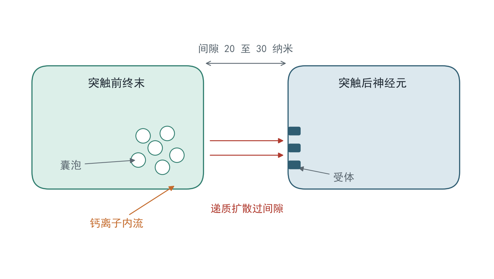

# 第 2 章　大脑的零件

果蝇的脑只有一粒小米大小，里面装着大约 13.9 万个神经元。人的脑重约 1.4 公斤，装着大约 860 亿个神经元。两者相差六十万倍，但把它们放在显微镜下，看到的基本构件是同一套。神经元、胶质细胞、突触、血管，以及填充其间的细胞外基质。

理解全脑仿真，第一步是弄清楚这些构件各自做什么。因为仿真里的每一个简化，针对的都是某一种构件。

## 2.1 一个神经元的形状

教科书上的神经元通常画成一个圆圆的胞体，伸出一丛树突，再拖一条长长的轴突，末端分叉。这个形象来自脊髓运动神经元，方便讲解，却容易让人以为神经元都长这样。

真实的情况要杂乱得多。果蝇脑里的神经元多数没有明显的树突主干，胞体偏在一边，所有输入输出都从同一根纤维上长出分支。这种形态叫单极神经元。人类大脑皮层的锥体神经元则是另一种极端，顶树突可以向上延伸一毫米，穿过好几层皮层，上面布满成千上万个突触。

形状不是装饰。树突的分支方式决定了它能接收哪些来源的输入，轴突的走行决定了它把信号送到哪里，纤维的粗细决定了信号传播的速度。一个神经元的功能，很大程度上写在它的几何形状里。

胞体是细胞的代谢中心，里面有细胞核、线粒体和合成蛋白质的机器。树突负责接收，表面分布着大量突触，把上游传来的化学信号转成电信号。轴突负责传输，起始段是动作电位产生的地方，之后信号沿着纤维一路传下去。轴突末端叫突触前终末，里面堆着装满神经递质的囊泡。

一个果蝇神经元的大小在几微米到几百微米之间。胞体直径通常只有 3 到 10 微米，比红细胞大不了多少。要在这样的尺度上追踪一根纤维的走向，光学显微镜已经不够用，这是后面要讲的电子显微镜登场的原因。

## 2.2 神经元不是唯一的细胞

脑里还有胶质细胞。这个名字容易让人以为是“胶水”，实际上它们参与的事情很多，包括维持细胞外的离子浓度、清除多余的神经递质、给轴突包上绝缘层、在损伤时做出反应。

人脑里胶质细胞的数量和神经元差不多，各占一半左右。果蝇脑里胶质细胞比例低一些，大约一成上下，种类也少，主要有星形胶质细胞样、皮层胶质和表面胶质几类。比例虽低，缺少它们神经元活不长，这一点在果蝇身上已经被遗传学实验反复验证。

胶质细胞对全脑仿真的意义在于，它提醒我们接线图并不等于全部。FlyWire 重建的是神经元之间的化学突触，胶质细胞与神经元之间的相互作用基本没有被纳入。这是一个已知的缺口，目前普遍认为它影响的是慢时间尺度的调节，而不是毫秒级的信号传递。这个判断是否成立，还需要更多实验。

## 2.3 突触，连接的物理形态

两个神经元相接的地方叫突触。最常见的是化学突触，结构可以分成三部分。

突触前一侧是膨大的终末，里面有几十到几百个囊泡，每个囊泡直径约 40 纳米，膜上镶着装神经递质的蛋白。突触后一侧是接收方的膜，上面密集分布着受体。两侧之间有一道 20 到 30 纳米的缝隙，叫突触间隙。

信号到达时，突触前膜去极化，电压门控钙通道打开，钙离子涌入，触发囊泡与膜融合，把递质释放到间隙里。递质扩散过去，结合到后膜受体上，受体构象改变，离子通道打开，产生一小股电流。整个过程从钙离子进入到电流出现，只需要几百微秒。

突触的强度通常用两点描述，一是连接的数量，同一个上游神经元可能在一个下游神经元上形成好几个突触；二是每个突触的效率，取决于受体数量和囊泡释放概率。FlyWire 记录的正是前者，每个连接对应多少个突触，这个数字被当成权重的近似。

还有一种电突触，也叫缝隙连接。两侧细胞膜上各有一组连接蛋白，直接拼成一个通道，离子可以自由穿过。电突触传递几乎没有延迟，方向性弱，常在需要同步放电的神经元群之间出现。果蝇的许多运动环路和视觉环路里都有电突触，但目前的连接组重建主要针对化学突触，电突触的系统性普查还在进行中。

## 2.4 递质决定了连接的符号

神经递质是突触传递的化学信使。不同的递质结合不同的受体，产生不同的效果。有的让后膜去极化，让下游更容易放电，叫兴奋性；有的让后膜超极化，让下游更难放电，叫抑制性。

哺乳动物最熟悉的组合是谷氨酸兴奋、γ-氨基丁酸抑制。果蝇的规则不太一样。果蝇脑里最主要的兴奋性递质是乙酰胆碱，谷氨酸在很多环路里反而起抑制作用，γ-氨基丁酸依旧是抑制性的。除此之外还有多巴胺、血清素、章鱼胺和组胺，这些递质不直接产生快速电流，而是调节神经元对输入的响应强度，影响动机、唤醒和学习的效率。

确定每个突触用哪种递质，是连接组学里最麻烦的步骤之一。电子显微镜图像里看不到递质分子，只能从突触的形态推断。2024 年的一项工作用机器学习，根据突触前囊泡的形状、大小和分布，把果蝇的每个突触分类成几种主要的递质类型，准确率在八成到九成之间。Eon 用的就是这套预测结果。预测会有错，错的比例不大，但在 5000 万个连接上累积起来，足以影响某些环路的整体平衡。

## 2.5 一张数量表

把这一章的数字集中放在一起，能更直观地感受尺度。

| 对象 | 果蝇 | 小鼠 | 人 |
| --- | ---: | ---: | ---: |
| 神经元数量 | 约 13.9 万 | 约 7000 万 | 约 860 亿 |
| 突触数量 | 约 5000 万 | 约 1000 亿 | 约 100 万亿 |
| 平均每个神经元的突触数 | 约 360 | 约 1400 | 约 1200 |
| 脑重 | 约 1 毫克 | 约 0.4 克 | 约 1400 克 |

: 表 2-1　三种动物的脑规模对比，数据取自已发表的连接组与细胞计数研究

表格里的数字都是量级估计。不同文献对小鼠突触总数的估计从几百亿到上千亿不等，人的数字差异更大。但比例关系是清楚的，从果蝇到人，神经元数量增加约六十万倍，突触数量增加约两千万倍。

这个增长不是均匀的。小鼠的神经元数量是果蝇的五百倍，突触数量是果蝇的两百倍，平均连接数反而更多。到了人，单个神经元的连接数没有继续暴涨，增加的主要是神经元总数和远程连接的比例。这种变化对网络动力学意味着什么，目前还没有定论。

## 2.6 为什么从零件开始

如果把全脑仿真比作复刻一台机器，那么神经元是零件，突触是接线，递质是接线的极性。知道了这三样，至少能画出一张完整的电路图。

但电路图不等于机器能转。一台机器的行为还取决于零件的具体特性，晶体管的开关速度、电容的充放电曲线、导线的电阻。对应到大脑，就是膜的电学性质、离子通道的种类和分布、突触的时间进程。这些内容会在下一章展开。

值得提前说明的是，当前的果蝇全脑仿真对零件的处理非常粗糙。它把每个神经元压成一个点，忽略了树突的分支，忽略了离子通道的分布，也忽略了电突触。它赌的是接线方式比零件细节更重要。这个赌注能不能赢，取决于你想解释的是哪一类现象。

## 2.7 脑的代谢与支撑系统

大脑只占体重的百分之二，却消耗全身约五分之一的氧气和葡萄糖。这个比例在清醒时更高，在思考时局部脑区的血流会增加。神经活动是要花钱的，账单主要付在离子泵上。

动作电位让钠离子涌入、钾离子流出，要恢复到静息状态，钠钾泵必须把离子逆着梯度泵回去。每泵出三个钠、泵进两个钾，消耗一个 ATP。一次动作电位消耗的 ATP 分子数以亿计，整个脑的钠钾泵消耗了大约一半的能量预算。其余的能量用于合成递质、维持细胞结构、清理废物。

能量供应依赖血管。脑组织里几乎没有能量储备，葡萄糖和氧气随血液即时送达，用完就没了。血流中断几秒钟，神经元就开始失去功能，几分钟后开始死亡。这就是中风为什么凶险。

血管在脑内形成密集的网络，每一段毛细血管服务的细胞范围很小。功能磁共振测量的正是血流的变化，它看到的不是神经元的放电，而是局部代谢的需求。这个间接性带来了延迟和空间模糊，也是功能磁共振只能定位到毫米级的原因。

果蝇的脑小，靠血淋巴供能，没有哺乳动物那样的毛细血管网。它的神经元更依赖局部代谢和胶质细胞的转运。果蝇的胶质细胞可以把代谢物送给神经元，也能缓冲细胞外的钾离子浓度。这种支持功能在连接组里看不到，但对维持活动必不可少。

对仿真来说，代谢有两层意义。一层是成本，真实大脑的能耗给了我们一个下界，任何仿真系统如果比大脑耗能高几个数量级，就说明它的计算方式离生物还很远。另一层是约束，能量供应限制了放电率、连接数和同步程度，模型如果不考虑这些约束，可能产生真实大脑负担不起的活动模式。

## 2.8 数清楚有多少细胞

“人脑有 860 亿个神经元”这句话来自 2009 年的一篇论文。作者用了一种叫各向同性分馏的方法，把脑组织打散成均匀的细胞悬液，取样计数细胞核，再按体积推算总数。

在这之前，流行的数字是 1000 亿。两个数字差了百分之十几，原因不是谁算错了，而是方法不同。传统的组织切片计数要处理体积变化、细胞重叠、切片厚度这些误差，各向同性分馏绕开了这些问题，把整个脑变成一锅汤再取样，统计上更干净。

这个方法还修正了另一个印象。长期以来人们认为胶质细胞的数量是神经元的十倍，实际测出来比例接近一比一。神经元和胶质细胞各占一半，不同脑区略有差异，小脑的神经元密度最高，皮层次之。

果蝇的数字更精确，因为连接组是逐个细胞重建的。FlyWire 给出 139255 个神经元，加上胶质细胞和其他细胞，总数在二十万上下。这个数字不是抽样估计，是数出来的，每一个细胞都有编号和坐标。

精确计数有一个副作用，它让比较成为可能。过去比较两个物种的脑，只能比重量或体积，现在可以比神经元数量、突触数量、细胞类型数量。这些量之间的比例关系，比如神经元与胶质细胞的比例、兴奋与抑制的比例、局部与远程连接的比例，成了研究脑组织原则的新入口。

计数也有边界。数字给出规模，不给出功能。同样是 302 个神经元，线虫只能做几十种行为，一个设计良好的机器人用同样多的单元可以做更多事。神经元数量是必要信息，但不是充分信息，真正决定能力的是连接方式与动力学，这也是后面几章要展开的内容。

## 2.9 脑区与分工

脑不是一团均匀的细胞，它按区域分工。果蝇的脑可以粗分成几块。视叶占据两侧，处理视觉，神经元数量占全脑一半以上。触角叶接收嗅觉，每个小球对应一类气味受体。蘑菇体负责学习与记忆，形状像一对蘑菇。中央复合体负责导航和运动规划，里面有编码头部方向的环形网络。再往后是下降神经元聚集的区域，把指令送往胸神经节。

哺乳动物的分工更明显。皮层按功能分区，视觉、听觉、体感、运动各有各的区域，区域之间通过白质束连接。皮层下面还有丘脑、基底节、海马、小脑，各自承担不同的计算。这种分区不是绝对的，很多功能需要多个区域协同，但分区提供了一个粗略的坐标，让研究者知道该往哪里找。

分区对全脑仿真的意义在于模块化。不同区域的连接密度、细胞类型、动力学参数差别很大，用一个统一的模型套所有区域，效果不会好。合理的做法是按区域分别建模，再把区域之间的长程连接接上。果蝇的连接组已经支持这种分块分析，视叶、触角叶、蘑菇体、中央复合体各自形成相对独立的模块，模块内部的连接密集，模块之间通过少数通路交流。

分区也有陷阱。把脑区当成独立的计算单元，容易忽略它们之间的相互调制。视觉输入会影响嗅觉的学习，饥饿状态会改变觅食环路的活动，这些跨模块的影响往往通过神经调质或稀疏的长程连接实现，在粗粒度的分区图上看不出来。

## 2.10 细胞类型为什么这么多

果蝇的连接组注释出八千多种细胞类型。这个数字让很多人意外，一个十几万神经元的脑，为什么需要这么多类型。

类型是按形态、位置、连接模式、递质、发育来源综合划分的。两个神经元如果形态相似但投射到不同脑区，算不同类型；如果投射相同但递质不同，也算不同类型。划分越细，类型越多。八千多种是当前注释粒度下的结果，粒度变粗，类型数会降到几百。

类型多意味着每个类型的数量少。果蝇的多数细胞类型只有几十个成员，少数类型有几千个。这种长尾分布让统计变得困难，一个类型只有二十个细胞，很难做平均，更难做功能实验。

类型的意义在于可重复性。同一类型的神经元在不同个体之间的连接模式高度相似，这给比较和建模提供了基础。如果每个神经元都是独一无二的，连接组就没法推广；有了类型，就可以用类型平均代替个体差异，把模型参数从十几万个降到几千组。

类型也有例外。近年来的多连接组比较发现，同一类型在不同个体之间的连接并非完全一致，有些类型的变异很大。这种变异可能来自发育噪声，也可能来自经验。类型是统计意义上的类别，不是精确的模板，建模时要把这一点考虑进去。

## 2.11 脑的大小与寿命

同一套构件装进不同的脑，规模差得很远，装进去之后能维持多久也差得很远。这两件事看着无关，实际上都绕着代谢成本转。

比较脑的大小，最常用的办法是画脑重对体重的双对数图。哺乳动物的数据大致落在一条直线上，斜率在零点七到零点七五之间，体重涨一百倍，脑重只涨三十倍上下。这个关系由 Snell 在一八九二年提出，后来被反复拟合，偏离这条线越远的物种被说成脑相对越大，脑化指数就是从这个残差来的。人类是偏离最远的一个。

脑重却是个糟糕的代理变量。它把神经元和胶质细胞、灰质和白质、胞体和纤维混在一起称。Herculano-Houzel 用各向同性分馏把几十个物种数了一遍，得到的图景和重量排序并不一致。啮齿类的神经元密度高，脑变大时密度还往下掉，大鼠的脑重是小鼠的四倍多，神经元数量却不到三倍。灵长类的密度相对稳定，脑变大主要靠加神经元，不是把每个细胞做大。这就解释了为什么人的脑只有非洲象的三分之一重，皮层神经元反而是大象的近三倍。

大象的数字最能说明问题。非洲象的脑里有约 2570 亿个神经元，接近人的三倍，其中 98% 堆在小脑，大脑皮层只有 56 亿。人的 860 亿里，小脑占 690 亿，皮层 160 亿。总数相近，花在不同的地方，能力就不一样。长鳍领航鲸的皮层有 370 亿神经元，比人多出一倍有余，行为复杂度并没有相应提高，说明数量之外还有连接方式和身体的问题。

| 物种 | 脑重 | 神经元总数 | 小脑占比 |
| --- | ---: | ---: | ---: |
| 果蝇 | 约 1 毫克 | 13.9 万 | 无小脑 |
| 小鼠 | 约 0.4 克 | 约 7100 万 | 约一半 |
| 人 | 约 1.4 千克 | 约 860 亿 | 约八成 |
| 非洲象 | 约 4.6 千克 | 约 2570 亿 | 约 98% |

: 表 2-2　几种动物的脑重、神经元总数与小脑占比，数据取自 Herculano-Houzel 等人的细胞计数工作

脑变大带来的不只是神经元变多，还有距离变远。连接不同脑区的白质体积增长得比灰质快，幂指数大于一，意味着大脑里用于连线的组织占比更高，人的白质体积与灰质大致相当，甚至还要多一些。距离一长，传导延迟就从几毫秒拉到几十毫秒，靠一个统一时钟协调越来越难。大脑因此更多依赖并行、分级和局部计算，而不是把信号送到一个中心再分发。昆虫的脑小，这类距离问题不明显，果蝇脑内最长的纤维也只有毫米量级。

寿命这一头常被忽略。实验室品系的果蝇在二十五摄氏度下活两个月上下，小鼠两年，人八十年。神经元的特殊之处在于终末分化，绝大多数在出生前后就停止分裂，此后不再更新。一个细胞要撑八十年，靠的是蛋白不断降解又重合成、受损的线粒体被自噬清走、DNA 损伤被修复。这套维护系统的负担随寿命线性增长，代谢率高、氧化损伤重的动物往往活得短，原因有一部分就在这里。跨物种比较时，寿命和体重、代谢率、脑化指数纠缠在一起，很难把脑本身的贡献单独分离出来，现有的结论大多是统计相关，而不是因果。

大小和寿命放在一起，会得到一个对仿真很不利的数字。设人的皮层神经元平均放电率在零点几赫兹，八十年下来单个神经元累积的放电次数落在十的八次方到九次方量级。全脑仿真跑一秒生物时间已经不便宜，而果蝇的一生有五百万秒。想模拟发育、学习、衰老这些以天和年为单位的过程，按生物时间硬推没有出路，只能靠加速、靠粗粒化的可塑性规则，或者只挑关键片段来算。

## 2.12 从零件到系统的过渡

零件清点到这儿可以收尾。把前面十节压成一句话，果蝇的脑由十三万九千个神经元、五千万个化学突触、八千多种细胞类型组成，用乙酰胆碱做主要的兴奋性递质，靠血淋巴和胶质细胞供能。这些事实各自都可靠，凑在一起却还构不成一个能解释行为的系统。

差距可以用一个粗算说明。五千万个突触，每个权重用四比特存下来，总共两亿比特，约二十五兆字节，大致相当于手机里一段十几秒的视频。这个体量的参数确实能产生求偶、觅食、避光、睡眠这些行为。现代语言模型的参数量以万亿计，却常在最简单的物理常识上翻车。两者的差别不在存储容量，在结构、在样本效率、在和环境的耦合方式。

清单也不是毫无约束力。神经元数量给状态空间的维数划了上界，突触数量给可调参数的个数划了上界，细胞类型数量给元件的种类划了上界。任何声称解释了果蝇行为的模型，都要落在这些上界之内。这一条看着宽松，实际能筛掉不少方案，比如那些要求每个神经元独立调参、或者需要比真实突触多一个数量级的连接才能工作的模型。

清单缺的是另一半。它不告诉你膜时间常数是十毫秒还是五十毫秒，不告诉你突触释放概率是零点一还是零点九，不告诉你哪些连接会随经验改变，也不告诉你在饥饿、求偶、睡眠时整个网络的兴奋性怎么漂移。它连电突触都基本没有收录。这些量一部分在下一章要讲的膜性质里，一部分只能上台测量。

更难处理的是时间尺度的跨度。动作电位以毫秒计，放电率的调节在百毫秒级，突触可塑在秒到小时，发育和衰老则要以天、以年为单位。这中间隔了十个数量级，而一个仿真往往只能选其中一个窗口认真算。选了毫秒就要放弃学习，选了学习就只能把神经元压成平均放电率。看清这一点，才能判断一篇全脑仿真的结论到底适用于哪一层现象。

选果蝇做全脑仿真，理由也在这里。它是目前唯一一个既有完整连接组、又有成熟遗传工具、行为复杂度又足够看的系统。小鼠的七千万个神经元多出五百倍，电子显微镜重建目前只覆盖皮层的一个立方毫米，离全脑还差得远，人的 860 亿更不必说。果蝇的规模刚好卡在能做完、又足够复杂的边界上，这就是它成为第一个全脑仿真对象的原因。

本书采取的立场是结构携带了相当一部分答案。支持这个立场的证据是连接组的可重复性，同一类型的神经元在不同个体之间接线方式高度相似，随机生成的网络做不到这一点。反例来自线虫，302 个神经元的接线图一九八六年就画完了，四十年过去，我们对它每一种行为的理解仍然不完整。结构是必要条件，不是充分条件。更实际的说法是，连接组是一份问题清单，它把该测什么说得比是什么更清楚。

后面的路大概是这样。先把单个神经元的电学性质讲清楚，弄明白膜电位怎么算、动作电位怎么来、突触电流长什么样；再把这些单元连成网络，看结构能生出哪些动力学；然后回到果蝇，看这些动力学和真实记录对得上多少。零件清单是入场的门票，检票之后才是真正的活儿。分清清单和系统，是读懂后面所有内容的前提，也是判断一项仿真是真进展还是只是热闹的第一道门槛。
