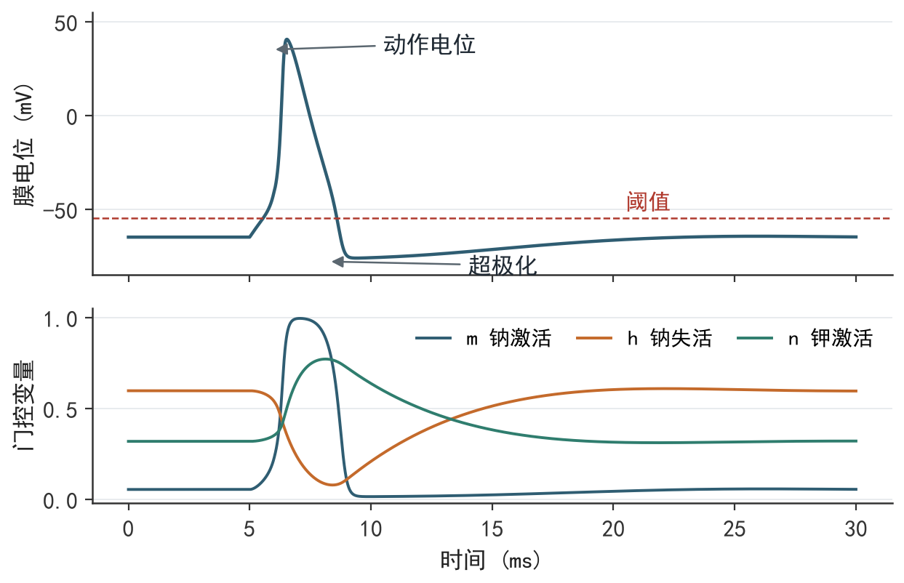
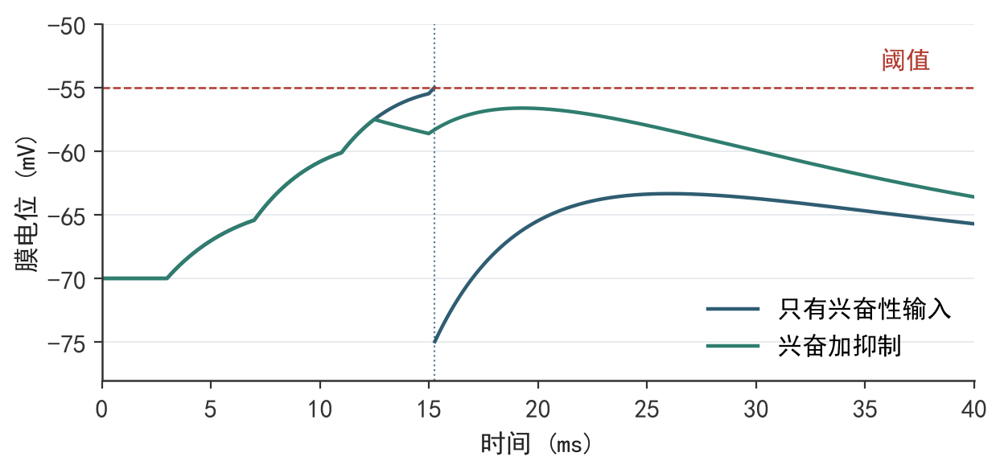

# 第 3 章　神经信号如何传递

神经元之间的通信靠电，也靠化学。电信号在单个细胞内部传播，化学信号跨越细胞之间的缝隙。两者衔接的地方，就是整个神经系统最基本的一次信息转换。

这一章讲清楚三件事。静息时细胞膜两侧为什么有电压差，动作电位如何产生和传播，突触如何把电信号重新变回电信号。理解这三件事，后面看任何神经元模型都不会觉得突兀。

## 3.1 细胞膜是一个电容器

神经元被一层脂质双分子层包着。脂质分子是绝缘的，膜内外两侧的离子无法自由穿过，除非通过膜上的通道蛋白。这层膜把电荷分开，形成电容。

膜两侧的离子浓度并不相同。细胞外的钠离子浓度高，细胞内的钾离子浓度高，氯离子和钙离子也各有各的梯度。这些梯度由离子泵维持，最著名的是钠钾泵，每消耗一个 ATP，把三个钠离子泵出细胞，两个钾离子泵进来。

浓度差和泵的共同作用，让膜内相对于膜外呈现负电位，通常在负六十到负七十毫伏之间。这个电位叫静息膜电位。它不是一个死数，而是一个动态平衡，钾通道始终开着让钾离子外流，钠离子有少量内漏，泵不断把漏进来的钠补出去。

用电路的语言描述，膜可以用一个电容并联几个电导来表示。每个电导对应一种离子通道，每个通道有自己的平衡电位，由能斯特方程决定。这个等效电路是后面所有神经元模型的原型。

## 3.2 动作电位

当膜电位被推到某个阈值，通常是负五十五毫伏左右，电压门控钠通道会突然打开。钠离子顺着电化学梯度涌入，膜电位迅速上升，几十微秒内从负值翻到正三十毫伏附近。这就是动作电位的上升相。

钠通道的开放是短暂的。通道蛋白在去极化后几百微秒内自动失活，堵住自己的孔道。与此同时，电压门控钾通道缓慢打开，钾离子外流，把膜电位拉回负值。由于钾通道关闭得慢，膜电位会短暂地低于静息值，形成一段超极化，然后才慢慢恢复。

整个波形持续一到两毫秒。它的形状几乎不随刺激强度改变，刺激弱到刚好过阈值，产生的动作电位和强刺激产生的一样大。信息不编码在幅度里，而编码在放电的时间、频率和哪一群神经元在放电。

放电之后有一段时间，神经元无论如何刺激都不会再放电，叫绝对不应期。紧接着是一段相对不应期，需要更强的刺激才能引发第二次放电。不应期限制了神经元的最大放电频率，也让动作电位只能向前传播，不能回头。

## 3.3 一九五二年的五个方程

上面这套描述不是凭直觉想出来的。1952 年，Alan Hodgkin 和 Andrew Huxley 在枪乌贼的巨大轴突上做了一系列实验，用电压钳把膜电位固定在各个水平，测量不同电位下的离子电流，再把电流拆成钠、钾和漏电流三部分。

他们发现，钠和钾的电导不是常数，而是随时间和电压变化。为了描述这种变化，他们引入了三个门控变量，m 控制钠通道的激活，h 控制钠通道的失活，n 控制钾通道的激活。每个变量都满足一个一阶微分方程，速率常数由电压决定。

把这些方程和膜电容的电流平衡方程联立，就得到四个常微分方程组成的系统。给定一个初始状态和外部电流，可以数值求解出完整的动作电位波形。计算结果和实验记录几乎重合，这在当时是相当惊人的成就。

这套方程至今仍是神经元建模的基准。后面要讲的漏电积分发放模型、Izhikevich 模型、以及各种简化模型，都可以看作对它不同方向的近似。

## 3.4 信号沿着轴突走

动作电位产生在轴突起始段，要传到轴突末端，还有一段距离。传导的方式不是电流沿着导线直接流过去，而是一连串局部电流点燃相邻的膜。

在无髓鞘的轴突上，每一小段膜依次去极化、产生动作电位，速度取决于纤维的粗细和膜的被动电学性质。果蝇的许多轴突很细，传导速度只有每秒一米左右。哺乳动物的无髓鞘纤维也差不多在这个量级。

脊椎动物演化出了髓鞘。施万细胞或少突胶质细胞把轴突一层层裹起来，形成绝缘层，只在每隔一段距离留一个缺口，叫郎飞结。动作电位只在郎飞结处产生，从一个结跳到下一个结，速度可以提高到每秒几十米甚至上百米。多发性硬化症破坏的正是髓鞘，病人会出现传导变慢或信号丢失。

果蝇没有典型的髓鞘，但有些大型中间神经元通过加粗轴突来提高速度。比如参与逃逸反应的巨型纤维，直径可以达到十几微米，是果蝇体内最快的传导通路之一。

## 3.5 突触处的转换

动作电位传到末端，膜去极化打开电压门控钙通道。钙离子进入终末，触发囊泡融合。一个囊泡里大约有几千个递质分子，释放到间隙后，其中一部分到达后膜，结合到受体上。

受体分两类。一类是离子通道型，递质结合后通道立刻打开，响应在毫秒以内，负责快速传递。另一类是代谢型，通过 G 蛋白引发一连串生化反应，响应慢，持续几秒到几分钟，负责调节。

离子通道型受体打开后，后膜产生一小段电流，对应的膜电位变化叫突触后电位。兴奋性突触产生去极化的兴奋性突触后电位，幅度通常只有零点几毫伏。抑制性突触产生超极化的抑制性突触后电位，或者把膜电位钳在静息值附近，增大放电难度。

单个突触后电位太小，不足以引发动作电位。神经元靠时间和空间上的叠加。同一时刻多个突触同时活动，电位相加，这叫空间总和。同一个突触连续快速活动，电位一个叠一个，这叫时间总和。叠加后的电位传到轴突起始段，超过阈值才触发一次放电。

这就是神经元的基本运算。它把成百上千个输入加权求和，再经过一个非线性阈值，决定是否输出。人工神经网络里的神经元节点，原型正是这个结构。

## 3.6 从生物细节到积分发放

把上面所有细节都算进去，计算量会非常大。一个皮层锥体神经元的房室模型可以有两千多个隔室，每个隔室十几个离子通道，模拟一秒生物时间需要几分钟甚至几小时的计算。

全脑仿真必须做取舍。最常见的一步简化，是把整个神经元压成一个点，只保留膜电位一个状态变量。突触输入被处理成电流，膜电位按一个简单的微分方程积分。当电位超过阈值，就记录一次放电，然后把电位重置。

这就是漏电积分发放模型。它的方程只有一行。

$$
\tau \frac{dV}{dt} = -(V - V_{\text{rest}}) + R I(t)
$$

其中 $\tau$ 是膜时间常数，通常在十到二十毫秒，$R$ 是膜电阻，$I(t)$ 是输入电流。放电之后，$V$ 被重置到一个较低的值，并在不应期内保持不变。

这个模型丢掉了动作电位的形状，丢掉了树突的几何结构，丢掉了离子通道的多样性。它保留了三个最关键的要素，输入整合、阈值、不应期。对于理解网络层面的放电节律和信息流，这三样往往够用。

果蝇全脑仿真用的就是它。选择它的理由很实际，13.9 万个神经元和 5000 万个突触，如果每个神经元都用房室模型，计算量会膨胀几个数量级，而且参数根本无从获得。用 LIF，至少可以在合理的时间内跑完整个脑，先看看结构能带来什么。

## 3.7 哪些信息被丢掉了

简化总是有代价的。丢掉的东西里，有几样值得单独点出来。

树突的非线性。真实神经元的树突上有电压门控通道，能对输入做局部运算，比如方向选择性、 coincidence detection。点模型把这些全部抹平了，所有输入被一视同仁地相加。

突触的时间进程。真实的突触电流有上升相和衰减相，不同受体类型的时间常数差别很大。LIF 通常用瞬时电流或一个简单的指数衰减来近似，这会影响网络同步的精确程度。

神经调质。多巴胺、血清素这些递质改变的是神经元的整体兴奋性和突触的可塑性，不直接产生快速电流。点模型如果没有额外的状态变量，就无法表达这些调节。

这些缺失在解释单个环路时可能是致命的，在解释大范围活动模式时未必。判断一个模型是否够用，标准不是它有多逼真，而是它能不能复现你想解释的现象，以及能不能做出可检验的预测。这条标准会贯穿整本书。
