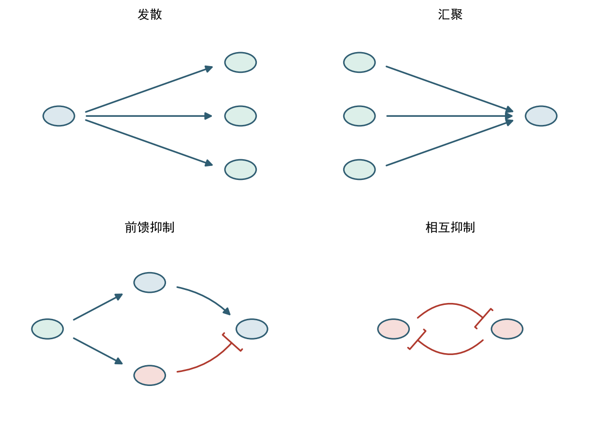

# 第 4 章　从神经元到神经环路

一个神经元能做的事情很有限。它把输入加起来，超过阈值就放电。真正产生行为的是神经元之间的连接方式，也就是环路。

环路这个词借自电子学。在电路里，几个元件按特定方式连起来，就能实现放大、滤波、振荡这些功能。神经系统也类似，只不过元件是神经元，连线是突触，而且连线本身还会随经验改变。

这一章讲几种反复出现的连接模式，以及它们在果蝇身上的具体例子。这些模式是理解全脑仿真的语法，看懂了它们，再复杂的连接图也能拆成熟悉的片段。

## 4.1 三种最基本的连接

第一种是发散。一个神经元把轴突分叉，连到几十个甚至上千个下游细胞。发散的作用是广播，一个信号可以让很多目标同时知道。

第二种是汇聚。许多神经元把轴突收到同一个下游细胞上。果蝇的蘑菇体输出神经元，单个细胞可以接收上千个上游输入。汇聚的作用是整合，把分散的信息集中到一处。

第三种是反馈。下游细胞反过来连回上游，形成回路。反馈可以是负的，用来稳定系统；也可以是正的，用来放大信号或维持活动。

这三种连接组合起来，能搭出绝大多数神经环路。麻省理工学院的神经生物学家把皮层里的连接模式归纳成十几种基元，比如前馈兴奋、前馈抑制、反馈抑制、相互抑制。这些基元在不同脑区反复出现，像语言里的常用句式。

## 4.2 前馈抑制与时间窗

前馈抑制的结构值得单独说。一个输入同时连到两个细胞，一个兴奋性，一个抑制性，抑制性细胞再去抑制那个兴奋性细胞。

表面上看，这像是自己给自己找麻烦。输入来了，兴奋被打了个折扣。但抑制比兴奋晚到一点点，因为多经过一个突触，有大约一毫秒的延迟。结果是，兴奋性细胞只在输入到达后的一个短时间窗内响应，之后被抑制压住。

这种结构让神经元对输入的时序变得敏感。如果两个输入同时到达，第一个输入打开的窗口刚好能让第二个通过；如果第二个来得太晚，窗口已经关上。听觉系统里判断声音到达两耳的时间差，用的就是类似的机制。

果蝇的嗅觉环路里也有大量前馈抑制。嗅觉受体神经元把信号送到触角叶，触角叶里的局部中间神经元在 glomerulus 之间形成广泛的抑制连接。这种抑制增强了气味表征的对比度，让相似的气味更容易区分。

## 4.3 相互抑制与 winner-take-all

两个抑制性神经元互相连接，会形成一种竞争关系。谁先兴奋起来，谁就抑制对方，自己越兴奋，对方越被压住。结果通常只有一个赢家。

这种结构叫 winner-take-all。它在决策、注意和动作选择里很常见。果蝇在选择往左转还是往右转时，两侧的转向指令之间存在相互抑制，最终只有一个方向被执行。

把相互抑制扩展成一圈，就得到环形网络。每个神经元抑制它两侧的邻居，同时接受来自更远处的兴奋。给定一个输入，网络会在某个位置形成一团活动，这团活动可以稳定地停在原地，也可以随输入平滑移动。这种结构叫吸引子网络，果蝇中央复合体里编码头部方向的神经元群，被广泛认为就是这样一个环形吸引子。

吸引子的意义在于，它把连续变化的输入转换成离散、稳定的内部状态。头转向哪里，对应的那组神经元就放电，即使视觉输入短暂消失，活动还能维持一会儿。这是工作记忆和朝向感的基础。

## 4.4 中央模式发生器

有些行为是节律性的，走路、飞行、呼吸、咀嚼。这些节律不需要每一步都由感觉输入触发，神经系统内部就能产生。

能自发产生节律的环路叫中央模式发生器。它的典型结构是几个抑制性神经元互相连接，再加上适应电流或延迟。抑制让活动在几个节点之间轮流切换，适应让当前节点逐渐疲劳，于是节律自动延续。

果蝇的行走由胸神经节里的网络控制。2024 年的连接组研究重建了控制每条腿的局部网络，发现左右腿之间的协调依赖一组特定的抑制性中间神经元。当这些神经元被沉默，果蝇的步态从交替变成同步，走路变得笨拙。

中央模式发生器解释了一个常被忽略的事实，行为不完全是对刺激的反应。很多动作是神经系统自己生成的，感觉输入只负责启动、停止和修正。这也是为什么一只被放进空场的果蝇会不停地走动和探索，而不是静止不动。

## 4.5 果蝇的逃逸环路

果蝇对逼近的阴影有强烈的逃逸反应。这个行为研究得很透，可以作为环路到行为的完整案例。

视觉系统的小叶板区域有一类神经元，专门响应视野中快速扩大的暗物体。它们的输出一直延伸到脑的后部，连接到一对粗大的下降神经元，也就是巨型纤维。巨型纤维是果蝇体内最粗的神经元之一，直径十几微米，直接下行到胸神经节，激活腿部肌肉，果蝇在几百毫秒内起跳、展翅、飞走。

这条通路只有三级，刺激到动作的延迟极短。它是最典型的所谓“命令神经元”，单个细胞的放电足以触发整套行为。

但命令神经元的概念后来被修正了。更细致的研究发现，逃逸不是一条通路说了算。除了巨型纤维，还有几条并行通路参与，它们负责不同的逃逸方向、不同的刺激强度、不同的行为阶段。巨型纤维更像是一个快速通道，而不是唯一的开关。

这个修正对全脑仿真很重要。如果按命令神经元的思路去建模，很容易把复杂行为简化成几个开关。真实的神经系统更像是许多通路同时投票，行为是投票结果，而不是某条线路的独白。

## 4.6 蘑菇体与学习

果蝇的学习中心叫蘑菇体。它是一对形似蘑菇的结构，由大约两千多个 Kenyon 细胞组成。这些细胞的轴突平行排列，形成一根细长的柄，输入来自嗅觉投射神经元，输出通过蘑菇体输出神经元送到下游。

蘑菇体的连接方式很特别。嗅觉信息以稀疏编码的方式进入 Kenyon 细胞，每个气味只激活其中很少一部分。Kenyon 细胞到输出神经元的突触是可塑的，多巴胺神经元在惩罚或奖励时释放多巴胺，改变这些突触的强度。

这就是经典的条件化学习。一种气味本来不引起回避，如果它总是伴随电击，多巴胺就会削弱连接该气味表征与回避输出的突触，之后闻到这种气味，果蝇就会躲开。

蘑菇体的结构在昆虫中高度保守，从果蝇到蜜蜂到蝗虫都能找到类似的构造。它也是全脑仿真里少数几个可以被逐突触验证的环路，因为它的细胞类型清楚，连接规则相对简单，行为读出明确。

2026 年的一项工作把蘑菇体到输出神经元的突触做成可塑的，放进 FlyWire 全脑模型里，让模型学会了对特定气味回避。这是全脑仿真第一次在完整连接组里加入学习规则，虽然规则是人为设定的，但学习的效果确实来自连接结构。

## 4.7 环路之上的问题

单个环路可以解释单个行为。但一只果蝇同时要做很多事，走路、避障、觅食、理毛、躲避天敌。这些环路共享同一批神经元，彼此之间会互相干扰。

神经系统怎么解决这个问题，目前没有完整答案。一个可能的机制是神经调质，不同的内部状态释放不同的调质，改变环路的相对权重。饥饿时觅食环路占优，危险时逃逸环路占优。另一个可能是抑制性网络的全局调控，通过提高或降低整体抑制水平，切换系统的工作模式。

这些问题正是全脑仿真想回答的。把所有的环路放进同一张图，让它们同时运行，看行为如何在不同目标之间切换。这也是为什么全脑仿真不能只满足于复现单个行为，真正的考验是多行为共存时的协调。
