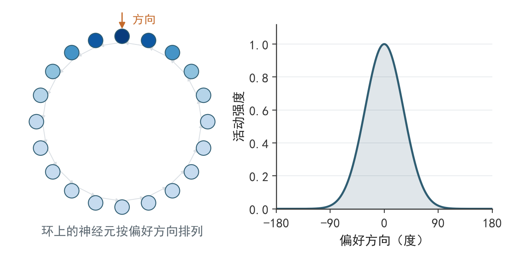

# 第 4 章　从神经元到神经环路

一个神经元能做的事情很有限。它把输入加起来，超过阈值就放电。真正产生行为的是神经元之间的连接方式，也就是环路。

环路这个词借自电子学。在电路里，几个元件按特定方式连起来，就能实现放大、滤波、振荡这些功能。神经系统也类似，只不过元件是神经元，连线是突触，而且连线本身还会随经验改变。

这一章讲几种反复出现的连接模式，以及它们在果蝇身上的具体例子。这些模式是理解全脑仿真的语法，看懂了它们，再复杂的连接图也能拆成熟悉的片段。

## 4.1 三种最基本的连接

第一种是发散。一个神经元把轴突分叉，连到几十个甚至上千个下游细胞。发散的作用是广播，一个信号可以让很多目标同时知道。

第二种是汇聚。许多神经元把轴突收到同一个下游细胞上。果蝇的蘑菇体输出神经元，单个细胞可以接收上千个上游输入。汇聚的作用是整合，把分散的信息集中到一处。

第三种是反馈。下游细胞反过来连回上游，形成回路。反馈可以是负的，用来稳定系统；也可以是正的，用来放大信号或维持活动。

这三种连接组合起来，能搭出绝大多数神经环路。麻省理工学院的神经生物学家把皮层里的连接模式归纳成十几种基元，比如前馈兴奋、前馈抑制、反馈抑制、相互抑制。这些基元在不同脑区反复出现，像语言里的常用句式。

数字上可以感受一下这三者的相对规模。FlyWire 的连接组里，13.9 万个神经元之间大约有 5000 万个突触，平均下来每个神经元分摊到三百多个输出连接，扇出并不夸张。但平均值掩盖了差异，少数神经元能连出几千个突触，比如某些投射神经元和局部中间神经元，而多数小细胞只有十几个连接。这种重尾的分布本身就是一条信息，说明网络里存在少数负责广播的枢纽，以及大量只做局部计算的细胞。

汇聚常常和阈值一起工作。一个下游细胞如果必须同时收到五路输入才够放电，它实际上就在做逻辑与运算。神经系统里没有真正的逻辑门，但通过调节突触权重和细胞的静息电位，一个普通神经元可以逼近乘法、除法、最大化这几种运算。这也是为什么单细胞层面的模型不能太粗糙，一个只做线性求和的单元，会把这类非线性计算全部丢掉。

反馈的时间尺度差别很大。通过缝隙连接的直接电耦合可以在零点一毫秒内把电位传回去，适合做同步；经过两三个化学突触的反馈环路通常要几十毫秒，适合做慢速调节。同一张连接图里，这两类反馈往往同时存在，快的负责相位，慢的负责增益。

在三大类之外，还有两种模式值得单列。一种是侧抑制，一排神经元彼此抑制对方，谁收到的输入最强，谁就能压住邻居，结果是强化了输入之间的差异。视网膜、触角叶、体感皮层的手指表征边界上都能看到这种效果。另一种是门控，一个抑制性神经元给整条通路上锁，只有在特定状态下才松手。门控让神经系统可以在不拆掉环路的前提下临时改变信息流的方向。

还有一种连接方式绕过了化学突触，也就是缝隙连接。它由两个细胞的连接子蛋白对接而成，离子可以直接通过，因此信号是双向的、几乎没有延迟的。线虫的连接组里有六百个左右的缝隙连接，果蝇和哺乳动物也有大量同类结构。缝隙连接在需要精确同步的地方特别重要，比如逃逸反应、呼吸节律和一些快速振荡的网络。

连接符号的稳定性依赖一条经验规则，也就是 Dale 定律。一个神经元通常只释放一种主要的递质，因此它所有的突触要么都是兴奋性的，要么都是抑制性的。这条规则有例外，有些神经元会共释放神经肽或者两种小分子递质，但它足够可靠，让研究者可以从细胞类型推断连接的符号。对全脑仿真来说这一点至关重要，因为电镜图像能看出突触在哪里，却看不出它是兴奋还是抑制，只能靠细胞类型去补。

把连接写成矩阵以后，图论的语言就可以用了。邻接矩阵的一行代表一个神经元的所有输出，一列代表所有输入。度分布描述每个细胞连了多少伙伴，聚类系数描述邻居之间互相连接的程度，最短路径描述信号要跳几次才能从一个细胞到另一个。1998 年 Watts 和 Strogatz 提出小世界网络时，用的正是线虫的连接数据，他们测到线虫神经网络的平均最短路径约为 2.65，聚类系数约为 0.28，比同样规模的随机网络高出一个量级以上。这组数字说明神经系统既不是完全规则的分层结构，也不是混沌的随机连线，它更像一个局部抱团、全局几步可达的中间形态。

## 4.2 前馈抑制与时间窗

前馈抑制的结构值得单独说。一个输入同时连到两个细胞，一个兴奋性，一个抑制性，抑制性细胞再去抑制那个兴奋性细胞。

表面上看，这像是自己给自己找麻烦。输入来了，兴奋被打了个折扣。但抑制比兴奋晚到一点点，因为多经过一个突触，有大约一毫秒的延迟。结果是，兴奋性细胞只在输入到达后的一个短时间窗内响应，之后被抑制压住。

这种结构让神经元对输入的时序变得敏感。如果两个输入同时到达，第一个输入打开的窗口刚好能让第二个通过；如果第二个来得太晚，窗口已经关上。听觉系统里判断声音到达两耳的时间差，用的就是类似的机制。

果蝇的嗅觉环路里也有大量前馈抑制。嗅觉受体神经元把信号送到触角叶，触角叶里的局部中间神经元在 glomerulus 之间形成广泛的抑制连接。这种抑制增强了气味表征的对比度，让相似的气味更容易区分。

窗口的宽度可以做一点估算。设兴奋性输入在 $t=0$ 到达，抑制性输入经过一个额外的突触延迟 $d$ 到达，那么兴奋性细胞的响应窗口大致从 $0$ 开到 $d$ 加上抑制性突触后电位的上升时间。哺乳动物皮层里 $d$ 通常在一到三毫秒之间，所以窗口也只有几毫秒宽。这个宽度不是随便定的，它要和被检测的信号的时间尺度匹配。太宽了失去选择性，太窄了真实的同步输入也会被漏掉。

用延迟线做一致性检测的经典构想来自 Jeffress 在 1948 年的工作。他设想两耳的输入沿着两条长度不同的轴突路径相向传播，只有在某个位置，来自两耳的脉冲才会同时抵达同一个细胞。声音到达两耳的时间差决定了这个位置在哪里，于是一排细胞就构成了一张时间差的地图。仓鸮的听觉核团里确实存在这种排列，哺乳动物的内侧上橄榄核用的是另一套机制，靠兴奋和抑制的精确对齐来实现同样的功能。这两种实现说明一件事，同一个计算目标可以由完全不同的环路结构完成。

果蝇触角叶的局部中间神经元数量接近两百个，几乎全是抑制性的，它们既接收受体神经元的输入，也接收投射神经元的反馈，形成前馈加反馈的混合抑制。这种结构实现的功能之一是除法归一化，也就是把每个 glomerulus 的响应除以全体的总活动。归一化的好处是让气味表征不随浓度整体放大或缩小，浓度变了十倍，模式还是那个模式。计算上这相当于把信号的绝对强度和信息内容分开，下游只需要关心后者。

小脑皮层提供了另一个干净的例证。颗粒细胞把苔状纤维的输入送给浦肯野细胞，同时也兴奋篮状细胞和星形细胞，后者再抑制浦肯野细胞。由于颗粒细胞到浦肯野细胞的路更长，抑制总是稍晚到达，于是浦肯野细胞对同时激活的平行纤维变得格外敏感。这种时序选择性被认为是小脑学习的基础之一。

## 4.3 相互抑制与胜者通吃

两个抑制性神经元互相连接，会形成一种竞争关系。谁先兴奋起来，谁就抑制对方，自己越兴奋，对方越被压住。结果通常只有一个赢家。

这种结构叫胜者通吃。它在决策、注意和动作选择里很常见。果蝇在选择往左转还是往右转时，两侧的转向指令之间存在相互抑制，最终只有一个方向被执行。

把相互抑制扩展成一圈，就得到环形网络。每个神经元抑制它两侧的邻居，同时接受来自更远处的兴奋。给定一个输入，网络会在某个位置形成一团活动，这团活动可以稳定地停在原地，也可以随输入平滑移动。这种结构叫吸引子网络，果蝇中央复合体里编码头部方向的神经元群，被广泛认为就是这样一个环形吸引子。

吸引子的意义在于，它把连续变化的输入转换成离散、稳定的内部状态。头转向哪里，对应的那组神经元就放电，即使视觉输入短暂消失，活动还能维持一会儿。这是工作记忆和朝向感的基础。

用两个单元就能写出胜者通吃的最简形式。设两个细胞的活动为 $r_1$ 和 $r_2$，输入为 $I_1$ 和 $I_2$，抑制强度为 $w$，那么

$$\tau \frac{dr_1}{dt} = -r_1 + f(I_1 - w r_2)$$

第二个方程把下标对调。只要 $w$ 足够大，任何一点初始差异都会被放大，最后只剩一个细胞保持活动。$w$ 小一些的时候，两个细胞可以共存，只是强者压着弱者，这叫软竞争，它保留了输入的相对大小信息，在需要分级输出的场合比硬性通吃更有用。

环形网络可以看成把这种竞争铺在一维的环上，每个位置只和邻居较劲。它的标准写法是一个卷积形式

$$\tau \frac{dr(\theta)}{dt} = -r(\theta) + f\left(\int J(\theta - \theta')\, r(\theta')\, d\theta' + I(\theta)\right)$$

其中 $J$ 描述距离为 $\theta - \theta'$ 的两个位置之间是兴奋还是抑制。如果 $J$ 的形状是近处为正、远处为负，像一顶墨西哥帽，网络就会自发形成一团宽度固定的活动包。这团活动包就是吸引子，它的位置编码了被记住的量。输入稍微偏向某个方向，活动包就朝那边挪一点，输入撤掉以后它停在原地，这就是积分。

活动包的宽度由兴奋和抑制的空间范围之比决定，不随输入强度改变。这一点很重要，因为它意味着刺激强弱不会破坏编码，只是改变活动包的高度。真实神经系统里，头方向信号大致只覆盖环的一小段，几十度左右，和这个理论预期相符。

吸引子网络还有另一种形态，也就是 Hopfield 在 1982 年提出的离散版本。每个单元取正负两态，单元之间对称连接，系统会沿着能量下降的方向演化，最后落在一个存储好的模式上。Hopfield 证明这种网络的记忆容量大约是单元数的百分之十四。这个数字听起来不大，但它说明了一件事，记忆不需要专门的存储地址，模式本身就藏在连接的权重里。

环形吸引子在实际脑区里的对应物已经被记录得比较清楚。果蝇中央复合体的椭球体里有一圈柱状神经元，其中 E-PG 细胞的树突和轴突分别落在环的两端，形成闭环；P-EN 细胞接收来自前庭样信号的速度输入，把角速度注入环里。头转动时活动包沿环移动，头停下时活动包停在新的位置，这正是路径积分需要的行为。视觉地标通过另一组神经元进来，偶尔把活动包拉回正确的位置，纠正累积误差。

吸引子模型也解释了工作记忆实验里那个经典现象。给猴子看一个位置，隔几秒再让它指出来，中间那段延迟期里，偏好那个位置的前额叶细胞会持续放电。放电不是靠外部输入维持的，而是靠网络内部的兴奋回路把自己撑住。这类持续活动很脆弱，一个干扰就能让它漂走或者塌掉，这恰恰符合我们对短期记忆的主观体验。

## 4.4 中央模式发生器

有些行为是节律性的，走路、飞行、呼吸、咀嚼。这些节律不需要每一步都由感觉输入触发，神经系统内部就能产生。

能自发产生节律的环路叫中央模式发生器。它的典型结构是几个抑制性神经元互相连接，再加上适应电流或延迟。抑制让活动在几个节点之间轮流切换，适应让当前节点逐渐疲劳，于是节律自动延续。

果蝇的行走由胸神经节里的网络控制。2024 年的连接组研究重建了控制每条腿的局部网络，发现左右腿之间的协调依赖一组特定的抑制性中间神经元。当这些神经元被沉默，果蝇的步态从交替变成同步，走路变得笨拙。

中央模式发生器解释了一个常被忽略的事实，行为不完全是对刺激的反应。很多动作是神经系统自己生成的，感觉输入只负责启动、停止和修正。这也是为什么一只被放进空场的果蝇会不停地走动和探索，而不是静止不动。

这个想法最早由 Graham Brown 在 1911 年提出。他切断了猫的脊髓与上位脑的联系，仍然在支配后肢的神经里记录到交替的节律性放电。他据此提出半中心模型，两个相互抑制的神经元群各自带一个疲劳机制，一个累了另一个就接管，交替由此产生。用两个方程就能写出它的骨架

$$\tau \frac{du_1}{dt} = -u_1 + f(-w u_2 - a_1 + s)$$

$$\tau_a \frac{da_1}{dt} = -a_1 + u_1$$

第二个方程里的 $a_1$ 是适应变量，它随活动缓慢上升，把当前单元往下压。下标对调就得到另一半。这套方程能产生稳定的交替振荡，周期由适应的时间常数决定，从零点几秒到几秒都可以调出来。

半中心模型的证据在无脊椎动物里格外清楚。甲壳类的口胃神经节只有大约三十个神经元，却控制着胃的研磨和过滤两套节律，几十年来被反复解剖和记录。研究者发现同一个网络在不同的神经调质作用下能输出完全不同的节律模式，同一个细胞在不同状态下甚至可以属于不同的功能环路。这件事对连接组仿真的含义很直接，一张静态接线图不足以为网络指定功能，调质环境是另一半信息。

脊椎动物里，七鳃鳗的脊髓是研究游泳节律的经典标本。把一段离体脊髓泡在含 NMDA 的溶液里，不需要任何感觉输入，腹侧的运动神经元就会发出交替的爆发，节律和完整动物游泳时几乎一样。这个实验干净地证明了节律来自脊髓内部，而不是来自脑的命令或者身体的反馈。哺乳动物的行走网络被认为也存在于脊髓，只是被上位结构层层覆盖，在完整动物身上不容易单独看到。

牵张反射是另一条互补的线索，它展示的是反馈而不是生成。肌肉里埋着力敏感受器，也就是肌梭，肌梭的传入纤维在肌肉被拉长时发放，直接兴奋支配同一块肌肉的运动神经元，同时通过一个抑制性中间神经元压住拮抗肌。这条环路只经过一个突触，是全身最快的反射通路之一。它的功能是负反馈，肌肉被外力拉长，反射让它收缩回去，长度得以维持。对侧的抑制保证伸肌收缩时屈肌放松，关节不会被两组肌肉同时拉扯。

反射弧之上还有一层。运动神经元发出的侧支会兴奋 Renshaw 细胞，后者反过来抑制同一群运动神经元，形成递归抑制，防止输出无限制地升高。肌腱里的高尔基腱器官则监测张力而不是长度，通过 Ib 纤维提供另一种负反馈。三种反馈叠在一起，让一块肌肉在不同负载下都能平稳工作。有意思的是，这些看起来完全自动的环路始终受上位中枢调节，同一段脊髓在站立、行走、奔跑时的增益完全不同，反射不是固定的机械装置。

把生成和反馈放在一起看，中央模式发生器的位置就清楚了。它提供节律的骨架，感觉反馈负责把骨架铺在真实的地面上。行走时每一步落地都会触发一次牵张反射，反射的强度微调下一步的幅度，节律本身不依赖它。果蝇胸神经节的研究支持这种分工，去除感觉输入以后步态节律还在，但左右腿的协调和步幅变得不稳定。

## 4.5 果蝇的逃逸环路

果蝇对逼近的阴影有强烈的逃逸反应。这个行为研究得很透，可以作为环路到行为的完整案例。

视觉系统的小叶板区域有一类神经元，专门响应视野中快速扩大的暗物体。它们的输出一直延伸到脑的后部，连接到一对粗大的下降神经元，也就是巨型纤维。巨型纤维是果蝇体内最粗的神经元之一，直径十几微米，直接下行到胸神经节，激活腿部肌肉，果蝇在几百毫秒内起跳、展翅、飞走。

这条通路只有三级，刺激到动作的延迟极短。它是最典型的所谓“命令神经元”，单个细胞的放电足以触发整套行为。

但命令神经元的概念后来被修正了。更细致的研究发现，逃逸不是一条通路说了算。除了巨型纤维，还有几条并行通路参与，它们负责不同的逃逸方向、不同的刺激强度、不同的行为阶段。巨型纤维更像是一个快速通道，而不是唯一的开关。

这个修正对全脑仿真很重要。如果按命令神经元的思路去建模，很容易把复杂行为简化成几个开关。真实的神经系统更像是许多通路同时投票，行为是投票结果，而不是某条线路的独白。

细节值得展开一点。检测逼近物体的细胞位于视叶的深层，它们对视野中暗区面积的扩张速率敏感，对单纯的亮度变化不敏感。一个静止的黑点不会引起它们兴奋，一个匀速移动的黑点只会引起中等响应，只有一个正在变大的暗斑才能把它们推到高发放。这种选择性可以用一个简单的判据描述，就是暗区半径的增长速度与半径之比，量纲上相当于一个倒数时间。生物学家把这类细胞统称为 looming 敏感细胞，在蝗虫、果蝇、小鼠身上都找到了对应的神经元。

巨型纤维两侧各有一根，左边的接收左视野的信号，右边的接收右视野。它下行到胸神经节后分成两支，一支驱动后腿的伸肌，让果蝇跳起来，另一支驱动翅膀的肌肉，让它在起跳后立刻展开翅膀。两条支路的时序必须精确，起跳早于展翅会摔在地上，展翅早于起跳会撞到地面。这种时序由两条通路的传导延迟自然形成，不需要额外的计时器。

命令神经元这个说法本身有一段历史。1978 年，Kupfermann 和 Weiss 在一篇评论里给出了一组判定标准，一个神经元要算真正的命令神经元，必须既必要又充分，去掉它行为消失，单独激活它行为出现。用这套标准去衡量，绝大多数候选者都不合格。后续几十年的记录显示，很多被叫作命令神经元的细胞只是行为的相关物，它们在高强度刺激下放电，但行为也可以在没有它们的情况下以别的形式出现。

蝗虫的 DCMD 神经元是这场争论的中心案例之一。它对视网膜上逼近的物体反应强烈，刺激它能让蝗虫起跳转向。但研究者后来发现，切断 DCMD 之后蝗虫仍然能躲避，只是成功率下降，方向精度变差。这说明它是一条高效通路，不是唯一通路。果蝇的巨型纤维面对的是同样的结论。

更合适的描述是分布式决策。多组神经元各自给出一个带权重的意见，下游的整合层把这些意见加总，超过阈值就执行。有些通路的权重大，反应快，比如巨型纤维；有些通路的权重小，但提供方向和强度的细节。行为的结果是加权和，而非某一条线路的独白。这种架构的优点是稳健，任何单点损坏都不会让行为彻底消失，代价是行为会有变异，同一刺激下不同个体的反应时间和方向都不一样。

## 4.6 蘑菇体与学习

果蝇的学习中心叫蘑菇体。它是一对形似蘑菇的结构，由大约两千多个 Kenyon 细胞组成。这些细胞的轴突平行排列，形成一根细长的柄，输入来自嗅觉投射神经元，输出通过蘑菇体输出神经元送到下游。

蘑菇体的连接方式很特别。嗅觉信息以稀疏编码的方式进入 Kenyon 细胞，每个气味只激活其中很少一部分。Kenyon 细胞到输出神经元的突触是可塑的，多巴胺神经元在惩罚或奖励时释放多巴胺，改变这些突触的强度。

这就是经典的条件化学习。一种气味本来不引起回避，如果它总是伴随电击，多巴胺就会削弱连接该气味表征与回避输出的突触，之后闻到这种气味，果蝇就会躲开。

蘑菇体的结构在昆虫中高度保守，从果蝇到蜜蜂到蝗虫都能找到类似的构造。它也是全脑仿真里少数几个可以被逐突触验证的环路，因为它的细胞类型清楚，连接规则相对简单，行为读出明确。

2026 年的一项工作把蘑菇体到输出神经元的突触做成可塑的，放进 FlyWire 全脑模型里，让模型学会了对特定气味回避。这是全脑仿真第一次在完整连接组里加入学习规则，虽然规则是人为设定的，但学习的效果确实来自连接结构。

解剖上，蘑菇体可以分成几个部分。顶端是萼，嗅觉投射神经元的轴突在这里与 Kenyon 细胞的树突形成突触，一个投射神经元会和几百个 Kenyon 细胞接触，把一小群 glomerulus 的信号撒到一大片 Kenyon 细胞上。中间是柄，Kenyon 细胞的轴突在这里并行排列，像一束光纤。前端分成几片叶，α 叶和 β 叶、α′ 叶和 β′ 叶、γ 叶，每一片又被切成若干个隔室，果蝇一侧大约有十五个隔室。

隔室是理解蘑菇体的关键。每个隔室有自己的多巴胺输入和自己的输出细胞，形成一个相对独立的学习单元。惩罚性的多巴胺神经元主要落在某些隔室，奖励性的落在另一些，同一个气味在不同隔室里的连接可以被独立地增强或削弱。这种分区让一个气味可以同时携带好几种价值标签，比如甜味代表食物，苦味代表毒，同一嗅觉表征的不同侧面各自存进不同的抽屉。

稀疏编码的作用也值得说清楚。果蝇的嗅觉受体神经元大约有一千二百个，分成五十类左右，每类投射到一个 glomerulus。气味在受体层面是宽泛的，一个气味分子往往激活好几个 glomerulus。但经过 Kenyon 细胞的随机扩张连接，每个气味只激活大约百分之五到十的 Kenyon 细胞，而且不同气味的激活集合重叠很少。这样做的效果是把相似的输入拉开距离，让下游的线性读出更容易区分。这套思路和机器学习里的随机特征映射是同一个道理。

记忆的维持和遗忘同样重要。果蝇里已经找到专门促进遗忘的神经元，它们持续地削弱蘑菇体输出，让记忆不要无限期地占据资源。学习和遗忘是一对平衡，只学不忘的系统会被旧经验锁死，只忘不学的系统无法积累。蘑菇体把这个平衡做在两套独立的细胞上，调节起来很方便。

中央复合体是另一块不能略过的结构。它位于脑的中线，由四个部分组成，最上面是原脑桥，中间是扇形体和椭球体，下面是两个小结节。前面提到的环形吸引子就在椭球体里，负责头方向；扇形体参与运动规划和动作选择；结节参与导航和速度估计。整个复合体像是昆虫脑里的导航仪和调度台。

这两块结构之间有实实在在的连接。蘑菇体的输出有一部分送到中央复合体，把气味的价值信息带进导航计算。反过来，中央复合体也向蘑菇体回送信号，用当前的空间情境调制学习的强度。这种互连让果蝇能在特定地点学会回避，而不是无条件地怕某种气味。全脑仿真要复现这种情境依赖的学习，就必须同时把两块结构放进去，只做蘑菇体是不够的。

蜜蜂提供了一个对照。它的蘑菇体大得多，Kenyon 细胞的数量比果蝇高两个数量级，隔室的划分也更复杂。蜜蜂能记住花的位置、颜色、气味和访问时间，还能通过舞蹈向同伴传递方位。结构规模的扩大显然带来了更强的联想能力，但基本的学习逻辑和果蝇一致，都是用稀疏编码加可塑性读出。

## 4.7 环路之上的问题

单个环路可以解释单个行为。但一只果蝇同时要做很多事，走路、避障、觅食、理毛、躲避天敌。这些环路共享同一批神经元，彼此之间会互相干扰。

神经系统怎么解决这个问题，目前没有完整答案。一个可能的机制是神经调质，不同的内部状态释放不同的调质，改变环路的相对权重。饥饿时觅食环路占优，危险时逃逸环路占优。另一个可能是抑制性网络的全局调控，通过提高或降低整体抑制水平，切换系统的工作模式。

这些问题正是全脑仿真想回答的。把所有的环路放进同一张图，让它们同时运行，看行为如何在不同目标之间切换。这也是为什么全脑仿真不能只满足于复现单个行为，真正的考验是多行为共存时的协调。

神经调质系统的规模小得让人意外。果蝇脑里真正的多巴胺能神经元只有一百多个，血清素能神经元不到一百个，但它们的分支极其广泛，一根纤维能扫过大半个脑。这种一对多的结构让少数细胞可以同时改变很多环路的参数，实现全局的状态切换。它们释放的递质不是快速的点对点信号，而是慢速的、弥散的调制，作用时间从几百毫秒到几分钟。

睡眠是一个具体的例子。果蝇的睡眠由一小群背侧扇形体神经元控制，激活它们果蝇就睡着，抑制它们果蝇就保持清醒。这群细胞并不直接产生睡眠的所有表现，它们更像一个总开关，把下游若干环路同时切到睡眠模式。睡眠时的行为变化涉及运动、感觉阈值、代谢和记忆巩固，单一环路无法解释这种全局性。

竞争也是真实存在的。左右转向的指令之间不只相互抑制，还要和前进、理毛、进食的指令争夺同一批运动神经元。果蝇的腿只有那么多肌肉，同一时刻只能做一件事。谁拿到运动资源，谁的行为就表现出来。这个层面的选择发生在胸神经节，而决策的起点可能在大脑，两者之间通过下降神经元传递。

还有一个容易被忽略的因素，身体的力学。走路的节律不只由神经决定，腿的惯性、关节的阻尼、地面的摩擦都在参与。同一套神经指令在不同的负载下会产生不同的步态，反馈回路把力学耦合进了神经动力学。全脑仿真如果只算神经不算身体，会丢掉这一半的因果链，这也是为什么闭环仿真比开环仿真更接近真实。
