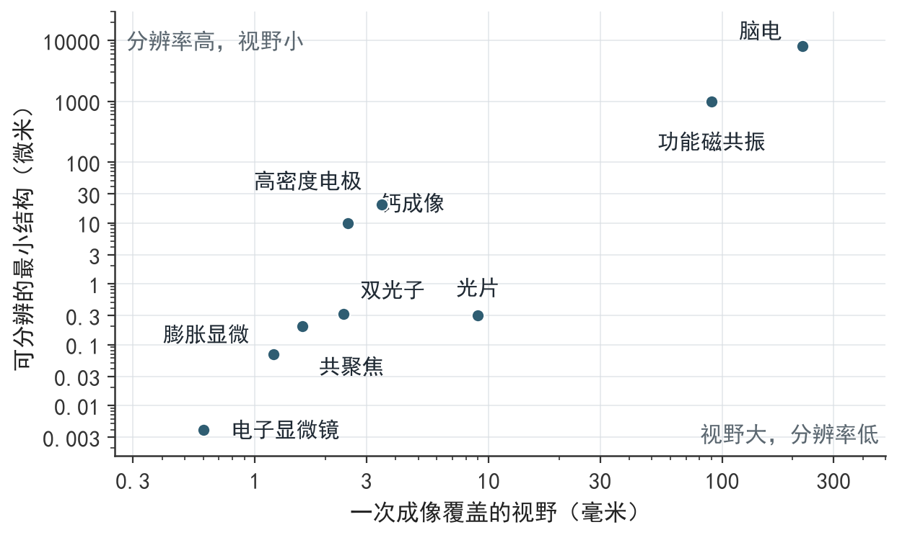

# 第 5 章　我们如何看见大脑

研究大脑有一个绕不开的困难，它又小又不透明。一个果蝇神经元直径几微米，一根轴突细到零点几微米，而整块脑组织是不透光的。想看清单个细胞，就得切开、透明化或者用特殊的光学手段。

每一种成像方法都是在这两个指标之间做交易，一个是分辨率，能看到多小的结构；另一个是视野，一次能看多大的范围。分辨率越高，视野通常越小，成像也越慢。连接组学要做的，是在纳米分辨率下扫完整个脑，这个要求把大多数方法都排除掉了。

这一章按分辨率和视野的顺序，把常用的手段过一遍。

## 5.1 光学显微镜的极限

普通光学显微镜的分辨率受衍射限制，大约在两百纳米。这个尺度能看到细胞体、树突的大致走向，但看不清突触，也分不开挤在一起的两根纤维。

共聚焦显微镜用激光逐点扫描，加一个针孔挡住焦外的光，可以得到光学切片，把厚组织一层层看清楚。它的分辨率提升有限，主要优势是能排除背景，适合看几十微米厚的样本。

双光子显微镜用两个红外光子同时激发一个荧光分子，红外光在组织里散射小，穿透深度可以到一毫米左右。这是活体成像的主力，小鼠大脑皮层的大部分研究都靠它。代价是扫描速度慢，视野有限。

光片显微镜换了一个思路，用一片薄薄的激光从侧面照亮样本，相机从正面拍摄整片区域。它不需要逐点扫描，速度极快，可以在几分钟内拍完整个果蝇脑。配合组织透明化技术，果蝇全脑的神经元形态可以整体呈现出来。

## 5.2 让细胞自己发光

形态只是一部分。要知道神经元在什么时候放电，需要功能信号。

最常用的是钙成像。神经元放电时钙离子内流，如果用一种对钙敏感的荧光蛋白标记神经元，放电就会表现为荧光增强。GCaMP 系列蛋白经过多年改造，信噪比已经很高，可以检测单个动作电位。

钙成像的优势是能同时记录成千上万个神经元，果蝇全脑钙成像可以覆盖大部分细胞。缺点是时间分辨率低，钙信号的衰减常数在几百毫秒量级，无法分辨毫秒级的放电时序。它看到的是活动的包络，不是精确的脉冲。

电压成像更直接，用电压敏感的染料或蛋白记录膜电位的快速变化。它的时间分辨率可以到毫秒，但信号弱，长时间照射会漂白，目前主要用于小范围、短时间的记录。

电极记录是另一条路。钨丝电极、硅探针、Neuropixels 高密度探针，可以直接测量细胞外的电位变化。Neuropixels 探针一根有上千个记录点，能同时捕捉几百个神经元的放电。它的时间分辨率是所有方法里最高的，但空间覆盖有限，只能记录探针经过的那一条路径。

## 5.3 电子显微镜

要看清突触，光学显微镜不够。突触间隙只有二十多纳米，囊泡直径四十纳米，必须用电子显微镜。

透射电镜的分辨率可以到零点几纳米，问题是样本必须切成几十纳米厚的超薄切片，一次只能看一个切面。早期的做法是用钻石刀一张张切，人工捞到铜网上，再逐张拍照。一个果蝇脑需要几千张切片，每张都要对齐，工作量惊人。

后来出现了自动切片机。ATUM 系统把切片直接捞到一卷胶带上，像电影胶片一样连续收集，再自动送进扫描电镜。FIB-SEM 用聚焦离子束在样品表面一层层削掉材料，每削一层拍一张，整个过程中样品不动，对齐问题小了很多。这两种方法把果蝇全脑的数据采集变成了可能。

FlyWire 用的数据来自 FAFB 数据集，大约七千张切片，每张厚四十纳米，平面像素四纳米。整个数据集有几十太字节的图像。这个规模决定了后续处理必须自动化，人眼根本看不过来。

## 5.4 从图像到连接组

拿到图像只是开始。要得到一张连接组，还要经过好几步。

第一步是配准。切片在切割和收集过程中会变形、撕裂、错位，需要把相邻切片对齐，让同一根纤维在上下层之间接上。这一步用图像配准算法，配合人工修正。

第二步是分割。算法要把每个神经元从像素堆里分离出来，给每个细胞一个独立的标识。这是一项极其困难的任务，因为神经纤维彼此紧贴，边界模糊，图像里还有噪声和破损。深度学习在这里起了决定性作用，卷积网络和后来的 Transformer 架构，把分割准确率从早期的六成提高到了九成以上。

第三步是校对。算法会犯错，尤其是细小的分支和断裂的纤维。FlyWire 采用了一种聪明的策略，把校对任务拆成小块，让全球的志愿者和研究人员在线认领，像玩游戏一样一点点修。参与校对的人数以千计，累计工作量相当于几百人年。

第四步是突触检测。算法要在图像里找到突触前囊泡聚集的位置和突触后致密区，把连接关系确定下来。这一步的准确率直接决定了连接组的质量。

第五步是注释。给每个神经元分配类型，标注它属于哪个脑区、投射到哪里、用什么递质。这一步结合了形态特征、连接模式和基因表达数据。

整个流程下来，一个果蝇脑的连接组需要几年时间和数千万美元。这还是在有成熟流水线的情况下。

## 5.5 方法的取舍

把几种主要方法放在一起比较，取舍就很清楚。

| 方法 | 分辨率 | 视野 | 时间分辨率 | 主要用途 |
| --- | --- | --- | --- | --- |
| 共聚焦 | 约 200 纳米 | 毫米级 | 秒 | 形态、固定样本 |
| 双光子 | 约 300 纳米 | 毫米级 | 百毫秒 | 活体功能成像 |
| 光片 | 约 300 纳米 | 厘米级 | 分钟 | 全脑形态 |
| 膨胀显微 | 约 70 纳米 | 毫米级 | 分钟 | 超分辨形态 |
| 电镜 | 约 4 纳米 | 毫米级 | 天到月 | 突触级连接 |
| 高密度电极 | 细胞级 | 毫米级 | 微秒 | 活体电活动 |

: 表 5-1　常用神经成像方法的能力对比，数值为典型量级

这张表说明一件事，没有一种方法能同时满足高分辨率、大视野和快时间。连接组学选择了分辨率，代价是只能看固定的死组织，看不到活动。功能成像选择了时间和活体，代价是看不清突触。

全脑仿真需要两者结合。结构来自电镜，功能来自钙成像和电极记录，两套数据要对齐到同一个坐标系里。这件事本身就是一个难题，目前只有少数几个数据集做到了。

## 5.6 膨胀显微的启示

有一项技术值得单独提一下。膨胀显微把脑组织嵌进一种可膨胀的水凝胶里，用酶把蛋白质消化掉，剩下的分子骨架均匀撑开。水凝胶吸水后体积可以膨胀到原来的几十倍，原本挤在一起的分子被拉开，普通光学显微镜就能看清。

四倍线性膨胀相当于把分辨率提高四倍，从两百纳米降到五十纳米，足以分辨突触的轮廓。十倍的膨胀能看到更细的结构，但对样本的均匀性要求极高。

这项技术的意义不只是提高分辨率。它说明成像的瓶颈不一定在光学，也可以在样本处理。把样本做大，是一种笨拙但有效的思路。Eon 目前正在用膨胀显微来扩展小鼠的连接组数据，看中的正是它可以大幅提高成像通量。

## 5.7 数据的形状

最后要说的是，这些方法产出的数据形状完全不同。

电镜数据是三维的体积图像，每个体素对应一个灰度值，整个数据集可以到几十太字节。钙成像数据是四维的，三个空间维度加一个时间维度，每个神经元有一条荧光时间序列。电极数据是一维的时间序列，每个通道一条。

要把它们放进同一个模型，需要先定义一套公共的坐标和标识。FlyWire 给每个神经元分配了唯一的 ID，钙成像实验里的细胞要通过配准映射到这些 ID 上。这个映射并不完美，尤其是当样本来自不同的个体时。

这也是当前全脑仿真的一个隐性限制。结构数据来自一只果蝇，功能数据来自另一只，两者的细胞类型可以对应，但具体的连接强度不可能完全一致。模型实际上是在一个平均的、拼合的大脑上运行，而不是某一个真实个体的脑。
