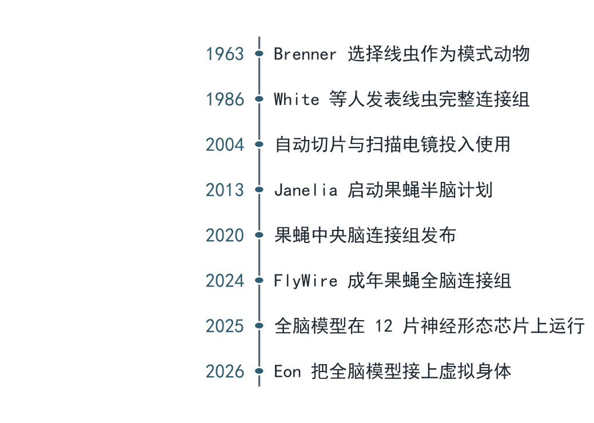

# 第 6 章　连接组学的开端

全脑仿真的故事通常从线虫开始。不是因为它重要，而是因为它小。

线虫学名秀丽隐杆线虫，成虫只有一毫米长，通体透明，在实验室的培养皿里吃细菌就能活。它的整个身体只有 959 个细胞，其中 302 个是神经元。这个数字小到可以一个一个数清楚。

1960 年代，分子生物学家 Sydney Brenner 想找一个简单的动物来研究基因如何控制发育。他放弃了果蝇和小鼠，选择了线虫，理由是它的细胞数目固定，每个个体的细胞谱系几乎完全一样。这个选择后来改变了神经科学。

## 6.1 手工重建的十四年

1970 年代初，Brenner 的团队开始用电子显微镜切片线虫。线虫虽小，但要看清突触，仍然需要把身体切成几千张超薄切片，每张几十纳米厚。

重建的方式极其原始。研究者把切片拍成照片，一张张贴在墙上，用彩笔在透明胶片上描出每个细胞的轮廓，再一层层叠加，追踪纤维的走向。一个实验室十几个人，分工负责不同的身体部位，做了十几年。

1986 年，John White、Eileen Southgate、J. Nichol Thomson 和 Brenner 在《皇家学会哲学汇刊》上发表了那篇著名的论文，标题是《秀丽隐杆线虫神经系统的结构》。论文附了三百多页图谱，标出了 302 个神经元和它们之间的连接。

这份数据里大约有 7000 个化学突触和 600 个缝隙连接。每个神经元的形态、位置、投射路径都被记录了下来。这是人类第一次拿到一个完整动物的神经接线图。

论文里有一个当时没被充分注意的发现，线虫的接线在个体之间高度一致。不同个体同一位置的神经元，连接的伙伴和数量几乎相同。这意味着接线图不是随机的，它编码了某种确定的信息。

## 6.2 一张图带来的问题

连接组有了，问题却更多了。

第一个问题是，知道了谁连着谁，还是不知道信号怎么流。连接有方向，有强弱，有兴奋和抑制的区别，这些在 1986 年的数据里都不完整。White 他们能看出突触的位置和形态，但无法确定递质类型，也无法测量连接强度。

第二个问题是，线虫的行为太简单。它可以前进、后退、转弯、产卵、对触摸做出反应，但这些都是几十个神经元就能完成的事。从线虫的连接组里，很难提炼出适用于更大脑的原则。

第三个问题是，规模。线虫 302 个神经元，用了十几年。按这个速度，果蝇的 13.9 万个神经元需要几千年。技术在 1986 年之后并没有立刻跟上，连接组学进入了一段长达二十多年的沉寂期。

这段时间里，电生理和分子生物学突飞猛进，连接组学却几乎没有进展。原因很现实，没有人愿意投入巨资去做一件看起来没有尽头的事。

## 6.3 线虫之后的重建

沉寂不等于停止。少数几个团队一直在改进方法。

1990 年代，Winfried Denk 发明了双光子显微镜，后来又把注意力转向电子显微镜的自动化。2000 年代，串行块面扫描电镜出现，用钻石刀把样本表面削掉一层，扫描电镜拍一张，再削一层，整个过程可以自动运行。切片不再需要人工收集和对齐，数据质量大幅提高。

2010 年代，深度学习进入图像分割领域。过去需要人工描边的任务，开始由算法完成。虽然算法会出错，但配合众包校对，效率提高了几个数量级。

2019 年，一个团队完成了线虫全部神经元的重新重建，把连接组扩展到了包括肌肉和器官的整个身体。这份数据比 1986 年的版本精细得多，包含了突触的精确位置和部分递质信息。

## 6.4 OpenWorm 的尝试

有了线虫的连接组，一个自然的想法是把它跑起来。2011 年，一个名为 OpenWorm 的开源项目成立，目标是完整模拟线虫。

项目的做法是把 302 个神经元建成模型，接上一个由物理引擎驱动的身体，让线虫在虚拟环境里游动。神经元用简化的电导模型，肌肉用弹簧和阻尼近似，感觉输入来自环境中的化学梯度和接触。

OpenWorm 遇到了一连串问题。第一，1986 年的连接组缺少连接强度，只能凭经验设定。第二，线虫的很多行为依赖神经调质，比如血清素控制觅食和产卵的切换，这些在模型里很难表达。第三，身体和神经系统的耦合极其复杂，肌肉的力学特性、体液的黏滞、皮肤的弹性，都会影响运动。

项目运行了十几年，产出了不少工具和论文，但始终没有做到让人信服的完整行为复现。它的价值更多在于暴露问题，让后来者知道难点在哪里。

这段经历给全脑仿真留下了几条教训。连接组是必要条件，不是充分条件。没有连接强度、递质类型和神经调质，光有接线图跑不出真实行为。身体的物理特性不是可有可无的装饰，它和神经系统共同决定了行为。

## 6.5 为什么还是从线虫开始

尽管有这些困难，线虫仍然是理解全脑仿真的最佳入口。

它的神经系统小到可以完整地放在一页纸上。302 个神经元，几十种细胞类型，连接关系清楚，行为可以逐条观察。任何一个建模想法，都可以在这个系统里快速验证。

它也是唯一一个连接组被反复重建、数据质量不断迭代的动物。从 1986 年的手工图谱，到 2019 年的全身体连接组，再到近年来的功能成像，线虫的数据积累最厚。

更重要的是，线虫研究提出了一个至今没有答案的问题，一个只有 302 个神经元的系统，为什么能产生如此多样的行为。线虫能学习，能记住温度，能在细菌丛中做出选择。这些能力不需要复杂的脑，只需要合适的连接和调节。

这个问题对全脑仿真的意义在于，它把“规模”和“功能”分开了。功能不必然来自规模，规模也不自动带来功能。真正决定行为的，是连接方式、动力学和环境的相互作用。

## 6.6 从线虫到果蝇

线虫的连接组用了十四年，果蝇用了不到十年。这个加速来自三件事，自动切片、自动分割、群体校对。

自动化把人力从重复劳动里解放出来，人只需要处理算法不确定的部分。群体校对把工作量分散到全球，让一个项目可以调动几千人的注意力。这两件事结合在一起，把连接组学从手工作坊变成了工业流水线。

2019 年，Janelia 研究 campus 发布了果蝇半脑的连接组，包含约 2.5 万个神经元和 2000 万个突触。2024 年，FlyWire 完成了全脑，13.9 万个神经元，5000 万个突触。从半脑到全脑，规模翻了五倍多，时间只用了四年。

## 6.7 线虫教会我们什么

线虫的连接组被反复研究了几十年，结论里有一些超出线虫本身的东西。这些结论后来成了判断其他连接组的参照。

第一个关于网络的整体形状。302 个神经元之间有几千个化学突触和几百个缝隙连接，如果连接是随机的，任意两个神经元之间的距离会相当远，实际测出来是两三跳。Watts 和 Strogatz 在 1998 年提出小世界网络时，用的现实例子之一就是线虫的神经网络，聚类系数高，平均路径短，局部抱团，同时有少数长程连接把各个团串起来。这个形状后来在皮层、在海马、在果蝇的脑里都出现了，成了描述神经网络的默认假设。线虫的贡献是提供了一个能数清楚的样本。

第二个结论关于冗余。同一对神经元之间往往不止一个突触，有的连接有十几个接触点，散落在不同的神经毡区域。White 他们在 1986 年的论文里已经注意到这一点，但当时只能记下数量，无法判断强弱。后来的工作表明，多接触点让连接更可靠，单个突触的失效不至于让通路中断，同时也给调节留了余地，强弱可以在几个接触点上分别调整。这条观察直接影响建模。把“一个连接一个权重”换成“一个连接一串权重”，模型的表达能力立刻不同，代价是参数多了一倍以上。

第三个结论是结构确实能预测功能，前提是结构足够细。腹神经索的运动回路是个经典例子。前进由 AVB 和 PVC 一类命令中间神经元驱动，后退由 AVA、AVD、AVE 驱动，运动神经元按体节排列，同一体节内的背侧和腹侧运动神经元用缝隙连接耦合，保证两侧肌肉同步收缩。这些推断全部来自接线图，后来被电生理和钙成像大体证实。但只看连接不看递质，符号就会搞错。AFD 感受温度，投射到 AIY，这条连接是谷氨酸能的，而线虫的谷氨酸受体是氯离子通道，作用是抑制。如果按脊椎动物的习惯把谷氨酸当成兴奋，整个温度趋向回路的符号就翻过来了。这个例子在文献里被反复引用，因为它把“连接组不够用”讲得最清楚。

第四个结论关于个体差异。线虫的细胞谱系几乎完全固定，每个个体都是 959 个细胞，每个细胞的位置和名字都能对上。早期因此认为接线完全不变，后来的精细重建发现并非如此，连接的数目在个体之间有可观的波动，有些突触时有时无，有些连接的伙伴多一个少一个。这意味着“一份连接组代表一个物种”这个假设只在类型层面成立，在突触层面不成立。近几年对发育过程的重建进一步显示，接线在幼虫到成虫的过程中会改动，有些连接先建立后删除，跟哺乳动物发育早期的修剪是同一类现象。

还有一层信息不在最早那份接线图里，后来才补上。2016 年 Bentley 等人把基因表达叠到连接组上，做出了所谓多层连接组，给每个神经元标上它的递质、它表达的受体、它分泌的神经肽。叠上去之后，一些在纯结构图上看不出的模式出现了。同类运动神经元往往表达同一套肽受体，调质系统的细胞数目很少、投射却很广，用几十个细胞去改变几百个细胞的状态。这类连接在结构图上不起眼，突触数目也少，功能上却决定了整个回路在什么模式下工作。只数突触的数据天生看不见这一层，这也是后来果蝇、小鼠的连接组项目都要配套做转录组分型的原因。

这几条合起来给全脑仿真留下了三句话。连接组是骨架，没有它无从下手。连接组不是全部，缺了递质、受体、调质，符号与强度都是猜的。动力学和身体不能当装饰，线虫的很多行为是神经回路与肌肉、体液、环境共同产生的。OpenWorm 遇到的困难基本都能归到这三条上。

## 6.8 连接组之外的功能研究

结构给的是静态的图，功能研究回答的是这张图怎么被使用。线虫是少数几种能把两边都做得比较干净的小动物。

全脑钙成像在线虫上已经相当成熟。Schrödel 等人在 2013 年用扫描光片的方法把头部大部分神经元的活动同时记录下来，做出了第一份接近全脑的活动图谱。后来 Venkatachalam 等人在 2016 年把设备改成可以在自由运动的虫子上工作，覆盖率下降了，但行为不再被固定装置扭曲。时间分辨率由钙指示剂的衰减常数决定，几百毫秒，恰好和线虫的动作节律在同一个量级，所以够用。换成一只快速振翅的果蝇，这个时间尺度就不够看了。

线虫功能研究有一个别的动物没有的便利，细胞是个体可识别的。302 个神经元每一个都有名字，位置固定，同一种经元在不同个体里一认就能找到。近几年 NeuroPAL 这类技术用一组彩色荧光蛋白的组合给每个细胞一个身份码，一台显微镜拍下来就能自动认出大部分细胞，跨个体的比较从此不需要人工对照。这一点在果蝇那里完全办不到，果蝇的神经元只能按类型说话。

电生理在线虫上很难。细胞直径一到两微米，外面顶着一层高压的体腔液，膜片钳的电极很难封接，能记录到的细胞数量有限。更根本的发现是，线虫的大部分神经元不产生典型的动作电位，膜电位随输入连续变化，信号靠分级电位传递。这个事实有直接的建模后果。那些把神经元抽象成脉冲发放单元的模型，在线虫身上从一开始就错了。仿真要用电导模型，要处理持续变化的膜电位，不能只处理 0 和 1。

行为实验提供的是因果。连接组说 A 连到 B，钙成像说 A 和 B 在某个行为里同时活跃，这两条都是相关性。要知道 A 是不是必需，得把它关掉看行为变不变。要知道 A 是不是充分，得单独把它点亮。线虫的光遗传工具已经能做到单细胞精度，用通道视紫红质表达在特定细胞上，照光就能激活；反过来用组胺门控的氯通道可以在光照下沉默指定细胞，两种手段合起来能把一个连接钉住。必要性和充分性两条线都立住，才算是把结构上的推断变成了实验结论。

这些手段合起来能回答的问题，比任何单一手段都多。以温度趋化为例子。AFD 是主要的温度感受神经元，活动随温度变化；连接组显示 AFD 抑制 AIY，AIY 又抑制 AIZ，三级抑制串起来，AIZ 的活动在温度上升时被放开，虫子朝低温走。钙成像能看到这三级的活动相位，光遗传能在任意一级注入扰动，行为实验能测出虫子的运动方向。结构给符号和路径，功能给时序，行为给后果，三样拼在一起才是一个能算的回路模型。

局限也很清楚。钙成像看不到抑制性突触的负向信号，只能看到钙升高，抑制性中间神经元在图上跟兴奋性神经元长得差不多。神经肽在线虫里广泛存在，而钙成像对肽能传递几乎无感。固定装置会改变感觉输入，自由运动的记录又牺牲了覆盖率和定位精度。这些缺口正是把功能数据往连接组上叠时最大的不确定来源。

线虫还能做学习实验，这一点常被低估。常用的条件化范式把培养温度和食物配对，虫子会把曾经伴随食物的温度记成偏好，几个小时后仍能表现出来。分子层面牵涉到 AFD 到 AIN 的信号，以及二酰甘油和胰岛素通路的调节，中间还夹着神经肽。这类实验的价值在于，它把“可塑性”压缩到了一个能穷举的回路里，哪些细胞参与、哪些基因参与，可以一条条查。神经肽在这个过程里几乎是必需的，而肽能信号在电镜图上完全不可见，这又是结构数据的一个盲区。行为学的另一边是自动追踪，机器视觉可以同时记录几十条虫的姿势和轨迹，把转弯频率、速度、暂停时长统计成行为谱，再拿光遗传或突变体做对照。没有这套量化，电路层面的结论很难落到行为上。

## 6.9 从线虫到果蝇的方法差异

从 302 到十三万九千，不是把同一个方法放大，而是换了一类问题。规模一上去，几个原本不存在的概念问题会自己冒出来。

最根本的差别是个体可识别性。线虫的每个细胞在每只虫子里都能找到对应，果蝇不行。果蝇的神经元属于几千种类型，每种有几十到几千个拷贝，同一类型在两个个体里的位置、分支细节都有差异，无法一一对应。问题的提法于是变了。线虫问的是这个细胞连到哪些细胞，答案是一张确定的名单；果蝇问的是这个类型的细胞平均连到哪些类型，答案是一个分布。前者可以追到单个突触，后者只能追到统计。仿真里同样的网络，一个代表真个体，一个代表算术平均，用途完全不同。

递质系统也复杂得多。果蝇的主要兴奋性递质是乙酰胆碱，这一点和脊椎动物相反，脊椎动物拿乙酰胆碱当神经肌肉接头的信使，果蝇拿它当中枢的主力。抑制性递质是 GABA 和谷氨酸，谷氨酸在果蝇里主要抑制，在脊椎动物里主要兴奋。此外还有多巴胺、血清素、章鱼胺，各自对应不同的行为调节。这些身份无法从灰度图像里读出来，要靠免疫组化和转录组分型，再与形态类型对齐。半脑数据集把已知类型的递质身份传播到形态相似的细胞上，给出了全脑的递质预测，这是一种合理的推断，不是直接的测量。引用的时候要记住这个区别。

数据规模换了量级。FAFB 的七千多张四十纳米切片，平面像素四纳米，原始图像在几十到上百太字节。自动分割要跑上千块 GPU，校对要靠一个在线平台把几万个神经元分给几百人同时处理。线虫那套一个实验室十几个人干十几年的模式在这里完全不可能，规模本身逼出了工业化。

身体结构带来另一层麻烦。线虫的神经索和身体是一体的，重建一次就全拿到。果蝇的脑和胸腹神经节分开，中间靠颈连接，需要分别成像再拼接，而两段的坐标系不一样，拼接处的纤维最容易错。飞行、行走、理毛这些行为的回路跨越两段，只做脑就答不完整。现在公开的全脑数据多数只到脑，胸腹神经节是另一个项目，这是果蝇仿真目前一个明显的缺口。

果蝇的优势在功能工具。GAL4/UAS 系统让研究者能把荧光指示剂或光遗传通道表达在任意一类细胞上，全脑钙成像配合行为追踪已经常规化，近几年还出现了同一只果蝇先做钙成像再做电镜的尝试。线虫胜在细胞少、个体一致，果蝇胜在遗传工具丰富、行为复杂。两边的数据叠起来，才能既知道线路，又知道线路在做什么。

这些差异合在一起说明，从线虫到果蝇不是方法的线性放大。可识别性消失，连接组从个体图谱变成类型图谱。规模上升，自动化与社区协作成为必需品。递质与调质的重要性上升，单纯的结构数据越来越不够用。这三件事在后面讨论果蝇数据集时会一直起作用。

注释在果蝇里是一门专门的学问。果蝇的脑被划分成几十个神经毡区，每个区有名字和边界，神经元的类型命名常带着它所属的区和投射方向。这套体系让不同实验室的数据能对上话，也让自动注释成为可能。困难在边界，神经毡之间没有膜隔着，只有纤维密度的变化，划分主要靠人工画。半脑与全脑之间的类型匹配还要跨数据集，两套数据的坐标系、分割粒度、突触检测阈值都不同，同一个类型在两边可能挂着不同的编号。这些琐碎的对齐工作没有智力上的吸引力，却是所有比较研究的地基。也正是在这一步上，社区才意识到需要一套共享的命名规范，否则每份新数据都是一座孤岛。

这些差别会直接传到仿真侧。线虫的 302 个神经元可以逐个建成电导模型，每个细胞用几十个参数描述离子通道，整个网络跑起来一台机器就能实时。果蝇的十三万九千个神经元如果按同样粒度建模，参数量会到千万级，而且大部分细胞的通道性质根本没有测量过，只能从类型推。现实的做法是分层，少数被详细记录过的类型用详细模型，其余用简化的脉冲或发放率模型，再接一个能双向耦合的接口。分层建出来的东西本质上是一个平均脑，与前面说的类型图谱是同一件事。预算也很现实，毫秒级步长的详细网络在大规模上跑一分钟仿真，可能要花上百个 GPU 小时。所以现阶段这类仿真的成果更适合看成对结构的检验，而不是对某个具体行为的预测。真要预测行为，还得等通道表达、连接强度、调质状态都测出来，那是往后的任务。现阶段能做的，是把结构层面的预测一条条列出来，交给实验去验，这也是目前看起来最务实的做法。

下一章讲这两份数据是怎么来的，以及它们各自能回答什么问题。
