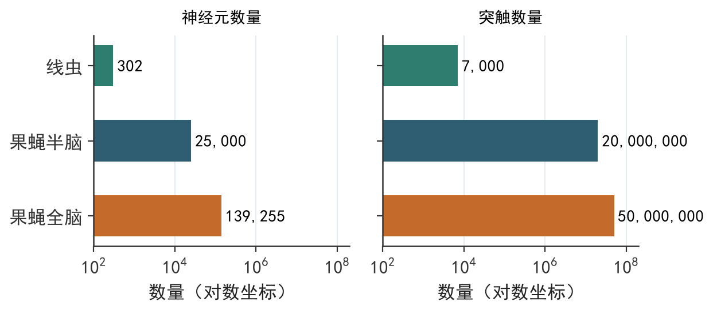

# 第 7 章　果蝇的半脑与全脑图谱

线虫之后，连接组学把目标转向了果蝇。理由很充分。果蝇的行为比线虫丰富得多，能飞、能走、能学习、能社交，而它的脑仍然小到可以放进一台电镜。它还有几十年的遗传学积累，研究者可以用基因工具精确地开关某一群神经元，这为验证连接组提供了手段。

从半脑到全脑，果蝇用了大约五年。这一段历史很能说明连接组学的工程性质。

果蝇还有第三个优势，它的大小刚好卡在“能做完”和“值得做”之间。线虫只有三百多个神经元，图谱做完之后能提的问题很快就问完了。小鼠的脑要大五个数量级，按目前的手段做不动。果蝇的十几万个神经元，正好是一支团队用几年时间可以啃下来的量级，而它的行为复杂度又足够支撑关于学习、导航、择食、求偶这些问题的讨论。整个领域在果蝇身上花的力气，很大程度上是因为这个尺寸比例合适。

## 7.1 半脑计划

2013 年，Janelia 研究 campus 启动了一个雄心勃勃的项目，要重建果蝇中央脑的全部神经连接。中央脑指除去两侧视叶之后的部分，包含蘑菇体、中央复合体、触角叶等结构，是嗅觉、学习、运动控制和导航的中枢。

先做中央脑而不是整个脑，是一个经过计算的选择。视叶占了果蝇脑神经元的一半以上，但它的结构高度规则，像一块反复复制粘贴的棋盘，层与层之间、柱与柱之间的接线几乎一致。这种规则性意味着可以用抽样推断整体，认真做完一小块，就能知道其余部分大概长什么样。中央脑正相反，那里有几万种形态各异的细胞，每一种的接线都要单独看。工程上先啃硬骨头，把最难的部分做透，是合理的排序。

项目用了 FIB-SEM 成像，把一只成年雌果蝇的脑切成几千层，逐层扫描。图像分割由机器完成，校对由一支专门的团队负责。整个项目持续了七年。

FIB-SEM 的工作方式值得展开。它的名字来自聚焦离子束和扫描电子显微镜的结合，原理像一个极其精密的刨子。镓离子束把样品表面削掉薄薄一层，电子束紧接着扫过新露出的断面，拍下一张高分辨率的图，然后削下一层，再拍一张。削去的厚度可以控制在个位数纳米，得到的体素接近立方体。这一点对重建至关重要。传统的超薄切片要先切下来、再捞到铜网上，切片会皱、会裂、会丢，层与层之间还要靠图像特征重新对齐。FIB-SEM 在原地一层层剥，样品始终固定在同一个位置，层间配准的误差小得多，膜的连续性也保得住。

代价是速度。离子束削掉一层要几十秒，一台显微镜一天只能推进很小的深度，一只果蝇的中央脑要连续跑几个月。样品制备也不轻松，脑组织要用甲醛固定，用重金属盐浸泡染色，让脂质膜在电子束下显出深色轮廓，再包埋进树脂。染色不均匀，图像就有的地方过暗、有的地方发白，后面的分割算法就会在那里出错。

扫描出来的原始数据是几十到上百太字节的图像堆栈。这些图像本身还不能叫连接组，必须先从像素里把每个神经元分离出来，再找出神经元之间的接触点。分割用了当时最先进的机器学习方法，把图像切成小块，判断相邻体素是否属于同一个细胞，再把这些判断拼成完整的三维形状。算法在人工标注的样本上训练，训练集本身就要几万个工时。

突触的识别靠一个果蝇特有的结构。果蝇的突触前末端有一块 T 形的致密带，周围聚着一圈突触囊泡，这个结构叫 T-bar，在电镜图里对比度很高，形状也稳定。研究者训练了一个卷积网络在整份数据上滑动，判断每个位置是不是突触，输出的突触总数在两千万量级。这个数字后来被反复引用，成了果蝇中央脑的一个基准量。每条突触还记录了位置、大小、参与的两个神经元，所以数据不只是“谁连谁”，还包括“在哪里连、连了多大”。

校对是人力最密集的一段。自动分割会漏掉比体素还细的纤维，会把并排走的两根轴突粘成一根，会在切片破损的地方断开。校对员在三维界面里逐段检查，遇到错误就切一刀或者补一段。一个中等大小的神经元，完整核对一遍要几个小时，大的投射神经元要几天。团队以神经元为单位认领任务，做完了打上标记，再由第二个人复核。这套流程听起来笨，但它把一件不可能一个人做完的事，拆成了几千件可以分工做的事。

2020 年，结果以专刊形式发表在《eLife》上。这份被称为 hemibrain 的数据集包含约 2.5 万个神经元和 2000 万个突触，注释出四千多种细胞类型。论文首次给出了中央脑的完整连接矩阵，还配套发布了一个在线查询工具，研究者可以输入任意两个神经元，查看它们之间的连接路径。

hemibrain 的贡献不只是数据。它建立了一套工作流程，从成像、分割、校对到注释、发布、共享，后来的项目基本沿用了这套流程。它也证明了连接组可以做到突触级的精度，每个连接的位置、大小、形状都有记录。

它的局限同样明显。视叶被排除在外，而视叶占了果蝇脑神经元的一半以上。中央脑的很多功能依赖视觉输入，没有视叶，视觉环路的研究无法展开。另一个局限是样本只有一个。一只雌性果蝇的接线，能不能代表整个物种，当时没有人能回答。数据里也没有功能信息，所有关于信息流向的推断，都建立在“突触前到突触后”这个解剖学约定上，而这个约定在有的环路里并不成立。

## 7.2 FlyWire 全脑

2019 年前后，一个更大的计划开始成形。普林斯顿的 Sebastian Seung 团队、剑桥的 Greg Jefferis 团队、Janelia 的 Davi Bock 团队，以及全球几十个实验室联合起来，决定重建成年果蝇的完整脑，包括视叶。

数据来自 FAFB 数据集，一只七天大的成年雌果蝇。成像在 2016 年完成，七千多张切片，每张四十纳米厚。图像分割由 Google 提供算力支持，算法在几十万张图像上训练，把每个神经元从像素里分离出来。

FAFB 的成像参数和 hemibrain 不一样，这个差别后面会反复出现。FAFB 的横向分辨率是四纳米，比 hemibrain 的八纳米细一倍，但层厚是四十纳米，比 hemibrain 厚好几倍。也就是说，它在切面内看得更清楚，在深度方向上反而更粗糙。为了让三维形状连贯，图像的层间对齐必须做得极准，而这一步恰恰最难。切片在收集过程中会被拉伸、压缩、撕裂，同一个结构在相邻两张图上的位置可能差出十几个像素。团队用弹性配准把每一层都做局部变形，靠图像自身的纹理把层与层咬合起来。配准做不好，后面的分割就会在层与层之间断成一截一截。

分割用了一类叫泛洪填充网络的方法。算法从一个种子点出发，沿着膜的边界生长，把属于同一个神经元的体素一块块吞进来，直到碰到膜为止。种子点要人来给，通常点在每个神经元的细胞体上。一个细胞一个种子，十几万个种子撒下去，算法并行生长，最后得到十几万个独立的形状。这个方法比逐体素分类更适合神经元，因为神经元是细长的、分叉的、跨越很大范围的结构，局部判断很容易在细颈处断掉，而生长式的方法能顺着管子一路走到底。

真正的困难在校对。自动分割会漏掉细小的分支，会把相邻的纤维粘在一起，会在切片破损处断开。FlyWire 采用了一种前所未有的方式，把校对任务放到网上，任何人都可以注册账号，认领一小块区域，修正错误。参与者有专业研究人员，也有经过培训的志愿者，累计几千人，做了几百万次编辑。

让几千个陌生人在同一份数据上同时动手，技术上并不简单。FlyWire 背后有一套叫 CAVE 的数据库系统，它把每个神经元的每次修改都记成一条带时间戳的记录，任何人的编辑都可以追溯、可以撤销。系统还维护一个“已校对程度”的状态，哪些神经元被完整核过，哪些只核了一部分，哪些完全没过人手，都标得清清楚楚。没有这层基础设施，社区校对会变成一场灾难，一个人刚补好的分支被另一个人删掉，谁也不知道发生了什么。

校对的工作量用“编辑次数”来衡量比较直观。几百万次编辑听起来很多，摊到十几万个神经元上，平均每个神经元几十次。实际分布很不均，大的投射神经元和密集的局部中间神经元最费工，小的、孤立的细胞几乎不用动。论文给出的估计是，人工校对的总投入在几十人年的量级，如果不靠社区，一个实验室做不完。

2024 年 10 月，《自然》发表了 FlyWire 的系列论文。核心数据是 139255 个神经元和约 5000 万个化学突触，注释出八千四百多种细胞类型。这个数字比 hemibrain 多出五倍，多出来的主要是视叶。

同期的另一篇论文对细胞类型做了系统的层次化注释，把神经元分成类、型、发育单元三个层级。还有论文专门分析了视叶的运动通路、嗅觉通路的连接逻辑、以及全脑的连接统计。

这个层级值得解释一下。“类”是最粗的一层，按发育来源和大致形态划分，比如所有的蘑菇体神经元算一类。“型”是最细的一层，要求形态、连接偏好、递质都一致，同一型的两个神经元在别的脑里应该能找到对应。“发育单元”介于两者之间，指由同一个神经母细胞分裂出来的一批细胞，它们共享发育历史，因此连接也往往相似。这种三层结构解决了连接组学的一个老问题。太粗的分类掩盖差异，太细的分类没法在不同个体之间对齐，分层之后，研究者在不同粒度上都能找到可比较的对象。

## 7.3 数据里能看到什么

拿到全脑连接组，第一件能做的事是统计。

果蝇脑的连接非常稀疏。13.9 万个神经元，5000 万个突触，平均每个神经元只有三百多个输出。如果随机连接，任意两个神经元之间相连的概率不到十亿分之一。实际的连接高度结构化，神经元倾向于连接类型相同的伙伴，形成局部密集的模块。

“平均三百多个”这个数字掩盖了一个很宽的分布。多数神经元只有几十到几百个输出，少数“枢纽”神经元有几千个，个别甚至上万。把每个神经元的输出数画成直方图，尾巴拖得很长，是典型的重尾分布。这类分布在神经系统里很常见，它意味着网络不是均匀的网，而是由少数高度连接的中枢和大量低度节点拼起来的。删掉一个普通神经元，网络几乎不受影响，删掉一个枢纽，一小片区域就瘫了。

第二个发现是左右对称。果蝇脑的左右两半在细胞类型和连接模式上高度对称，但不是完全镜像。有些神经元只在一侧存在，有些连接在两侧的强度不同。这种不对称可能与个体经验有关，也可能是发育噪声的结果。

对称性最漂亮的地方在类型层面。研究者可以把左半球的一个神经元和右半球同型的伙伴配对，两边的输入输出伙伴也一一对应，连突触数量都差不多。这种配对让“比较两侧”成了一种实验手段。如果某一侧的连接异常，就可以怀疑那一侧的功能出了问题。不对称的部分通常出现在高级中枢，尤其是蘑菇体和中央复合体附近，那里的连接在个体之间差别较大，可能与学习和经历有关。

第三个发现是感觉通路的分离。视觉、嗅觉、味觉的输入在早期阶段各自独立，到了中央脑才开始整合。这种分离在连接矩阵上表现为块状结构，不同模态的神经元集群之间连接稀疏，集群内部连接密集。

视叶内部的结构最能说明问题。视觉信号从复眼进入，经过层层加工，最后从视叶输出到中央脑。运动检测由两类细胞完成，T4 对亮度变亮敏感，T5 对变暗敏感，两类各有四个亚型，分别对应四个运动方向。连接组显示，上游的 Mi1 和 Tm3 细胞把信号送给 T4，L1 和 L2 送给 T5，而这两条通路的时间特性刚好差一个相位，一个兴奋一个抑制，延迟错开之后，方向就编码在两条通路的时间差里。这套“延迟线加相减”的机制在研究单个细胞时就被猜到了，连接组把它确认为解剖事实。

中央复合体是另一个例子。这是一组位于脑中央的结构，包含扇形体、椭球体和脑桥，负责头方向、导航和运动规划。连接组里能看到一类叫 E-PG 的神经元，它们的轴突在椭球体里排成一个环，相邻的细胞依次响应相邻的方向，形成所谓的环状吸引子。哺乳动物的头方向系统用的是同一套数学，虽然具体的细胞和结构完全不同。这种“不同硬件、同一算法”的现象，是连接组比较研究里最有意思的发现之一。

蘑菇体则像一台稀疏编码机。几千个 Kenyon 细胞接收来自触角叶的嗅觉输入，每个细胞只对少数几种气味强烈响应，输出轴突在蘑菇体里汇聚到少数下游神经元上。中间有一个叫 APL 的大神经元，把抑制信号广播回整个蘑菇体，压掉大部分细胞的响应，只留下最强的几个。连接组能看到 APL 的输入输出覆盖了几乎全部 Kenyon 细胞，这种“全局抑制”在解剖上是显式的。多巴胺能神经元则在特定气味与奖惩之间建立联系，构成强化学系的生物学原型。

这些统计结果本身不解释行为，但它们提供了约束。任何关于果蝇脑如何工作的理论，都必须与这些结构特征相符。反过来说，如果一个模型在结构上明显违背数据，比如假设存在大量数据里根本没有的长程连接，那它的预测就没什么价值，哪怕行为曲线拟合得很好。

## 7.4 从数据到工具

连接组的数据量太大，不可能靠读论文来使用。FlyWire 配套发布了几个工具。

NeuPrint 是一个在线数据库，可以按细胞类型、脑区、连接模式查询神经元。输入一个神经元 ID，能看到它的形态、输入输出的伙伴、以及在这些伙伴上的突触数量。

NeuPrint 的查询语言值得一提。它支持类似图数据库的写法，可以问“找出所有从 A 类神经元接收超过五十个突触、并且向 B 类神经元输出超过二十个突触的细胞”，返回的是一张表和一张网络图。这种查询方式把连接组当成一个可以自由切片的图，而不是一份固定的表格。研究者的思路因此变了，以前是先有一个假设再去验证，现在是先看看数据里有什么模式，再回头想这模式意味着什么。

FlyWire Codex 提供了三维可视化，可以在浏览器里旋转、缩放整个脑，点开任意一个神经元查看它的分支。对于不熟悉神经解剖的读者，这是最直观的入口。

三维可视化解决的其实是一个认知问题。神经元的形状在二维切片上极难理解，一根轴突可能在脑的这一头出发，绕一大圈，最后在另一头分叉。只有把整颗脑渲染成半透明，让选中的细胞亮起来，人才能直观地看出它的走向。Codex 里还能按细胞类型批量上色，一眼看出某一类细胞在脑里的分布是均匀的还是聚集的。

还有一组 Python 工具，可以批量下载连接矩阵，做网络分析。研究者可以用这些工具计算任意一组神经元的输入输出，做聚类、找环路、比较不同个体。

除了这些，还有一个不太被注意但很关键的工具，叫 NeuronBridge。它把电镜数据和光学显微镜的图谱对应起来。电镜里看到的细胞是灰度的形状，光镜里看到的是表达特定基因的荧光细胞，两者的形态可以比对。研究者如果在光镜实验里发现某群细胞的行为有意思，可以用 NeuronBridge 找到它们在电镜里的对应物，从而拿到连接信息。这一步打通了两种实验传统，让连接组不再是孤立的数据。

这些工具的意义在于降低了使用门槛。过去只有少数实验室有能力处理连接组数据，现在一个研究生花几天时间就能上手。

门槛降低带来的变化是研究问题的多样化。早期用 hemibrain 的论文，大多集中在少数几个著名环路上，比如蘑菇体、中央复合体、视叶运动通路。工具成熟之后，冷门的细胞类型开始有人研究，比如控制睡眠的、控制进食的、参与求偶的。这些小系统在果蝇遗传学里本来就有大量行为数据，接上连接组之后，结构和行为之间的链条一下就通了。

## 7.5 半脑与全脑的分工

hemibrain 和 FlyWire 不是替代关系，各有各的用处。

hemibrain 的优势是精度。它的成像分辨率更高，校对更彻底，每个突触的形态都经过人工检查。对于研究具体环路的研究者，hemibrain 的数据更可靠。

严格说，两份数据的“精度”各有侧重。hemibrain 的体素是等向的，轴向和横向一样细，膜与膜之间的缝隙在三个方向上都分得开，突触的形态参数因此更可信。FAFB 的横向分辨率更高，切面内的细节更锐利，但层厚大，纵向的边界要靠算法推断。所以研究突触的微结构，比如 T-bar 的大小、囊泡的分布，hemibrain 更合适；研究长距离投射的路径，FAFB 的横向锐度更有用。

FlyWire 的优势是覆盖。它包含视叶，能看到从视觉输入到运动输出的完整通路。对于研究全脑整合的研究者，FlyWire 是唯一的选择。

两份数据的细胞类型命名并不完全统一。同一个神经元在 hemibrain 里叫一个名字，在 FlyWire 里可能叫另一个。过去几年，几个团队一直在做对齐工作，目前大部分主要细胞类型已经可以对应。

对齐不是改个名字那么简单。两套数据的坐标系不同，切片方向不同，同一个细胞在两份数据里被切的角度不一样，形态看起来就有差别。对齐要靠三样东西一起用，形态特征、连接指纹、以及发育谱系。连接指纹尤其有用，一个神经元接收哪些类型、输出到哪些类型、各有多少突触，这组数字在个体之间相当稳定，比形态更可靠。对齐完成之后，两份数据才能真正合起来用，一份提供高精度的局部结构，一份提供全脑的上下文。

| 项目 | hemibrain | FlyWire |
|------|-----------|---------|
| 发表时间 | 2020 | 2024 |
| 神经元数 | 约 2.5 万 | 139255 |
| 突触数 | 约 2000 万 | 约 5000 万 |
| 细胞类型 | 四千余种 | 八千四百余种 |
| 覆盖范围 | 中央脑 | 全脑含视叶 |
| 体素 | 等向，约八纳米 | 横向四纳米，层厚四十纳米 |
| 校对方式 | 专职团队 | 社区众包加专业复核 |

: 表 7-1　hemibrain 与 FlyWire 的基本参数对比

## 7.6 还缺什么

连接组给出了结构，但结构只是故事的一半。

缺的第一样是强度。突触数量只是连接强度的一个粗略代理。同样的突触数量，释放概率可能差几倍，受体数量可能差几倍。这些信息在电镜图像里看不出来，需要功能实验补充。

具体说，一个连接的实际效果取决于三件事。突触前端的囊泡有多少、释放的概率有多大，突触后膜的受体有多少、打开后能流入多少电流，以及这个连接离细胞体有多远、信号传到胞体时衰减了多少。电镜能看到囊泡的数目和突触的面积，能大致推测前两项，但第三项完全看不到。一个位于树突远端的大突触，对胞体的影响可能还不如一个位于胞体附近的小突触。这种位置效应在皮层里被研究得很透，在果蝇脑里还只有零星的测量。

缺的第二样是递质。FlyWire 的递质类型是预测的，不是测量的。预测准确率在八成到九成，意味着每个神经元有百分之十到二十的概率被标错。对于单个连接，这个误差可以忽略；对于整条通路，误差会累积。

预测的方法本身也值得说明。研究者把已知递质类型的神经元作为训练集，提取它们突触前的图像特征，训练分类器去判断新突触属于兴奋性还是抑制性。果蝇的递质系统比较简单，主要是乙酰胆碱（兴奋）、GABA（抑制）和谷氨酸（在果蝇里也是抑制），所以这是一个二分类问题，准确率能做到八九成。剩下的错误大多出现在稀疏的、训练样本少的类型上。

缺的第三样是动态。连接组是静态的，它告诉你两个神经元之间有连接，不告诉你这个连接在什么时候增强、什么时候减弱。学习、记忆、状态切换，都发生在动态里。

动态还包括更慢的变化。果蝇的脑在昼夜节律里会改变接线，某些神经元在白天和夜间的连接强度不同。饥饿、求偶、飞行这些状态也会调节特定环路的增益，靠的是神经调质，比如多巴胺、章鱼胺、血清素。这些调质神经元在连接组里能看到，它们的分支广播到很多区域，但“广播了之后起什么作用”是连接组回答不了的。

这三样缺失，正是全脑仿真要面对的问题。模型必须用假设填补这些空白，而假设的好坏，决定了仿真的可信度。下一章先看看更大的脑，小鼠和人，它们的连接组进展到了哪一步。

## 7.7 从脑到腹神经索

脑不是孤立的。果蝇的运动指令要从脑传到胸神经节，感觉信号要从身体传回脑，这条通路走的是腹神经索。只做脑，得到的是一台没有手脚的计算机。

腹神经索的结构比脑简单，但组织方式不同。它由一串神经节组成，胸部三个，腹部若干个，每个神经节负责一对体节的感觉和运动。运动神经元的胞体在神经节里，轴突伸到对应的肌肉上。感觉神经元的胞体在体表，轴突长驱直入，直接终止在神经节里。中间神经元把两侧连起来，协调左右腿的步态。

2019 年前后，两个团队分别用不同的成像方法做了腹神经索。一个叫 FANC，用自动化卷带式切片加扫描电镜，做的是雌蝇。另一个叫 MANC，用 FIB-SEM，做的是雄蝇，2023 年发布初版，包含两万多个神经元和两千万量级的突触。两份数据的规模都和中央脑相当，做起来一样费工。

腹神经索的图谱解决了一个具体问题，腿怎么动。果蝇的每条腿有几十块肌肉，每块肌肉由几个运动神经元支配，这些运动神经元又接收来自局部中间神经元和来自脑的下降指令。连接组把这条链路上的每一环都列了出来，包括哪些中间神经元负责左右协调，哪些负责关节的时序。步态这种看起来整体的行为，被拆成了一组可以逐个核对的连接。

更小的一个数据集提供了另一种参照。2023 年，《科学》发表了一龄幼虫的全脑连接组，3016 个神经元，约 54.8 万个突触。这是第一份完整的昆虫脑图谱，比成虫小两个数量级，但结构完整，从感觉输入到运动输出都在里面。幼虫的行为简单，主要是爬行、转弯、对光反应，这些行为可以用几十个神经元解释清楚。它的价值在于提供了一个可以完整闭环的样本，每个神经元都被命名，每条通路都能追到尽头。

成虫和幼虫的对比很有意思。幼虫脑里没有发达的蘑菇体，学习能力也弱得多；它的视叶只有几十个细胞，只能分辨明暗。成虫脑则在这些区域大幅扩张，神经元数量翻了几十倍。同一个物种，两个发育阶段，连接组的差别主要体现在少数几个结构上，这种对比能帮我们理解“多出来的神经元到底用来干什么”。

## 7.8 一份图谱的可信度

使用连接组数据的人，最常问的一个问题是，这份数据有多准。

答案不是一个数字，而是一组分层的指标。

最底层是成像质量。体素越小，膜与膜之间的缝隙越分得开，但体素小不等于图像好。染色不均、切片褶皱、荷电效应都会在局部毁掉对比度，那些地方的膜看起来是糊的，分割必然出错。公开的数据集通常附带一张质量热图，标出哪些区域可信度低。用数据的人如果不看这张图，可能会在坏区域里得出错误结论。

中间层是分割错误，分两类。一类是把一个神经元拆成两个，叫分裂错误。这类错误会低估这个神经元的连接数，因为它的一部分突触被算到了另一个“假”神经元头上。另一类是把两个神经元粘成一个，叫合并错误。这类错误更危险，因为它会凭空造出一条连接，让两个本来无关的细胞看起来在通信。研究者在统计连接时，通常会更担心合并，因为假阳性比假阴性更容易误导环路推断。

顶层是注释错误。细胞类型的划分、递质类型的预测、脑区的边界，这些都带主观判断。同一份数据，两个团队注释出来的类型数量可能差百分之几十。这不是谁做错了，而是“类型”这个概念本身有模糊地带。划分得细，能抓住个体差异；划分得粗，能保证可重复。折中的办法是分层注释，也就是前面提到的类、型、发育单元三层，用的人可以自己选粒度。

跨数据集的一致性检验是另一个办法。同一个细胞类型，如果在 hemibrain、FlyWire、MANC 里都能找到，而且三份数据给出的连接指纹相似，那这个类型的可信度就高。2024 年的多连接组比较研究做了这件事，把几个数据集的细胞类型系统对齐，发现大部分类型在个体之间是可重复的，但突触数量在个体间有百分之几十的波动。这个结果既让人放心，也提醒人别把单个突触的数字太当真。

还有一个容易被忽略的细节，版本。连接组数据是活的，校对一直在进行，今天的查询结果和半年前的可能不同。正规的数据集会给每次发布打上版本号和时间戳，论文里引用时必须写明是哪个版本。不写版本的引用，等于引用了一个移动的靶子。

把这些放在一起，可以对“可信度”给出一个务实的态度。连接组不是真值，它是一份带着误差范围的测量。它的强项是拓扑，谁和谁相连，这个判断在大多数地方是可靠的。它的弱项是数值，突触多少个、强度多大，这些数字要谨慎使用。知道强项和弱项在哪里，比追求一个笼统的“准确率”更有用。
