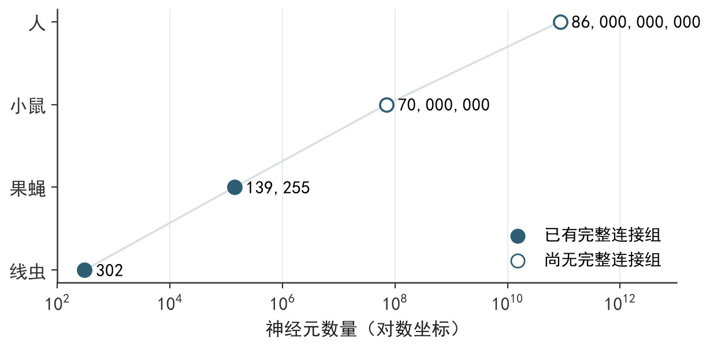

# 第 8 章　小鼠、人脑与尺度问题

果蝇的脑有 13.9 万个神经元。这个数字听起来不小，但放在哺乳动物里只是零头。小鼠有 7000 万个神经元，人是 860 亿个。如果果蝇全脑的连接组需要几年和数千万美元，那么按同样的方法做小鼠，成本会是多少。

这一章算一算这笔账，看看尺度到底意味着什么。

## 8.1 一立方毫米的小鼠皮层

2025 年 4 月，《自然》发表了一组关于小鼠视觉皮层的论文，统称 MICrONS 项目。这是目前哺乳动物脑最完整的连接组数据集。

数据来自一小块小鼠视觉皮层，体积一立方毫米，大约是一粒芝麻的十分之一。这一小块组织里有二十多万个细胞，包括神经元、胶质细胞和血管。电子显微镜重建出了五亿个突触。

同一块组织还做了活体钙成像，记录了约七万五千个神经元在观看图像时的活动。结构数据和功能数据被配准到同一个坐标系，研究者可以查出任一个神经元在什么刺激下放电，它的输入来自哪里，输出到哪里。

这份数据的价值在于，它第一次把结构和功能在同一块哺乳动物组织上对齐。过去的结构研究和功能研究是分开做的，现在可以在同一个细胞上同时问两个问题。

一立方毫米听起来很小，但它是小鼠大脑的几千分之一。要把整只小鼠脑都重建出来，规模要放大几千倍。

## 8.2 尺度账

连接组的成本大致随三个量增长，体积、神经元数量、突触数量。

成像时间与体积成正比。一立方毫米的小鼠皮层，用 FIB-SEM 需要几个月。整只小鼠脑约五百立方毫米，需要几十年。人的脑约一百四十万立方毫米，需要几万年。

数据存储与体积成正比。一立方毫米的原始图像在几十太字节量级，加上分割结果和中间产物，整个项目的存储在 PB 量级。整只小鼠脑需要 EB 级存储，人类目前没有这样的基础设施。

计算量与突触数量成正比。分割算法要在每个体素上运行，五亿个突触意味着数百亿次的网络推理。整只小鼠的突触数量是果蝇的二百倍，人的是果蝇的两万倍。

这三个量叠加起来，得到的是一个不太乐观的结论。按当前的技术，做完整的小鼠连接组不是不可能，但需要举国之力，做完整的人脑连接组在可预见的未来没有可行性。

## 8.3 已有的尝试

尽管困难，大规模的脑计划一直在推进。

美国 2013 年启动 BRAIN Initiative，投入数十亿美元，目标是开发研究大脑的新技术。它资助了电镜成像、探针、光学方法、数据分析等多个方向，FlyWire 和 MICrONS 都受益于这类资助。

欧洲 2013 年启动 Human Brain Project，预算约十亿欧元，最初的目标是用超级计算机模拟人脑。这个目标后来被大幅调整，项目转向了数据平台、神经信息学和脑疾病建模。调整的原因之一，就是完整人脑仿真的计算需求远超预期。

蓝脑计划在瑞士持续了十几年，重建了小鼠皮层的一个功能柱，包含几万个神经元和上亿个突触，用 Blue Gene 超级计算机做仿真。这个项目证明了详细模型可以跑起来，也暴露了参数缺失的问题，大部分离子通道的参数是从少数实验外推的，模型的预测能力有限。

这些项目的共同经验是，规模可以靠工程解决，参数不能。你可以买更多的电镜、更多的显卡、更多的硬盘，但你买不到一个神经元的完整参数。

## 8.4 缩小规模的策略

既然全脑遥不可及，研究者开始寻找折中方案。

第一种是选小区域。小鼠的一个皮层柱、一个海马切片、一个嗅球小球，体积小到可以完整重建，功能相对独立，可以回答具体问题。MICrONS 走的就是这条路。

第二种是选小动物。果蝇、斑马鱼幼鱼、线虫，神经系统小，行为可观察，遗传工具成熟。斑马鱼幼鱼只有十万个神经元，全身透明，可以活体成像，是目前全脑仿真的热门对象。

第三种是选简化模型。不追求每个神经元都重建，而是按细胞类型建群，每个群用统计特性代替具体连接。这种模型叫神经质量模型或群模型，计算量小几个数量级，能复现脑电、功能磁共振这类宏观信号。

第四种是混合。结构用连接组，功能用成像，动力学用简化模型，缺的部分用先验填补。Eon 的果蝇仿真就是这种思路，连接组是真实的，神经元模型是简化的，身体是模拟的。

这四种策略各有各的适用范围。想理解具体环路，选第一种。想理解全脑动力学，选第二种。想对接临床影像，选第三种。想演示闭环行为，选第四种。

## 8.5 人脑的特殊困难

人脑不只是更大。它的结构有一些质的不同。

第一是远程连接的比例高。果蝇的神经元多数是局部连接，轴突很短。人脑的皮层神经元可以投射到对侧半球，轴突长度几厘米。这些长程连接在连接组里占据的空间大，重建难度高。

第二是皮层折叠。人的大脑皮层折叠成沟回，同样的表面积压缩在更小的颅骨里。折叠让切片和配准变得极其复杂，一刀切下去，同一层细胞可能被切成好几段。

第三是细胞类型更多。果蝇有八千多种细胞类型，人脑的估计从几百种到几千种不等，取决于分类的粒度。类型越多，注释的工作量越大。

第四是个体差异。果蝇的接线在个体之间高度一致，人脑的差异大得多。一个标准连接组可能没有意义，需要考虑个体化的变异。

这些因素叠加，让人脑连接组不只是一个规模问题，而是一个性质不同的问题。

## 8.6 尺度不是唯一的瓶颈

最后要说的是，尺度不是全脑仿真唯一的瓶颈，甚至不是最关键的瓶颈。

即使有一天技术能把人脑的每个突触都测出来，仍然有一堆问题没有答案。突触的强度怎么定，离子通道的分布怎么测，神经调质的状态怎么记录，这些都不是成像能解决的。

而且，知道结构不等于知道功能。一张完整的接线图，如果没有动力学规则，仍然跑不起来。规则从哪来，只能从实验来，从电生理、光遗传、行为学来。这些实验的通量远低于成像，是真正的瓶颈。

所以讨论全脑仿真时，把注意力全放在“什么时候能扫完人脑”上，是抓错了重点。更值得问的是，我们对神经元和突触的动力学知道多少，这些知识能不能支撑一个可信的模型。这个问题，下一章开始回答。
