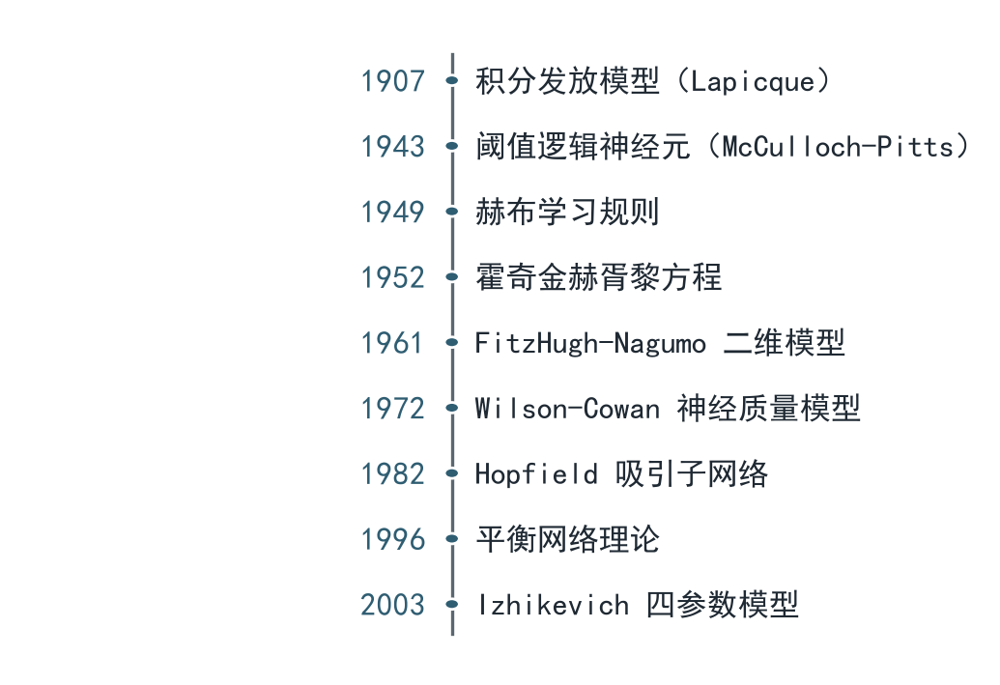

# 第 9 章　把神经科学写成方程

前面几章讲的是生物学的脑，由细胞、膜、离子和递质组成。要把它放进计算机，必须换一种语言，用变量、方程和参数描述同一件事。

这种转换不是最近才有的。早在计算机出现之前，研究者就在用数学描述神经元的电活动。八十多年来，这条路上积累了一长串模型，每一个都在回答不同的问题。

这一章按时间顺序把这些模型串起来，重点不是推导，而是看清每一代模型解决了什么，又放弃了什么。

## 9.1 从阈值逻辑开始

1943 年，Warren McCulloch 和 Walter Pitts 发表了一篇论文，提出用理想化的神经元构成逻辑网络。他们的神经元只有两个状态，兴奋和静息。输入加权求和，超过阈值就兴奋，否则静息。阈值可以取不同的值，实现与、或、非这些逻辑运算。

这个模型和真实的神经元差得很远，没有膜电位，没有时间过程，没有离子通道。但它证明了一件事，神经元网络可以计算。这个想法后来影响了整个计算机科学，人工神经网络的基本单元就是它的直系后代。

1949 年，Donald Hebb 提出了学习规则。如果两个神经元同时活动，它们之间的连接会增强。这条规则解释了为什么经验能改变大脑，也为后来的突触可塑性研究提供了框架。

## 9.2 霍奇金与赫胥黎

1952 年的模型是另一条路。Hodgkin 和 Huxley 不关心计算，他们关心的是动作电位到底怎么产生的。用枪乌贼的巨大轴突，他们测出了钠、钾电流随电压和时间的变化，写出了四个微分方程。

这套方程的意义在于，它第一次用物理量解释了生物现象。膜电位是变量，离子通道是电导，门控是随电压变化的概率。模型的每个参数都能和实验对应，预测的波形和实测几乎重合。

它的代价是复杂。四个耦合的常微分方程，十几个参数，数值求解需要小心处理刚性。单个神经元的模拟成本不高，但要把几万个这样的神经元连成网络，计算量会迅速膨胀。

后来的几十年，研究者一直在寻找折中方案。能不能用更少的方程，抓住动作电位最关键的几个特征，比如阈值、形状、不应期、适应。

## 9.3 简化模型的谱系

最早的是积分发放模型。1907 年，Louis Lapicque 提出把神经元看成积分器，输入电流累积到阈值就发放，然后重置。这个模型比 HH 早了四十五年，但直到计算机普及才被广泛使用。

加上漏电项，就成了漏电积分发放模型。膜电位按一个时间常数衰减回静息值，输入电流不断把它往上推。这个模型只有一个变量，计算极快，是大型网络仿真的主力。

它的缺点是无法产生丰富的放电模式。真实的神经元有适应、爆发、簇状放电，LIF 只能产生规则的单峰放电。

1961 年，Richard FitzHugh 和 Jin-ichi Nagumo 提出了一个二维模型，用两个变量描述兴奋和恢复。它的相平面可以画出极限环，能产生类似动作电位的波形，也能产生振荡和双稳。这个模型来自对 HH 方程的简化，保留了几何直觉，丢掉了离子通道的细节。

2003 年，Eugene Izhikevich 提出了一个二维模型，用四个参数控制放电模式。调整参数，可以得到规则放电、快速放电、簇状放电、适应、低频振荡等二十多种模式。计算量和 LIF 相当，表达能力接近 HH。这个模型在大规模网络仿真里很受欢迎。

## 9.4 从单细胞到网络

单个神经元的模型解决之后，问题转向网络。

1972 年，Hugh Wilson 和 Jack Cowan 提出了神经质量模型，把一群神经元当成一个整体，用平均放电率描述。模型只有几个变量，可以分析稳定性、振荡、行波。它适合描述皮层柱、脑区之间的相互作用，不适合描述单个细胞的行为。

1982 年，John Hopfield 提出了一种网络模型，神经元之间对称连接，能量函数单调下降，网络最终收敛到一个吸引子。这个模型解释了联想记忆，给定一个不完整的模式，网络能恢复到完整的记忆。吸引子的概念后来被广泛用于解释工作记忆、决策和导航。

1996 年，van Vreeswijk 和 Sompolinsky 提出了平衡网络理论。在随机连接的兴奋抑制网络里，如果兴奋和抑制大致平衡，网络可以保持不规则放电，同时对外部输入做出快速响应。这个理论解释了皮层神经元为什么在清醒时放电不规则，而不是像节律器那样整齐。

这些网络模型有一个共同点，它们不依赖具体的连接组。连接被假设成随机的，或者只保留统计特性，比如连接概率、平均强度。这样做的好处是可以用统计物理的方法分析，坏处是无法预测具体环路的行为。

## 9.5 模型之间的取舍

把模型排成一排，可以看到一条清晰的取舍线。

越靠近生物，参数越多，计算越贵，能解释的现象越具体。HH 模型可以解释动作电位的形状、阈值、不应期，但需要知道几十个参数。

越靠近抽象，参数越少，计算越便宜，能解释的现象越宏观。LIF 只能解释放电时刻，但一个 GPU 可以跑几百万个。

选择哪个模型，取决于你要回答的问题。想研究突触可塑性，需要能表达钙浓度的模型。想研究大网络的同步，LIF 就够。想研究单个神经元的树突计算，需要多房室模型。

全脑仿真面对的是一个特殊的问题，它既需要覆盖整个脑，又需要保留足够的行为细节。这迫使我选择一个折中的模型，通常是 LIF 或 Izhikevich，再在关键环路里替换成更细的模型。

## 9.6 方程之外

最后要提醒一点。模型不只是方程，还包括参数和初始条件。

同一个 HH 方程，参数不同，可以表现为规则放电、簇状放电或者静默。同一个 LIF 网络，连接强度不同，可以表现为同步、异步或者振荡。方程给出的是可能性空间，参数决定了落在哪个点。

参数从哪来，这是全脑仿真最难的部分。电生理实验可以测单个神经元的参数，但通量很低，一次只能测几个细胞。连接组可以给出连接的数量，但给不出强度。剩下的只能靠拟合和猜测。

这就是为什么全脑仿真的结果总是带着不确定性。不是方程写错了，而是参数不知道。下一章讲怎么把这些方程变成可运行的系统，以及工程上要处理哪些问题。

## 9.7 一个方程如何变成一门学科

1952 年那篇论文发表时，读者不多。霍奇金和赫胥黎用的是枪乌贼巨大轴突，一种只有少数海洋生物站能稳定供货的标本，方法上把电压钳和数学拟合绑在一起，生理学圈子之外的人读起来相当吃力。1963 年诺贝尔生理学或医学奖颁给他们和 Eccles，算是对这套工作的正式承认，但那时候"计算神经科学"这个词还不存在，做这类工作的人分散在生理系、物理系和少数工程系里，没有自己的会议，也没有自己的期刊。

真正传下来的不只是那四个方程，而是一种做法。霍奇金和赫胥黎面对的是一个整体现象，动作电位的完整波形，他们把它拆成几个可以单独测量的部件，钠电导、钾电导、各自的电压依赖门控，每个部件都设计实验单独测出来，再用方程把部件拼回去，看拼出来的波形是否和实测一致。这个"拆开测量再拼回去"的路子，后来成了这个领域的默认方法。今天任何一个建模者说"我先把通道动力学定下来，再看网络",用的都是这套思路。

1960 年代，Wilfrid Rall 把空间维度加了进来。他研究树突，树突是细长的管状结构，膜电位沿长度衰减，需要用电缆方程描述。Rall 证明了一件事，一根不规则的树突树在数学上可以化简成一组等效的圆柱，每个圆柱用几个房室近似，房室之间的耦合由轴向电阻和膜电导决定。这套电缆理论让"树突在做什么"从哲学讨论变成了可以计算的问题。他后来提出的观点更激进，树突上可以产生局部的再生电位，也就是说一个神经元不是一个加法器，而是几十个独立计算单元的组合。这个观点在 1990 年代被双光子成像和树突记录证实，成为现代神经元模型的基础。

1970 年代的关键变化是计算机变得可用。房室模型和 HH 方程都需要数值积分，手算不可能，大型机又不容易接触。等到小型机和后来的工作站进入实验室，做模型的人才多起来。1984 年 Michael Hines 写了一个专门解房室方程的求解器，后来发展成 NEURON 软件，它用树状数据结构表示神经元的形态，用隐式方法处理刚性方程，让一个研究生也能在几天内搭出一个多房室模型。同一时期 GENESIS 走的是另一条路，用脚本搭网络，适合做环路层面的仿真。工具的出现改变了人口结构，做模型不再需要自己写求解器。

1980 年代中后期，神经网络的热潮把这个方向推到了聚光灯下。Hopfield 在 1982 年把自旋玻璃的数学搬到神经网络上，Rumelhart 和 McClelland 在 1986 年推广了反向传播，一批物理学家和计算机科学家开始关心"大脑怎么计算"。这股热潮带来两样东西，钱和人。1989 年 Neural Computation 创刊，1990 年前后以计算神经科学为名的会议和论文集陆续出现，1994 年 Journal of Computational Neuroscience 创刊，一个领域需要的外部标志基本齐了。

1990 年代是学科化的完成期。研究生可以拿这个方向的学位，会议有了固定的年会和审稿流程，教科书开始出现，2001 年 Dayan 和 Abbott 的《理论神经科学》和 2002 年 Gerstner 与 Kistler 的《脉冲神经元模型》成为两代人的入门书。经费层面，2013 年美国的 BRAIN Initiative 和欧盟的人脑计划把"用计算理解大脑"写进了国家级的预算文件，这是五十年前无法想象的位置。

学科化也有代价。评价体系以论文数量和期刊等级为主，而模型的复杂度很容易堆上去，可检验性却不一定跟着提高。有人统计过，发表的计算模型里真正给出可被后续实验否证的定量预测的比例并不高。另一些批评更尖锐，认为很多模型只是在拟合曲线，参数调到能复现图就停了。这类批评推动了一个有益的变化，越来越多的期刊要求作者公开模型代码和参数，ModelDB 这类数据库就是在这个背景下成长起来的，它收录了上千个已发表的模型，任何人在上面能直接下载复现。

回头看，一个方程变成一门学科需要四件东西同时到位。语言，由 HH 提供，把膜电位、电导、门控这些概念固定下来，让不同实验室能说同一件事。工具，由计算机和数值方法提供，让复杂的方程能真的解出来。社群，由 1980 年代的神经网络热潮和随后的期刊会议提供，让做这件事的人能互相评审、互相引用。问题，由实验不断提出，从动作电位怎么产生，到网络如何维持不规则放电，到决策如何从群体活动中浮现。四件里缺一件，这个方向都会停在少数人的业余爱好上。

## 9.8 模型选择的实践

第 9.5 节说过，模型的取舍取决于要回答的问题。实践里这句话需要更具体的判据，否则"取决于问题"等于什么都没说。

第一个坐标是空间尺度。要研究的是一个离子通道、一个树突分支、一个神经元、一个皮层柱、一个脑区，还是整个脑。尺度和可用的观测手段直接绑定，如果模型的输出无法对应到任何一种能测到的信号，这个模型就失去了和实验对话的接口。研究树突计算必须能输出胞体或者树突上的电压，因为膜片钳能测这个；研究全脑静息态必须能输出区域层面的血氧或者电磁信号，因为 fMRI 和脑电只能测到这个粒度。

第二个坐标是时间尺度。通道的门控在微秒到毫秒，动作电位在一毫秒，突触可塑性在毫秒到小时，学习在小时到天，发育和演化在月到年。模型的步长必须跟得上要解释的现象，但也不能过细，用一微秒的步长去模拟一小时的节律，绝大部分计算都浪费在解不需要的细节上。

第三个坐标是抽象层次，用放电率还是用脉冲，用群体平均还是用个体神经元，用确定性方程还是用随机过程。这个坐标决定了模型能不能表达时序相关的现象，比如同步、延迟、脉冲时序依赖可塑性。用率模型去研究这些是根本做不到的，因为率模型把时间抹平了。

| 想回答的问题 | 常用模型 | 主要状态变量 | 相对代价 |
| --- | --- | --- | --- |
| 动作电位的波形、阈值、不应期 | Hodgkin-Huxley | 膜电位、门控变量 | 高 |
| 树突整合、局部再生电位 | 多房室模型 | 各房室电位、钙浓度 | 很高 |
| 皮层不规则放电与快速响应 | 平衡随机网络 | 膜电位、群体放电率 | 中 |
| 脑电节律、睡眠纺锤波 | 神经质量模型 | 兴奋与抑制群体放电率 | 低 |
| 癫痫的起始、扩散与终止 | 低维癫痫模型 | 慢变量、快速放电变量 | 低 |
| 证据累积与决策 | 漂移扩散、吸引子网络 | 累积量、群体活动 | 低 |
| 静息态功能连接 | 全脑神经质量模型 | 各脑区活动 | 中 |
| 学习与表征形成 | 率网络加学习规则 | 连接权重 | 中 |

: 表 9-1　常见问题与模型类型的对应关系，代价指参数数量与数值成本

表里最值得注意的是最后几行。癫痫和静息态这两类问题，实验能给的观测量很粗，癫痫靠立体脑电和影像，静息态靠 fMRI，时间分辨率在秒级。这种情况下用 HH 模型去建整脑毫无意义，因为模型的精细程度远远超过观测的分辨率，多出来的自由度只能靠猜。Jirsa 等人在 2012 年提出的癫痫模型用了五个变量，把一次发作的起始、扩散和终止压缩成慢变量的演化，参数可以直接从病人的颅内记录拟合。这类模型的价值不在于它像不像真实神经元，而在于它能用少数几个可估的量预测发作的走向。

反过来，用简化模型去回答需要细节的问题同样会失败。想知道某个中间神经元的树突上两种抑制性输入如何相互作用，用点神经元模型就不可能得到答案，因为这个问题的全部内容都在空间结构里。

由此可以提炼出几条判据。第一，模型必须有一个输出通道对应到实验能测的量，否则无法验证。第二，自由参数的个数应该少于独立观测的个数，否则拟合是欠定的，任何数据都能被解释。第三，模型要能给出没用它拟合过的实验的定量预测，这是区分"解释"和"拟合"的唯一办法。第四，模型的时间尺度要和问题的尺度匹配，用超出观测分辨率两个数量级的细节去建模，只会引入无法约束的参数。

还有一个常被忽略的成本是调试。模型越复杂，出错的地方越多，一个多房室模型的膜电位爆炸可能来自轴向电阻写错、时间步长太大或者初始条件不对，排查要几天。简化模型出错时，往往能一眼看出问题在哪。在这个意义上，模型的选择也取决于你能承担多少调试时间，这跟问题本身无关，跟团队规模有关。

实践里常见的折中是嵌套。先用一个低维模型把参数空间扫一遍，找出行为发生质变的那几个区域，再用详细模型在那几个点上做验证。癫痫建模经常这么做，先用神经质量模型找出癫痫样放电出现的参数区间，再在区间里挑几个点用脉冲网络确认机制。全脑仿真也是这个思路，主体用简化神经元，关键环路换成多房室。

## 9.9 参数从哪里来

方程写出来只是骨架，参数才是血肉。一个 HH 型的神经元模型需要每个离子通道的最大电导、半激活电压、斜率、时间常数，一个多房室模型还要每个房室的长度、直径、膜电容、轴向电阻，一个网络模型还要连接概率、突触权重、传导延迟。这些数字没有一个是方程能给的，全部来自实验或者推断。

最直接的一类是电生理测量。电压钳可以把膜电位固定在一系列值上，测出对应的电流，从电流的稳态值算出激活曲线，从电流的上升和衰减算出时间常数。膜片钳可以把单个通道的开放和关闭记录成方波，直接统计出开放概率。突触强度可以用配对记录测，同时扎两个神经元，刺激一个看另一个的响应幅度。这些方法的共同优点是直接，测出来的就是模型里要的那个量。共同缺点是通量低，一天做几个细胞已经算顺利，而人的皮层有几百种细胞类型。

第二类是拟合。有些参数测不到，但模型的输出能测到，于是反过来调参数去匹配输出。最简单的例子是 f-I 曲线，给神经元注入一系列恒定电流，记录放电频率，然后用简化模型去拟合这条曲线，得到阈值和斜率。Izhikevich 模型只有四个参数，正是为了让这种拟合容易做，他给出的参数表里每一行对应一种已知的放电模式，取自哺乳动物皮层的记录。更系统的做法是多目标优化，同时拟合放电波形、亚阈值响应、适应特性、树突的衰减，用进化算法在参数空间里搜索。蓝脑计划在 2015 年发表的工作就是用这套流程为小鼠皮层建了数千个神经元模型，每个模型的参数都对应一组电生理特征。

第三类是借用。绝大多数建模者不会自己去测参数，而是从文献里抄。这个环节看似省事，实际最危险。一个参数在什么物种、什么温度、什么年龄、什么脑区、什么细胞类型上测的，抄的时候常常记不全。霍奇金和赫胥黎的数据来自枪乌贼轴突，温度约 6 摄氏度，要用到 37 度的哺乳动物身上，速率常数得按 $Q_{10}$ 缩放，通常取 3 左右，而电导密度本身也得改，因为枪乌贼轴突和皮层锥体细胞的膜性质差别很大。类似的坑还有很多，切片里的神经元缺少在体的神经调质输入，测出来的膜电阻偏高，突触权重在体外和体内可以差几倍。

为了缓解这些问题，社区建了一批数据库。ModelDB 收录了上千个已发表的模型，从单个通道到完整环路，代码可以直接下载。Allen 细胞类型数据库把小鼠皮层的电生理记录、形态重建和转录组数据配在一起，让建模者按细胞类型查参数。NeuroElectro 从文献里自动抽取电生理性质的数值，汇总成按细胞类型和脑区分类的统计。这些资源的共同思路是把参数从"某篇论文的图里读出来"变成"从数据库里查出来"，同时保留来源和实验条件。

即使有了这些，参数估计仍有一个根本困难。2007 年 Gutenkunst 等人用系统生物学里的模型说明，参数空间通常只有少数几个方向被数据强烈约束，其余方向上参数怎么变，模型的输出几乎不变。这种模型被称为 sloppy，中文有时译作松散模型。含义很实际，你无法从数据里唯一确定每个参数的值，但模型的预测可能依然稳定。这既是个坏消息也是个好消息，坏消息是"这个通道的电导到底是多少"这类问题经常没有答案，好消息是模型不需要每个参数都对才能预测对。

实践上的应对有几条。报告参数时给分布而不是单点，尤其是从多个细胞拟合出来的量，本来就有一个自然的离散度。做敏感性分析，找出哪些参数一动输出就翻倍，哪些参数怎么动都无所谓，后者可以大胆用估计值。把参数的不确定性一路传到预测上，让模型的输出也带误差棒，而不是一个看起来很确定的数。全脑仿真对这个要求更严，因为参数有百万个，来源从电生理到文献到猜测混在一起，如果不给每个参数记来源和置信度，模型出错时根本查不出是哪一环的问题。建一份参数账本，把每个数字的来源、实验条件、误差范围记下来，花的时间不多，省下的时间往往以月计。
