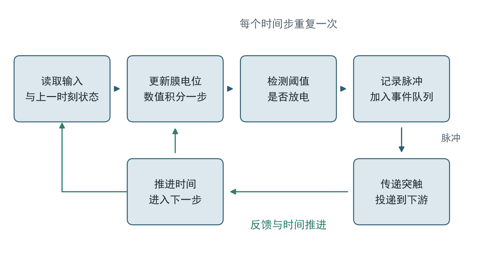

# 第 10 章　从方程到可运行的系统

写下一组微分方程，和让它在计算机上跑起来，是两件不同的事。方程描述连续的时间，计算机只能做离散的步骤。方程假设无限精度，计算机只有有限的浮点数。方程里的神经元可以同时更新，计算机的核心里只能一个一个算。

这一章讲中间这段工程。它不涉及新的生物学，但决定了全脑仿真能不能做成。

## 10.1 时间怎么离散

最直接的方法是把时间切成小步，每一步用当前的状态推算下一步。这叫显式欧拉法。

以漏电积分发放模型为例。膜电位的导数等于输入电流减去漏电流，再除以时间常数。用欧拉法，下一步的膜电位等于当前值加上导数乘以步长。

步长要足够小。太大，数值会不稳定，膜电位可能发散；太小，计算量会增加。通常取零点一毫秒，这个尺度比动作电位的时间常数小一个数量级，能保证稳定。

欧拉法的误差是一阶的，精度不高。要更准，可以用四阶龙格库塔，每一步算四次导数，误差降到四阶。代价是计算量翻四倍，在大规模网络里不划算。

还有一类方法利用方程的特殊结构。LIF 的方程是线性的，可以解析求解，每一步用指数函数精确更新。这叫指数欧拉法，稳定性和精度都比普通欧拉好，计算量只多一点。大多数现代仿真器默认用它。

对于有放电的网络，还有事件驱动的思路。神经元的膜电位在两个脉冲之间是平滑变化的，可以解析地算出下一次越过阈值的时刻，只在那个时刻处理事件。这种方法没有时间步长的概念，精度高，但实现复杂，只适合简单的神经元模型。

## 10.2 仿真器的分工

不同的模型需要不同的仿真器。目前常用的有几个。

NEURON 是最老的之一，1980 年代由耶鲁的 Ted Carnevale 和 Michael Hines 开发。它专门处理多房室模型，把一个神经元切成几百个圆柱形的隔室，每个隔室有自己的膜方程和离子通道。NEURON 的强项是生物细节，弱项是规模，跑几万个神经元已经很吃力。

NEST 走另一条路，专注点神经元网络。它的神经元是 LIF 或 Izhikevich 这类简化模型，突触是简单的电流或电导。NEST 为并行计算设计，可以在几千个核心上跑，是目前大规模网络仿真的主力。欧洲的 Human Brain Project 大量使用它。

Brian2 是 Python 写的，特点是让用户直接用数学方程描述模型，代码自动生成成高效的 C++ 或 GPU 代码。它的学习曲线比 NEST 平缓，适合研究和教学，规模上限取决于后端。

GeNN 专门为 GPU 优化，把神经元和突触的状态放在显存里，用并行核函数更新。它的速度比 CPU 快一到两个数量级，适合需要反复跑参数的场景。

Arbor 是近几年出现的新仿真器，由挪威和瑞士的团队开发，目标是支持复杂的形态和高效的并行。它的设计借鉴了 NEURON 和 NEST 的经验，试图在细节和规模之间找平衡。

还有一类是神经形态硬件。Intel 的 Loihi 2 把神经元做进芯片，每个核模拟一组神经元，脉冲通过片上网络传递。它的能耗比传统处理器低几个数量级，速度也快，但编程模型和传统仿真器完全不同。

## 10.3 规模的上限

仿真器的能力可以用一个基准来衡量。2014 年，Potjans 和 Diesmann 提出了一个皮层柱的基准模型，一平方毫米的皮层，七万七千个神经元，三亿个突触，包含四层和两类细胞。这个模型成了大规模仿真的标准测试。

在普通工作站上，这个模型可以跑到实时。在超级计算机上，规模可以放大几个数量级。2017 年，日本的 K 计算机用 NEST 模拟了十七亿个神经元和十万亿个突触，模拟一秒生物时间需要几十秒。这是目前公开报道的最大规模之一。

规模的上限不只取决于算力，还取决于通信。神经元之间的连接是稀疏的，但每个神经元要和几百个伙伴交换脉冲。在分布式系统里，这意味着大量的网络通信。核越多，通信开销越大，加速比会逐渐饱和。

解决的办法是减少通信。一种是把经常通信的神经元放在同一个核上，用图划分算法优化。另一种是降低脉冲的精度，用事件或稀疏编码代替逐位传输。还有一种是用神经形态硬件，把连接存在本地，避免全局通信。

## 10.4 从连接到模型

仿真器需要的输入是一份模型描述，包括神经元类型、参数、连接矩阵、输入输出。

连接组给出的正是连接矩阵。FlyWire 的数据可以导出成稀疏矩阵，每一行是一个突触前神经元，每一列是突触后神经元，值是两个神经元之间的突触数量。这个矩阵有 13.9 万行和列，非零元素 5000 万个，稀疏度不到千分之三。

把这个矩阵直接放进仿真器，会得到一个大而稀疏的网络。但还需要几样东西。

神经元的类型和参数。不同的细胞类型有不同的膜时间常数、阈值、不应期。FlyWire 的注释给出了类型，参数需要从文献里查，或者从电生理数据拟合。

突触的符号和强度。符号来自递质预测，强度来自突触数量。这两个都是近似，需要校准。

外部输入。感觉神经元需要接上刺激，运动神经元需要接上读出。这部分是模型和外界交互的接口，通常是手工设计的。

## 10.5 模型描述的标准化

不同仿真器的输入格式不同，这给模型共享带来了麻烦。同一个模型，在 NEST 里要写一套代码，在 NEURON 里要写另一套。

为了解决这个问题，社区推动了几套标准。NeuroML 用 XML 描述神经元和网络，可以被多个仿真器读取。SONATA 用 HDF5 存储大规模网络，专门为百万级神经元设计。还有 NineML、PyNN 等中间层，提供统一的 Python 接口，底层调用不同的仿真器。

标准化的进展缓慢，因为每个仿真器都有自己的优化和特性，完全兼容会牺牲性能。但对于全脑仿真这种需要跨团队协作的项目，标准化是必须的。FlyWire 的数据已经用 SONATA 格式发布，Eon 的模型可以直接读取。

## 10.6 仿真不是终点

跑起来只是第一步。真正的挑战在跑起来之后。

模型会产生海量的数据。13.9 万个神经元，每个每秒放电几次到几十次，一分钟就是几千万个脉冲。这些数据需要存储、可视化、分析。怎么从脉冲序列里看出模式，怎么和实验数据比较，怎么判断模型对不对，这些是另一套工具。

还有参数的搜索。全脑模型有几千个参数，很多不知道。要找到一组能复现实验数据的参数，需要反复运行模型，每次几分钟到几小时。这是一个高维优化问题，没有解析解，只能靠采样和近似。

这些工程问题不性感，但它们决定了全脑仿真能走多远。一个漂亮的模型，如果跑一次要一个月，就没法用来做研究。
