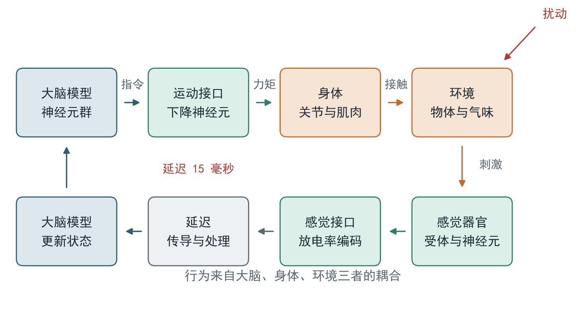

# 第 11 章　身体、环境与闭环

一个孤立的大脑什么也做不了。它需要感觉输入，需要把指令送出去，需要看到指令的后果。这三件事构成一个环，环合上了，行为才会出现。

这一章讲这个环的两端，身体和环境，以及为什么全脑仿真必须把它们包含进来。

## 11.1 身体不是载体

传统上，身体被看成大脑的载体，负责执行大脑的指令。这个看法把身体当成被动的机械，忽略了它在行为中的作用。

实际上，身体参与计算。果蝇的腿有特定的长度和关节角度，走路时不需要大脑计算每一步的落点，身体的力学特性会自动稳定步态。鱼的侧线能感知水流，身体的形状把水流转换成特定的压力模式。这些例子说明，很多看似聪明的行为，其实是身体和环境共同完成的。

这个观点在 1980 年代被机器人研究者明确提出。Rodney Brooks 造了一批没有中央规划的机器人，靠简单的反射和身体结构在房间里行走。他的结论是，智能不需要复杂的内部模型，身体与环境互动本身就产生了看似智能的行为。

对全脑仿真的启示是，把大脑单独拿出来跑，会丢失一部分行为。必须把身体放回去，让大脑控制一个真实的、有惯性和摩擦的身体，才能看到完整的行为。

## 11.2 从 Braitenberg 到 MuJoCo

1984 年，Valentino Braitenberg 写了一本小书，叫《车辆》。书里描述了一系列简单的机器人，用传感器直接连接马达，却能表现出害怕、好奇、爱慕这些行为。比如两个光传感器分别控制两个轮子，左边的传感器连右轮，右边的连左轮，机器人就会朝光走。反过来接，它就会躲光。

这些车辆没有大脑，只有几条连线，但行为看起来像有意图。Braitenberg 用它们说明，行为的复杂性不一定来自内部的复杂性，也可能来自连接方式。

四十年后，MuJoCo 把这种思想变成了工程工具。它是一个物理引擎，可以模拟刚体、关节、接触、摩擦、肌肉。给定一个身体模型和控制信号，它能算出身体在每个时刻的位置和速度。

NeuroMechFly v2 是果蝇的身体模型，包含 87 个关节，网格来自真实果蝇的 X 射线扫描。它有视觉、嗅觉、触觉的模拟输入，也有控制腿和翅膀的接口。研究者可以用它测试神经控制算法，不需要真的养果蝇。

2025 年，另一个团队用强化学习训练了一个完整的果蝇身体模型，能走、能飞、能转向。这个工作没有用连接组，控制策略是学出来的。它证明了 MuJoCo 可以模拟果蝇的复杂运动，也为比较不同控制策略提供了基准。

## 11.3 感觉如何进入

大脑需要知道外面发生了什么。在仿真里，这件事要把物理世界的事件转换成神经元的放电。

视觉最容易。虚拟相机拍下场景，图像经过一套视觉模型的过滤，转换成光感受器和下游神经元的激活。Lappalainen 等人在 2024 年做了一个连接组约束的视觉模型，覆盖 64 种视觉细胞类型，能预测果蝇视觉系统对运动刺激的响应。Eon 把这个模型的输出接到全脑模型的视觉神经元上。

嗅觉和味觉要简单一些。虚拟环境里的气味或食物，对应一组受体神经元的激活。果蝇的嗅觉受体有几十种，每种对应一类化学分子。闻到香蕉，就是一组特定的受体被激活。

触觉和本体感觉更麻烦。身体的接触、关节的角度、肌肉的张力，都要转换成感觉神经元的信号。NeuroMechFly 内置了一部分，但覆盖不全。

这些转换都有一个问题，强度怎么定。真实果蝇的受体神经元在某个浓度下放电多少赫兹，这个映射需要实验数据。没有数据的地方，只能靠估计。

## 11.4 运动如何出去

大脑的输出经过下降神经元，进入胸神经节，再控制肌肉。这条通路在仿真里被简化成一小组控制信号。

Eon 用了几个下降神经元作为手柄。DNa01 和 DNa02 与转向有关，oDN1 与前进速度有关，MN9 控制喙的伸出。这些神经元的放电率被映射成虚拟身体的转向角速度、前进速度和进食动作。

这个映射是手工设定的。放电率多少对应多大的转向，没有生物学的依据，只能调。Eon 承认这是一个近似，真实的下降神经元不是一对一的开关，而是一群神经元共同编码一个运动参数。

这带来一个方法论问题。如果映射是手工调的，那么行为有多少来自大脑，多少来自调参，很难分清。Eon 的回应是，映射只影响行为的幅度和细节，不影响行为的种类。哪种行为被触发，由大脑的活动模式决定。

这个回应有道理，但不完全令人信服。一个被精心调过的接口，可以让一个简单的模型表现出复杂的行为。要排除这种可能，需要做消融实验，比如打乱连接、随机化权重，看行为是否消失。

## 11.5 闭环与延迟

闭环的关键是反馈。身体动了，感觉输入变了，大脑要能感知到这个变化，并做出调整。

反馈需要时间。真实果蝇的视觉处理有几十毫秒的延迟，运动指令传到肌肉也有延迟。这些延迟会影响控制的稳定性。延迟太大，系统会振荡；延迟太小，系统反应过度。

Eon 的仿真把大脑和身体的同步周期设为十五毫秒。每十五毫秒，大脑接收一次感觉输入，更新一次状态，输出一次运动指令，身体模拟十五毫秒。这个周期比真实果蝇的神经延迟短，但对行为来说够用。

这个数字也暴露了一个问题。十五毫秒的周期意味着大脑的更新频率是六十多赫兹，而真实神经元的放电可以到几百赫兹。仿真在时间上是粗糙的，很多快速动态被平滑掉了。

## 11.6 环境也是变量

同样的脑，放在不同的环境里，会表现出不同的行为。这是全脑仿真容易被忽略的一点。

在空旷的场地上，果蝇会探索。在有食物的地方，它会觅食。有天敌的影子，它会逃。环境提供了行为的上下文，没有环境，行为无从谈起。

这也意味着，评估一个全脑仿真，不能只看它在一个测试场景里的表现。要换环境，换刺激，看它的行为是否合理。一个只会朝香蕉走的模型，可能只是记住了香蕉的位置，而不是真的会觅食。

环境的复杂性还会影响计算。物理引擎要算碰撞、摩擦、流体，这些计算量和神经仿真相当。要把两者同步，需要仔细设计接口，避免一方等另一方。

## 11.7 具身的代价

把身体加进来，代价是复杂度上一个台阶。

神经仿真只需要处理脉冲和膜电位，物理仿真要处理连续的空间、接触、变形。两者的时间尺度不同，数值方法不同，调试工具不同。把两个系统耦合起来，出错的地方多得多。

但收益也是明显的。只有闭环，才能验证大脑的输出是否真的能产生行为。只有闭环，才能让感觉输入依赖于自己的动作，形成真正的感知。只有闭环，才能说这是一个完整的、能对环境做出反应的系统。

这也是 Eon 的工作被称为里程碑的原因。不是因为它的模型最精细，而是因为它把环合上了。

## 11.8 从虚拟到真实

仿真里跑得通的控制策略，搬到真实身体上常常立刻失效。机器人学界把这叫 sim-to-real gap，差距的来源可以列成一张清单。

物理参数最直接。仿真里的质量、摩擦系数、关节阻尼都是猜的，真实值有偏差，而且随温度、磨损变化。接触模型是另一个大项，MuJoCo 用软约束近似刚体接触，参数一改，脚掌打滑的程度就变，步态跟着变。传感器有噪声、量化误差和延迟，仿真里往往干净得过分。执行器也不一样，真实肌肉是黏弹性的，力随长度和收缩速度变化，用理想力矩源代替，响应会差很多。

机器人领域的标准解法是域随机化。训练时把质量、摩擦、光照、纹理、延迟都在合理范围内随机扰动，策略学会在这些变化下都管用，搬到真实世界就不至于崩。Tobin 等人在 2017 年用这个方法把仿真里训练的视觉策略直接用到真实机械臂上。OpenAI 在 2019 年解魔方的那只手，用了自动域随机化，随着训练推进逐渐扩大扰动范围，配合循环网络处理延迟和部分可观测。

神经科学里的 sim-to-real 目标不同。不是让机器人完成任务，而是让模型的行为统计和真实动物对得上。这意味着不能只求鲁棒，还要保真。一个被训练得在任何扰动下都能走的控制器，可能走得像机器而不像果蝇。

可行的路子是先做系统辨识。测真实果蝇的步态，步频、支撑相占空比、关节角的活动范围、转身时的角速度，把这些量当成约束去拟合物理参数。NeuroMechFly 的网格和关节来自 X 射线扫描，几何是准的，动力学参数还是要拟合。拟合完再看残余误差，误差小的部分可以相信，大的部分要么是模型缺了什么，要么是数据本身有噪声。

延迟要对齐。真实果蝇从视觉刺激到腿部肌肉发力，中间有几十毫秒的延迟，分布在感光、视叶处理、下降神经元传导、神经肌肉接头几个环节。仿真里如果只给十五毫秒，控制环路会比真实系统稳定，行为可能过于灵敏。把延迟拆开按环节加上去，比笼统加一个总延迟更接近真实。

还有一个思路是把差距当成研究对象。模型和真实动物的差异不是失败，是信息。如果模型走路比真果蝇快一倍，可能是因为缺少负载反馈，也可能是因为抑制性连接太弱。把差异定位到具体机制，比把参数调到行为对上更有价值。

混合现实是折中方案。把真实果蝇放在气浮球上，前面是全景屏幕，视觉输入来自虚拟环境，这是果蝇实验里成熟的技术。反过来，把仿真脑接到真实机器人身上，让它在物理世界里跑，也能暴露仿真里看不到的问题。两条路都在缩小差距，只是缩小的方向相反。

还应该承认差距并不能完全消除。果蝇的肌肉有弹性，关节有柔量，外骨骼在受力时会微小变形，这些在刚体模型里都没有。气流的扰动、地面的微小不平、温度的漂移，也不可能全都建模。工程上的目标不是零差距，而是把差距控在不影响结论的范围内。换句话说，只要模型在关心的行为上稳定地落在真实动物的分布里，没有人会要求它的关节阻尼分毫不差。

视觉上的域差距容易被低估。仿真渲染的图像干净、光照均匀、纹理清晰，真实世界的镜头有噪点、光线有方向、背景里有杂物。这些差别对一个靠视觉导航的模型是致命的，因为它可能学会了依赖仿真里特有的线索。域随机化在这一块用得最多，随机换背景、随机改光强和色温，逼模型去看结构而不是看颜色。

尺度与时间的换算也有一层坑。如果模型的身体比真实动物大或小，简单的几何缩放不够，因为重力、惯性、黏性力随尺度变化的幂次不同。真正决定步态的是几个无量纲数，比如惯性力与重力之比（弗劳德数），或者惯性力与黏性力之比（雷诺数）。把这两个数对齐，仿真里的步态节奏才能和真实动物对上，而不是靠着调整时间去凑。

## 11.9 行为评估的困难

怎么判断一个模型像，这个问题比看起来难。

麻烦之一是行为的维度高。一只果蝇在十分钟里做了几千个动作，位置、朝向、六条腿的关节角、翅膀的角度，每一时刻都是几十维的向量。两条轨迹不可能逐点相同，个体之间本来就差很多。用一条轨迹和模型比，等于用一个样本估计分布。

另一个麻烦是随机性。同样的刺激，同样的饥饿状态，果蝇这次左转下次右转。这种变异不是噪声，是神经系统固有的，可能来自神经元的随机放电，也可能来自内部状态的漂移。模型如果不产生变异，行为看起来会更像机器。

评估要分层。最底层是运动学，步长、步频、支撑相比例、关节角范围，这些量有实验数据，可以直接比分布。中间层是行为序列，把连续的动作切成离散的行为模块，看模块之间的转移概率。最上层是任务表现，能不能找到食物、能不能躲开危险。层次越高，越接近像，也越难量化。

行为字典是个有用的中间层。Berman 等人 2014 年用三台相机拍自由活动的果蝇，把姿态序列聚类成一百多个行为模块，比如前走、后退、梳理、转向。每个个体的行为可以用一个转移矩阵描述，矩阵的相似度就是行为的相似度。这个做法把连续的高维轨迹压成了可比较的低维结构，模型的输出也能同样处理。

分布之间的距离有现成的工具。一维量用推土机距离或 KL 散度，轨迹用 Fréchet 距离或动态时间规整。这些指标给出一个数，但数的含义要小心，两个行为完全不同的模型也可能有相近的距离，因为距离对某些维度不敏感。

最难处理的是殊途同归。行为对上了，机制可能完全不同。一个模型可以靠着趋光性在走廊里走到尽头，看起来像觅食；可以靠着固定的转向偏置绕圈，看起来像探索。要排除这些解释，得做扰动实验，把光源去掉、把气味换掉、把地面弄粗糙，看行为怎么变。真实动物会对每一种扰动给出特征性的反应，模型如果只是碰巧走对路，扰动一改就露馅。

消融是另一个必要手段。把连接矩阵的行列做保度数的随机重排，保持每个神经元的入度和出度不变，只打乱连接对象，然后重跑。如果行为还在，说明行为不依赖具体的连接结构。再狠一点，把权重全部取随机值，或者去掉某一类神经元。Eon 的报告里做了这类对照，这是它比只报一个漂亮视频更有说服力的地方。

还有一个方向容易混淆。从神经活动解码行为，和从神经活动生成行为，是两件事。前者是分类问题，活动里有多少信息；后者是因果问题，这些活动够不够驱动身体。一个模型解码准确率很高，可能只是因为它把行为编码在了活动里，而生成通路上缺了关键环节。评估全脑模型要看后者。

: 表 11-1　行为评估的四个层级

| 层级 | 比较对象 | 常用指标 | 弱点 |
|---|---|---|---|
| 运动学 | 步态、关节角、角速度 | 分布距离、均值与方差 | 不涉及目标与上下文 |
| 行为序列 | 行为模块与转移矩阵 | 转移概率的相似度 | 依赖行为字典的划分 |
| 任务表现 | 找到食物、避开危险的成功率 | 成功率、耗时、路径效率 | 任务设计影响结论 |
| 扰动响应 | 去光、换气味、改变地面 | 响应的方向与幅度 | 实验成本高 |

还有一层是时间尺度。逃逸、理毛这种反射级行为持续几百毫秒，评估看的是响应潜伏期和关节序列；觅食、探索持续几分钟，看的是路径、停留时间、状态切换的频率。把两者放在同一张表里比不叫全面，只叫混乱。一个模型可能反射很准而长时任务很差，这也是有意义的信息，前提是分开报。

报告的规范也重要。一次运行的结果不能当结论，要给多个种子、多个个体的分布，给出置信区间。比较两个模型要看效应量，不能只看显著性。这些要求和实验神经科学一样，只是仿真里更容易偷懒，因为重跑一次的成本看起来很高，其实比养一批果蝇便宜得多。

评估还需要一个公认的基准。现在每个团队自己设计任务、自己选指标，结果无法直接比较，一个说自己的模型能找到食物，另一个说自己的模型会避光，两篇论文放在一起看不出谁更接近真实。理想的做法是建一套固定的任务集，配上公开的行为数据和评分脚本，像计算机视觉里的标准数据集那样。这件事比提高仿真精度更难，因为它需要社区共识，而不是单方面的技术突破。

还有一个容易被忽略的层，是神经活动本身的相似度。行为对上了，脑活动不一定对；反之亦然。直接把模型的放电率与铙成像数据比不合适，两者量纲不同，时间常数也不同，但可以在共同的计算层面比，比如对同一套刺激的响应排名、方向选择性指数、峰值潜伏期的先后顺序。这些量在两边都能算，而且对模型的具体参数不特别敏感，用作中间层的验证比对行为指标更直接。

## 11.10 环境设计

环境不是背景，是模型的一部分。选什么物理引擎、怎么建模传感器、设什么任务，每一个决定都在给结论加前提。

物理引擎的选择看需求。MuJoCo 用软约束处理接触，对关节体的仿真又快又稳，是生物运动仿真的主流，NeuroMechFly 就建在它上面。PyBullet 开源、接口简单，适合快速原型。Isaac Gym 和 Isaac Sim 把物理计算放到 GPU 上，一张卡能同时跑几千个环境，强化学习需要的大量采样靠它。Brax 用纯函数式写法，能整批在加速器上求导。要跑单个高保真场景，选 MuJoCo；要跑几百万次试错，选 GPU 批量引擎。

接触和摩擦是最容易失真的地方。真实足垫有黏附，果蝇能在垂直表面行走，靠的是爪和爪垫的分泌物。仿真里用库仑摩擦加一个法向黏附力近似，参数不对，要么走不动要么打滑。步态对摩擦系数很敏感，支撑相的滑移会改变身体的推进效率，调参数时要把这一项单独标出来。

视觉通道要按复眼建模。果蝇每只复眼约七百多个小眼，相邻小眼的夹角几度，视场接近半球。直接拿一张高分辨率图像喂给模型，等于给了一个比真实好得多的眼睛，行为会偏乐观。合理的做法是把图像重采样到小眼阵列，加上光子噪声和运动模糊，再按视叶的模型转换成光感受器的响应。

化学通道更难。真实的气味在空气里形成湍流羽流，浓度在时间和空间上都是间歇的，昆虫靠一段段地碰到气味分子来定位，这叫脉冲采样。仿真里如果把气味做成平滑的浓度梯度，寻味就退化成爬山，模型学到的策略和真实动物完全不同。要做对，得跑流体仿真或者用统计模型生成羽流，代价是每个时间步都要算流场。

本体感觉和机械感觉常被忽略。关节角度、肌肉张力、触角受到的阻力、平衡棒感受到的科氏力，这些信号在飞行和行走里都关键。果蝇的平衡棒是退化的后翅，振动时感受身体的旋转，去掉它飞行就不稳。仿真里加上这一路输入，飞行控制才谈得上闭环。

任务设置决定了能测出什么。开阔场地适合看探索和步态，气味羽流适合看寻源，T 迷宫适合看选择，气浮球加全景屏适合做受控的视觉刺激。后一种是真实实验里最常用的装置，果蝇站在球上，球随腿的动作转，屏幕根据球的转角更新画面。仿真里复现这套装置，它和实验数据才对得上。

: 表 11-2　感觉通道与仿真手段

| 通道 | 真实信号 | 仿真手段 | 主要难点 |
|---|---|---|---|
| 视觉 | 复眼小眼阵列的亮度 | 图像重采样加噪声 | 分辨率与延迟 |
| 嗅觉 | 湍流中的浓度脉冲 | 流体仿真或统计羽流 | 计算量 |
| 触觉 | 足垫接触力 | 接触求解器的法向力 | 黏附与滑移 |
| 本体感觉 | 关节角、肌肉张力 | 直接读关节状态 | 参数标定 |
| 平衡觉 | 平衡棒的科氏力 | 刚体动力学输出 | 高频振动 |

渲染是另一个成本项。视觉输入需要真实的图像，而图像渲染往往比物理计算贵得多。批量训练时常用的办法是把图像分辨率降到一百个像素以内，用简单的几何体代替精细模型，因为对小眼阵列来说，高分辨率本来就用不上。这也提醒一件事，仿真的逼真度和它的目的要对齐，给果蝇一个电影级渲染器并不会让行为更真。

闭环的时序要写清楚。物理引擎的步长通常比神经仿真小，MuJoCo 常用的步长是毫秒级，神经仿真是零点一毫秒，两者要对齐。常见做法是物理跑多步、神经跑一步，或者反过来，接口里做插值和缓冲。延迟预算要列表，传感、处理、执行各占多少，加起来不能超过行为需要的时间尺度。

最后一个提醒是奖励设计。用强化学习训练身体控制时，奖励函数会强烈地塑造行为。为了让果蝇走得像，可以设计一堆奖励项，但这样训出来的策略反映的是奖励，不是脑。要么只用任务本身的稀疏奖励，要么用监督学习模仿真实轨迹，要么干脆把手柄接口固定住，只让脑的部分可调。环境设计里最容易被忽略的一行，往往是这一行。

可复现性也是环境设计的一部分。地形用固定种子生成，刺激序列提前存成文件，引擎版本和物理参数写进配置，这些看起来像工程细节，实际上是别人能不能检验你的前提。一个用随机地形跑出来的结果，作者自己都重不出来，读者就只能选择相信或不相信，而科学不应该建立在这种选择上。

把环境当成一组可以写下来的假设，是这篇文章想说的最后一件事。写出哪些力被算了、哪些感觉通道被简化了、延迟被估算成多少，比把渲染调得更漂亮有用得多。拿到一篇新论文时也是同理，先找到这张表，再判断它的结论能推广到多远。
