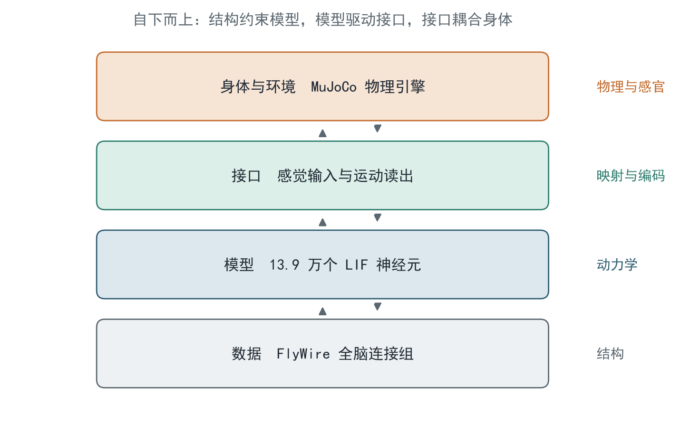

# 第 12 章　果蝇全脑仿真的现场

前面几章分别讲了零件、图谱、模型和身体。这一章把它们拼起来，看看 Eon Systems 到底做了什么，哪些部分有数据支撑，哪些部分是工程上的权宜之计。

需要先说明，这一节描述的是 2026 年 3 月公开的版本。团队自己说得很清楚，这是一个进行中的系统，不是最终产品。

## 12.1 系统全貌

整个系统可以分成四层。

最底层是连接组，来自 FlyWire 的成年果蝇全脑数据，13.9 万个神经元，5000 万个突触。每个神经元有唯一的 ID，每个连接有突触数量。

第二层是神经元模型，用漏电积分发放描述每个神经元。模型参数按细胞类型设定，取值参考已发表的果蝇电生理数据。

第三层是感觉和运动的接口。感觉侧把虚拟世界的事件映射到感觉神经元的激活，运动侧把一小组下降神经元的放电映射成身体的控制指令。

第四层是身体和环境，用 NeuroMechFly v2 的身体模型和 MuJoCo 的物理引擎。身体有 87 个关节，能走、能站、能伸喙。环境里有地面、食物、光线和虚拟的灰尘。

四层之间每十五毫秒同步一次。大脑更新，身体前进，感觉回流，循环往复。

## 12.2 大脑模型

大脑模型的核心是 Shiu 等人在 2024 年发表的 LIF 网络。那篇论文的目标不是做仿真，而是用连接组预测神经活动。他们用连接矩阵和递质预测搭了一个网络，激活特定的味觉神经元，看哪些下游神经元会被带动，再把预测和真实的钙成像对比。

结果相当好。模型预测的味觉响应神经元，与实验观察到的重合度很高。模型还预测了一组参与进食启动的运动神经元，后来被光遗传实验证实。论文报告的预测准确率在九成左右。

Eon 直接用了这个模型，把它从静态的预测工具变成了动态的控制器。激活感觉神经元，网络开始活动，活动传播到运动相关区域，读出下降神经元的放电。

这里有一个技术细节值得说。LIF 网络的连接权重用突触数量表示，一个连接有十个突触，权重就是十。这个假设很粗糙，因为突触数量和连接强度不是线性关系。但它有一个好处，不需要拟合参数，连接组给什么就用什么。

递质符号来自 Eckstein 等人的预测，兴奋性连接取正，抑制性取负。预测错误的比例在百分之十到二十之间，这些错误会改变局部环路的平衡。Eon 没有做 corrections，直接用原始预测。

## 12.3 感觉输入

感觉输入分几种。

味觉最直接。虚拟食物接触腿或喙，对应的味觉受体神经元被激活。甜味激活一组，苦味激活另一组。这些神经元的 ID 在 FlyWire 里有注释，可以直接找到。

嗅觉类似。虚拟环境里的气味分子对应一组嗅觉受体神经元，激活后信号传到触角叶，再传到蘑菇体。

触觉用触角机械感受通路。虚拟灰尘落在触角上，Johnston 器官的机械感受神经元被激活，信号传到脑内，触发理毛。这条通路在 2015 年被 Hampel 等人详细描述过，Eon 直接照搬。

视觉最复杂。他们用了 Lappalainen 等人的连接组约束视觉模型，计算视觉系统对场景的响应，再把响应注入全脑模型的对应神经元。Eon 承认，目前视觉输入对行为的影响还很弱，更多是装饰性的。 looming 刺激能激活逃逸相关的下降神经元，但身体层面的逃逸行为还没有实现。

## 12.4 运动读出

运动读出是整套系统里最手工的部分。

真实果蝇有一千多个下降神经元，负责把大脑的指令传到胸神经节。Eon 只用了其中几个。

DNa01 和 DNa02 与转向有关。这两个神经元的放电率差，被映射成身体的转向角速度。oDN1 与前进速度有关，放电率映射成前进速度。MN9 控制喙的伸出，用于进食。理毛由触角下降神经元触发。

映射的函数是手工调的。放电率多少对应多大的转向，没有标准答案，只能试。Eon 的工程师花了不少时间调整这些参数，让行为看起来自然。

这也是批评的焦点。如果映射可以随便调，那么行为有多少来自大脑，多少来自调参，就说不清了。Eon 的回应是，映射只决定行为的幅度，不决定行为的种类。哪种行为被触发，由大脑的活动模式决定。他们还指出，打乱连接后行为消失，说明行为不是调参调出来的。

## 12.5 行为

公开的视频里展示了三种行为。

觅食。果蝇在一片虚拟地面上走动，环境里有香蕉的气味。它朝着气味源移动，接近后停下，伸喙进食。这个过程里，转向和速度由大脑控制，身体由控制器执行。

理毛。虚拟灰尘落在触角上，果蝇停下，抬起前腿，清理触角，然后继续走。理毛的动作是身体控制器里的固定程序，触发信号来自大脑。

逃避。视频里没有完整展示，但模型对逼近的视觉刺激有反应，相关下降神经元会激活。身体层面的逃避动作还没有接上。

这三种行为覆盖了觅食、维护、防御三类基本功能。Eon 的说法是，这是第一次用完整连接组驱动多行为闭环。这个说法在限定条件下成立，因为此前的全脑模型没有身体，有身体的模型没有用连接组。

## 12.6 验证

怎么知道这个仿真是对的。Eon 给了几层证据。

第一层是神经元活动。模型预测的味觉和机械感觉响应，与已发表的钙成像数据对比，重合度在九成左右。这是 Shiu 论文的工作，不是 Eon 新做的，但构成了模型的基础。

第二层是行为。模型产生的觅食和理毛行为，与真实果蝇的行为序列相似。这里没有严格的定量指标，更多是定性比较。

第三层是消融。打乱连接组，或者随机化突触权重，行为消失。这说明行为依赖结构，不是靠接口调出来的。

这三层证据强度不同。第一层最硬，有定量对比。第二层次之，依赖观察者的判断。第三层能排除一些替代解释，但不能证明模型捕捉了真实的神经机制。

## 12.7 批评与回应

这项工作发表后，神经科学界有不少批评。主要集中在几点。

第一，LIF 太简单。没有树突，没有离子通道，没有神经调质。这样一个模型产生的行为，可能只是连接结构的粗粒度反映，不能说明真实大脑如何工作。

Eon 的回应是，简化是刻意的。他们想测试的是结构能解释多少，而不是细节能解释多少。结果说明结构确实携带了大量信息，这是一个有意义的发现。

第二，接口太手工。下降神经元到身体动作的映射是调的，身体控制器是预训练的。行为可能来自这些工程部件，而不是大脑。

Eon 承认这一点，并指出这是当前的技术限制。他们计划扫描果蝇的身体，重建运动神经元和肌肉的连接，把接口变成数据驱动。

第三，行为太少。三种行为，都是本能行为，不涉及学习、记忆、社交。这些高级功能需要可塑性和神经调质，当前模型没有。

Eon 的回应是，这是第一步。他们已经在模型里加入了蘑菇体的可塑性，让果蝇能学习气味。下一步是加入更多调质和内部状态。

第四，上传这个词被滥用。一个简化模型跑出几种行为，离复制一个心智还很远。

这一点 Eon 自己也同意。他们强调上传是一个连续谱，不是二元的。当前的版本是低保真的上传，保真度会逐步提高。

## 12.8 这次做到了什么

抛开宣传，这次工作的实质贡献有三点。

第一，它把连接组、神经元模型、身体和环境四样东西整合到一个闭环里，跑出了多行为。此前的工作要么缺身体，要么缺连接组，要么缺闭环。

第二，它提供了一个可复现的平台。数据是公开的，模型是开源的，身体模型是公开的，其他团队可以在此基础上改进。这比一个黑箱演示有价值得多。

第三，它把全脑仿真的工程问题摆到了台面上。接口怎么设计，延迟怎么处理，行为怎么评估，这些问题过去只在少数实验室里讨论，现在成了公开话题。

它没有做到的，是证明结构足以解释全部行为。这个问题太大，一次演示回答不了。它也没有做到高保真，模型离真实果蝇还有很长的距离。

但作为一条路的第一个路标，它足够清楚。
