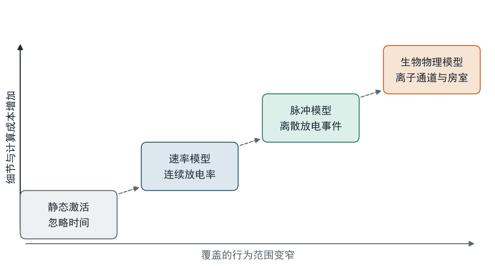

# 第 1 章　从接线图到动力学

一张连接组是一份清单。它列出神经元，列出它们之间的连接，列出每个连接上有几个突触。这份清单是静态的，没有时间，没有活动，没有行为。

要让它动起来，必须补上一组规则，规定每个神经元如何根据输入改变状态，每个突触如何把前一个神经元的活动传给后一个。规则加上清单，才构成一个动力学系统。

这一章把这件事形式化，说明连接组提供了什么，缺什么，补什么，以及不同补法之间的差别。

## 1.1 连接组的数学形式

把 $N$ 个神经元编号，连接组可以写成一个 $N \times N$ 的矩阵 $W$。矩阵的元素 $W_{ij}$ 表示从神经元 $j$ 到神经元 $i$ 的连接强度，如果没有连接就是零。

这个矩阵有三个特点。

第一，稀疏。果蝇的 $N$ 约为 13.9 万，非零元素约 5000 万，稀疏度不到千分之三。平均每个神经元只有三百多个输入和三百多个输出。

第二，有符号。$W_{ij}$ 可以是正的，表示兴奋性连接，也可以是负的，表示抑制性连接。符号来自递质预测，不是测量。

第三，非负整数。当前的数据里，$W_{ij}$ 的绝对值是突触数量，一个连接可能有 1 个突触，也可能有 50 个。它不是真实的电导，只是一个代理。

如果只关心谁连着谁，可以把 $W$ 二值化，得到邻接矩阵 $A$。如果关心强度，就用 $W$ 本身。两种表示在不同的问题里各有用处。

## 1.2 缺的是什么

有了 $W$，还缺四样东西。

第一是神经元的状态。每个神经元在当前时刻处于什么电位，有没有在放电，最近一次放电是什么时候。这些构成了状态向量 $\mathbf{x}(t)$，维度是 $N$ 或者 $kN$，取决于模型有几个变量。

第二是动力学规则。给定当前状态和输入，下一时刻的状态怎么变。这可以写成一个函数 $F$，满足

$$
\frac{d\mathbf{x}}{dt} = F(\mathbf{x}, \mathbf{u}, W)
$$

其中 $\mathbf{u}$ 是外部输入。不同的神经元模型对应不同的 $F$。

第三是时间延迟。信号从突触前传到突触后需要时间，轴突传导需要时间，突触释放需要时间。果蝇的局部连接延迟在 1 毫秒左右，长程连接可以到几毫秒。这些延迟会显著影响网络的同步行为。

第四是边界条件。哪些神经元接收外部输入，哪些神经元产生输出，输入输出的时间进程是什么。这决定了模型和外界如何耦合。

## 1.3 建模的阶梯

补这些缺失的方式不止一种，可以按细节程度排成一个阶梯。

最底层是静态激活模型。忽略时间，只算给定输入下的稳态活动。比如把感觉神经元的激活固定，让信号沿连接传播几步，看哪些神经元被点亮。这类模型计算便宜，适合做通路筛查。

往上一层是速率模型。每个神经元用一个连续变量表示放电率，突触传递用连接矩阵乘以前一层的速率。这类模型可以写成

$$
\tau \frac{d\mathbf{r}}{dt} = -\mathbf{r} + \phi(W\mathbf{r} + \mathbf{u})
$$

其中 $\mathbf{r}$ 是放电率向量，$\phi$ 是非线性函数，通常是阈值或 S 形函数。速率模型适合分析稳定性、增益、振荡，是理论神经科学的常用工具。

再往上是脉冲模型。每个神经元的状态是膜电位，放电是离散事件，突触输入是脉冲序列。这是全脑仿真最常用的层次，漏电积分发放网络属于这一层。

最高层是生物物理模型。每个神经元有多个房室，每个房室有离子通道，每个通道有门控变量。这一层最接近真实神经元，计算也最贵。

## 1.4 三个核心问题

不管选哪一层，都会遇到三个问题。

第一个是充分性。连接组加上某一层模型，能不能产生目标行为。如果能，说明结构携带了足够的信息；如果不能，说明还缺别的因素。这是全脑仿真最根本的实证问题。

第二个是可辨识性。给定观测数据，能不能唯一确定模型参数。很多参数在数据里没有体现，可以取任意值而不影响输出。这些参数叫不可辨识参数，它们的存在让模型的解释力打折扣。

第三个是保真度。模型和真实系统有多接近，用什么指标衡量。是神经活动的相关，行为的相似，还是预测新实验的能力。不同的指标会给出不同的答案。

这三个问题贯穿全书。第二章给数学工具，第三到五章讲单个神经元和突触的模型，第六到九章讲网络和结构，第十到十二章讲辨识、计算和评估。

## 1.5 一个具体的例子

为了让抽象的东西落地，看一个最小的例子。

假设只有两个神经元，一个是兴奋性的，一个是抑制性的，互相连接。兴奋性神经元有外部输入，抑制性神经元接收兴奋性神经元的输出，再反过来抑制它。

用速率模型写出来，是两个耦合的微分方程。

$$
\tau_E \frac{dr_E}{dt} = -r_E + \phi(w_{EE} r_E - w_{EI} r_I + u)
$$

$$
\tau_I \frac{dr_I}{dt} = -r_I + \phi(w_{IE} r_E - w_{II} r_I)
$$

给定参数，可以分析这个系统的平衡点、稳定性、以及对外部输入的响应。如果抑制足够强，系统会稳定在一个低活动状态；如果兴奋占优，系统可能振荡或者进入高活动状态。

这个例子说明，即使只有两个神经元，动力学的行为也可以很丰富。到了 13.9 万个神经元，可能的行为空间大到无法穷举，只能靠数值模拟和统计分析。

## 1.6 为什么形式化有用

有人可能会问，为什么要把神经科学写成方程，直接用文字描述不行吗。

文字适合描述机制，不适合描述相互作用。当几十个变量同时变化，文字很难说清楚谁影响谁，影响多大，什么时候稳定，什么时候失控。方程可以。

更重要的是，方程可以被检验。给定一组方程和参数，可以算出预测，再和实验对比。如果不符合，方程就是错的，或者参数是错的。这种可证伪性是科学理论的基本要求。

当然，方程也有局限。它只能描述被写进方程的东西，写不进去的东西就被忽略了。全脑仿真的很多争论，本质上是关于哪些东西必须写进方程，哪些可以忽略。这个问题没有先验的答案，只能通过实验和比较来回答。
