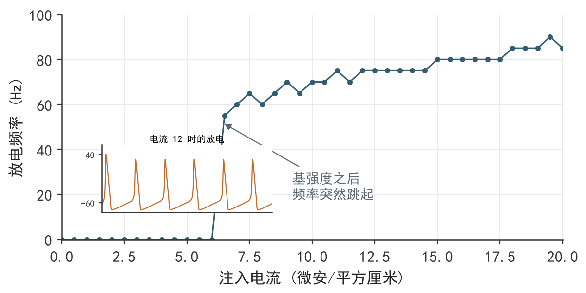

# 第 3 章　神经元的电学模型

第二章给了工具，这一章开始建模。目标是把一个神经元变成一个可以求解的系统，既要保留足够的生物细节，又要让计算可行。

从最简单的问题开始。一个封闭的细胞，膜两侧有离子浓度差，膜上有通道，通道的开关受电压控制。这样的系统会产生什么行为。

## 3.1 膜的等效电路

细胞膜是绝缘的脂质双分子层，两侧有电荷，构成一个电容。膜上的离子通道是导体，允许特定离子通过。离子在膜两侧的浓度差产生电动势，驱动离子流动。

这三样东西可以用一个电路表示，电容 $C$ 并联若干条电导通路，每条通路串联一个电池。电池的电压由能斯特方程给出

$$
E_{\text{ion}} = \frac{RT}{zF} \ln \frac{[\text{ion}]_{\text{out}}}{[\text{ion}]_{\text{in}}}
$$

其中 $R$ 是气体常数，$T$ 是温度，$z$ 是离子价数，$F$ 是法拉第常数。室温下，钠的平衡电位约为正六十毫伏，钾约为负九十毫伏，氯约为负七十毫伏。

膜电位的变化由电容电流决定。流入电容的电流等于外部电流减去各条离子通道的电流。

$$
C \frac{dV}{dt} = I_{\text{ext}} - \sum_k I_k
$$

每条通道的电流等于电导乘以驱动力。

$$
I_k = g_k (V - E_k)
$$

如果电导是常数，这个方程是线性的，解是指数衰减。真实的神经元不是这样，因为电导随电压和时间变化。

## 3.2 霍奇金赫胥黎方程

1952 年，Hodgkin 和 Huxley 在枪乌贼轴突上测出了钠和钾电流的电压依赖，提出用三个门控变量描述电导的变化。

钠通道的电导写成

$$
g_{\text{Na}} = \bar{g}_{\text{Na}} m^3 h
$$

钾通道写成

$$
g_{\text{K}} = \bar{g}_{\text{K}} n^4
$$

其中 $\bar{g}$ 是最大电导，$m$、$h$、$n$ 是门控变量，取值在零到一之间。$m$ 是激活变量，$h$ 是失活变量，$n$ 是钾通道的激活变量。指数 3 和 4 来自通道亚基的协同开放。

每个门控变量满足一阶动力学

$$
\frac{dm}{dt} = \alpha_m(V)(1 - m) - \beta_m(V) m
$$

$\alpha$ 和 $\beta$ 是电压的指数函数，由实验拟合得到。比如钠激活的速率常数可以写成

$$
\alpha_m(V) = \frac{0.1 (V + 40)}{1 - e^{-(V+40)/10}}
$$

$$
\beta_m(V) = 4 e^{-(V+65)/18}
$$

这些表达式看起来吓人，其实只是把实验曲线拟合成了函数。它们的物理含义是，通道在某个电压下打开和关闭的速率。

把膜方程和三个门控方程联立，得到四个耦合的常微分方程。给定初始条件和外部电流，可以数值求解出完整的动作电位。

## 3.3 门控变量的直觉

$m$ 和 $h$ 的行为可以从时间常数理解。

在静息电位附近，$m$ 的时间常数很小，大约零点几毫秒，意味着激活很快。$h$ 的时间常数大一些，几毫秒，失活较慢。$n$ 的时间常数更大，十几毫秒，钾通道的开放和关闭都慢。

这种时间尺度的差异是动作电位的关键。去极化时，$m$ 迅速上升，钠通道打开，钠电流涌入，进一步去极化，形成正反馈。几百微秒后，$h$ 开始下降，钠通道失活，正反馈终止。与此同时，$n$ 缓慢上升，钾通道打开，钾电流外流，把膜电位拉回。

如果 $h$ 不失活，钠通道会一直开着，膜电位会停在正电位附近，无法恢复。如果 $n$ 不慢，钾电流会过早出现，动作电位的幅度会变小。两个时间常数的配合，产生了一个短暂、全或无、能自我终止的脉冲。

## 3.4 阈值与 f-I 曲线

给神经元注入恒定电流，测量稳态放电频率，得到 f-I 曲线。

对于 HH 模型，存在一个最小电流，低于它神经元不放电，高于它开始放电。这个最小电流叫基强度。刚过基强度时，放电频率可以从零连续增加，这叫第一类兴奋性。有些神经元在基强度处突然跳到某个非零频率，这叫第二类兴奋性。

两类兴奋性的区别对应不同的分岔。第一类对应鞍结分岔，不动点消失，极限环从零频率出现。第二类对应霍普夫分岔，不动点失稳，极限环以有限频率出现。

这个区别不只是数学游戏。第一类神经元适合编码刺激强度，因为频率随电流连续变化。第二类神经元适合检测刺激的出现，因为它的响应是开关式的。果蝇的许多感觉神经元属于第一类，运动神经元更接近第二类。

## 3.5 适应与爆发

真实的神经元很少持续以固定频率放电。持续的刺激会导致频率逐渐下降，这叫适应。

适应的机制有很多种。一种是钾通道的慢失活，另一种是钙激活的钾通道，还有一种是钠钾泵的活动增强了超极化。这些机制的共同效果是，给神经元一个负反馈，让它在持续刺激下逐渐安静。

适应让神经元对变化敏感，对恒定刺激不敏感。这对感觉系统很重要，因为世界上的信息主要在变化里，不在恒定里。

爆发是另一种模式。有些神经元在短暂刺激下产生一串密集的脉冲，然后沉默一段时间，再产生一串。这种模式在丘脑、海马、皮层都有。爆发的机制通常涉及低阈值钙通道，它在超极化后恢复，下一次去极化时产生一个钙尖峰，带动一串钠脉冲。

HH 模型本身不能产生爆发，需要额外的离子通道。这就是为什么研究者开发了各种扩展模型，比如添加钙通道、钙激活钾通道、适应电流。每添加一个通道，模型的表达能力增强，参数也增多。

## 3.6 降维

HH 模型有四个变量，分析起来不方便。能不能用更少的变量抓住主要行为。

FitzHugh 和 Nagumo 给出了一个二维近似。用一个快变量表示膜电位，一个慢变量表示恢复，写成

$$
\frac{dV}{dt} = V - \frac{V^3}{3} - W + I
$$

$$
\tau \frac{dW}{dt} = V + a - bW
$$

这个系统的相平面可以画出零斜线和轨迹，直观地看到阈值、激发、恢复。它不能精确复现 HH 的波形，但能复现分岔的结构。

更极端的简化是相位模型。当神经元持续振荡时，状态可以用一个相位变量描述，相位随时间匀速增加，外部输入导致相位偏移。相位模型适合研究耦合振荡器的同步，比如昼夜节律、呼吸节律。

还有二次积分发放模型，把 HH 的某些特性压缩成一个二次方程，可以解析求解首次放电时间。这类模型在理论分析里很有用。

## 3.7 LIF 的位置

漏电积分发放模型是最激进的简化。它把膜电位当成唯一的变量，忽略所有离子通道的细节，只保留漏电、积分、阈值、重置。

$$
\tau \frac{dV}{dt} = -(V - E_L) + R I(t)
$$

这个模型不能产生动作电位的形状，不能产生适应，不能产生爆发。它只能告诉你神经元什么时候放电。

但它在网络仿真里极其有用。计算简单，参数少，可以解析分析。对于研究大规模网络的统计行为，比如放电率、同步、相关性，LIF 往往足够。果蝇全脑仿真用的就是它。

选择 LIF 的理由是权衡。HH 模型能给出更真实的单细胞行为，但 13.9 万个 HH 神经元，每个四个变量，加上几千个突触，计算量会超出当前硬件的承受范围。而且，HH 的参数在果蝇身上大部分没有测过，用估计的参数跑详细模型，精度未必比 LIF 高。

这是一个典型的建模决策，细节和规模之间必须取舍。下一章讲另一个方向的细节，把神经元从点扩展成有空间结构的房室模型。
