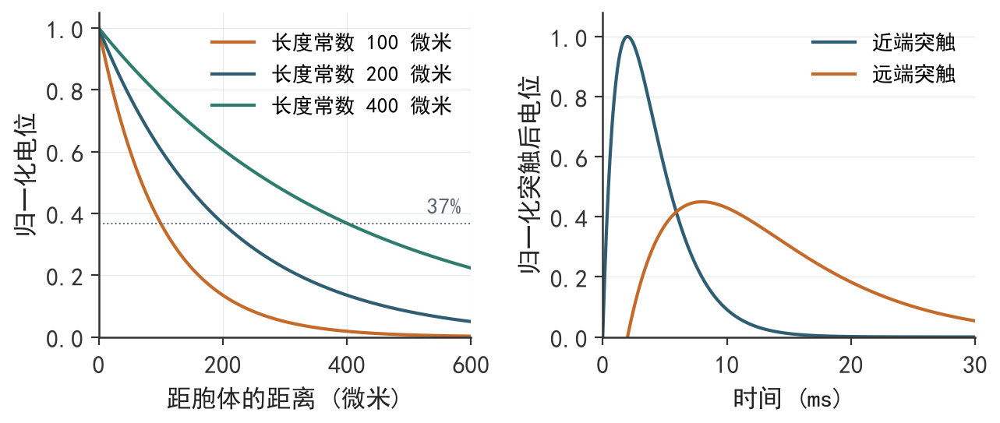

# 第 4 章　从电缆到房室模型

点神经元把整个细胞压成一个点，所有输入同时到达，同时求和。这个假设在果蝇身上勉强成立，因为果蝇神经元多数没有粗壮的树突树。但在脊椎动物身上，尤其是皮层锥体神经元，树突占了细胞膜面积的九成以上，输入在空间上分布，在时间上不同步，点模型会丢掉大量计算能力。

这一章把神经元从点扩展成有空间结构的模型。核心问题只有一个，电信号沿着纤维传播时会怎样衰减和变形。

## 4.1 电缆方程

把一根树突或轴突看成圆柱形的电缆。电缆有轴向电阻，电流沿轴向流动会遇到阻力；有膜电阻，电流会从膜上漏出去；有膜电容，膜两侧可以储存电荷。

取一小段长度 $\Delta x$，列出电流守恒。轴向流入的电流减去流出的电流，等于从膜上漏掉的电流加上给电容充电的电流。取极限，得到电缆方程

$$
\lambda^2 \frac{\partial^2 V}{\partial x^2} = \tau \frac{\partial V}{\partial t} + V
$$

其中 $\lambda$ 是长度常数

$$
\lambda = \sqrt{\frac{r_m}{r_a}}
$$

$\tau$ 是膜时间常数

$$
\tau = r_m c_m
$$

$r_m$ 是单位长度的膜电阻，$r_a$ 是单位长度的轴向电阻，$c_m$ 是单位长度的膜电容。

长度常数的物理含义是，稳态电位衰减到原来的百分之三十七所经过的距离。$\lambda$ 越大，信号传得越远。粗的纤维轴向电阻小，$\lambda$ 大；膜电阻高，漏电少，$\lambda$ 也大。

## 4.2 被动衰减

先考虑没有离子通道的被动电缆。给一端一个电压脉冲，看它如何沿电缆传播。

在稳态下，时间导数项为零，方程变成

$$
\lambda^2 \frac{d^2 V}{dx^2} = V
$$

解是指数衰减

$$
V(x) = V_0 e^{-x/\lambda}
$$

这意味着，距离胞体越远的突触，它的输入到达胞体时越弱。如果一个突触在三个长度常数之外，它的影响只剩百分之五。这就是为什么远端突触往往需要协同激活才能起作用。

在瞬态下，情况更复杂。脉冲不仅衰减，还会被展宽。高频成分衰减得快，低频成分衰减得慢，结果是信号的上升沿变缓，持续时间变长。这种低通滤波效应让远端突触的输入更慢、更持久。

## 4.3 房室模型

电缆方程是偏微分方程，解析解只对少数几何形状存在。真实的树突有分支、有粗细变化、有各种离子通道，必须数值求解。

最常用的方法是把电缆切成有限个隔室。每个隔室假设内部电位均匀，隔室之间用轴向电阻连接，每个隔室有自己的膜电容、膜电阻和离子通道。这样，偏微分方程变成了一组常微分方程。

隔室的数量决定了精度。一个皮层锥体神经元通常切成几百到几千个隔室。隔室越多，越接近真实的几何，计算也越贵。

数值求解的关键是效率。隔室之间的耦合是局部的，形成的矩阵是三对角的。三对角矩阵可以用追赶法在 $O(n)$ 时间内求解，比通用的矩阵求逆快得多。这个算法由 Michael Hines 在 1984 年提出，是 NEURON 仿真器的核心。

## 4.4 树突计算

有了房室模型，可以看到树突不只是被动的电缆。

第一个现象是重合检测。两个突触分别位于树突的两个分支，单独激活时，各自的电位传到胞体已经很弱，不足以触发动作电位。但同时激活时，两个电位在分支点汇合，叠加后超过阈值，触发放电。这让神经元能检测两个输入是否同时到达。

第二个现象是方向选择。如果突触沿树突依次排列，并且树突上有电压门控通道，那么从一端向另一端传播的序列会比反方向传播产生更大的响应。这种机制被认为是视网膜方向选择性细胞的基础。

第三个现象是局部非线性。树突上的 NMDA 受体在去极化时解除镁阻塞，产生再生的内向电流。一串同步输入可以触发一个局部的 NMDA 尖峰，持续几十毫秒，幅度可以达到几十毫伏。这个尖峰不传到轴突，但在局部放大了输入，改变了整合规则。

这些现象说明，树突是一个有计算能力的单元，不只是被动的求和器。点模型把这些全部抹平了。

## 4.5 主动树突与钙尖峰

树突上不只有被动性质，还有电压门控通道。钙通道在树突上尤其丰富，它们在高频输入或强同步输入下打开，产生钙尖峰。

钙尖峰比钠动作电位慢，持续几十到几百毫秒，幅度可以到几十毫伏。它在树突局部产生，可以传播到胞体，影响放电。钙尖峰还与突触可塑性耦合，因为钙浓度是许多可塑性规则的触发信号。

在皮层锥体神经元里，顶树突的钙尖峰被认为与注意力、学习、意识状态有关。一个感觉输入到达基底树突，一个反馈输入到达顶树突，两者同时出现时，顶树突产生钙尖峰，胞体爆发一串动作电位。这种机制被用来解释预测编码和注意力调制。

## 4.6 果蝇的特殊情况

果蝇的神经元多数是单极的，没有明显的树突树。它们的输入输出分支从同一根纤维上长出，几何结构比锥体神经元简单得多。

这不意味着空间结构不重要。果蝇的蘑菇体 Kenyon 细胞有一根细长的轴突，输入在末端，输出在中段，信号沿轴突传播时会衰减。这种空间布局影响了信号的时序。

果蝇的视觉系统里有大型的切线细胞，树突在视叶的多个柱之间展开，接收不同位置的输入。这些细胞的树突上有主动电导，能做局部计算。要理解它们的功能，点模型不够。

但全脑仿真没有用房室模型。原因很实际，13.9 万个神经元，每个切成几十个隔室，计算量会增加两个数量级，而且大部分神经元的几何参数没有测量。用点模型是一个妥协，代价是丢掉树突计算，收益是能跑完整脑。

## 4.7 什么时候需要房室模型

判断标准很简单。如果你的问题涉及输入的时空模式，比如两个输入是否同时到达，不同位置的输入如何相互作用，树突的主动性质如何放大信号，那么需要房室模型。如果你的问题涉及网络的整体活动，比如放电率、同步、信息流，点模型通常够用。

还有一类问题必须用房室模型，就是药物作用。很多药物作用于特定的离子通道，通道在树突和胞体上的分布不同，药效也不同。要预测药物对神经元的影响，必须知道通道的空间分布。

房室模型的代价是参数。一个 HH 点模型有十几个参数，一个房室模型有几百个参数，每个隔室的通道密度、每个通道的动力学都要设定。这些参数大部分没有实验测量，只能靠拟合。参数越多，拟合越容易过拟合，模型的预测力越弱。

这是建模的普遍规律。细节增加，表达能力增强，可辨识性下降。找到合适的细节水平，是建模的核心技能。
