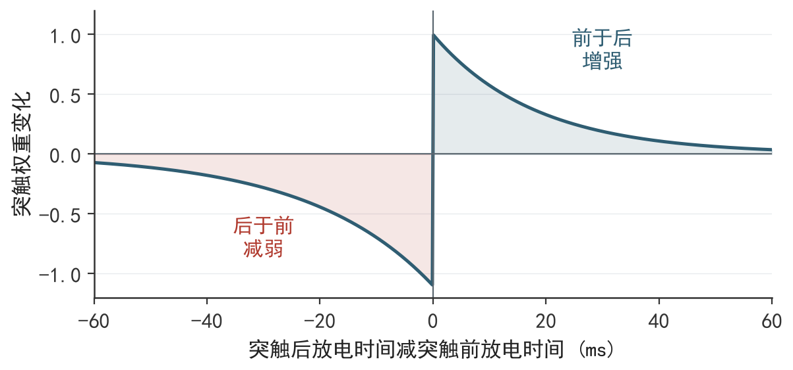

# 第 5 章　突触、电流与可塑性

第三章把神经元变成了方程，这一章处理连接。

突触不是一根导线。它把前一个神经元的脉冲转换成一小段电流，电流的幅度、形状、持续时间取决于受体类型、突触位置和最近的活动历史。这些细节决定了网络的时间结构和学习能力。

## 5.1 突触电流的几种写法

最简单的是电流脉冲。前一个神经元放电，后一个神经元的膜电位立刻获得一个增量，没有持续时间。

$$
I_{\text{syn}}(t) = w \sum_k \delta(t - t_k)
$$

这种写法计算最便宜，适合大规模仿真，但丢掉了突触的时间进程。

稍微真实一点的是指数衰减。每次脉冲让一个电导变量跳升，然后按指数衰减。

$$
I_{\text{syn}} = g_{\text{syn}} s (V - E_{\text{rev}})
$$

$$
\frac{ds}{dt} = -\frac{s}{\tau_s} + \sum_k \delta(t - t_k)
$$

$\tau_s$ 是衰减时间常数，兴奋性突触在几毫秒，抑制性突触可以到几十毫秒。$E_{\text{rev}}$ 是反转电位，兴奋性约为零毫伏，抑制性约为负七十毫伏。

更真实的是双指数，上升相和衰减相各有时间常数。

$$
s(t) = \frac{\tau_1 \tau_2}{\tau_1 - \tau_2} \left( e^{-t/\tau_2} - e^{-t/\tau_1} \right)
$$

这个形状更接近实测的突触后电流，上升快，衰减慢。

## 5.2 受体动力学

不同的受体有不同的时间进程和电压依赖。

AMPA 受体介导快速的兴奋性电流，时间常数在几毫秒，是大多数快速传递的主力。

NMDA 受体慢得多，时间常数几十到几百毫秒，而且有电压依赖。在静息电位下，镁离子堵住通道，即使有谷氨酸结合，电流也很小。去极化时，镁阻塞解除，通道打开。这种性质让 NMDA 受体成为一个重合检测器，只有在前膜释放递质和后膜已经去极化同时发生时，才有显著电流。

NMDA 的电压依赖常用一个经验公式描述

$$
I_{\text{NMDA}} = g_{\text{NMDA}} s (V - E_{\text{rev}}) \frac{1}{1 + e^{-(V - V_{\text{half}})/k}}
$$

$V_{\text{half}}$ 和 $k$ 是拟合参数。这个因子在负七十毫伏接近零，在零毫伏接近一。

GABA 受体介导抑制性电流。GABA_A 是离子通道型，时间常数几毫秒到几十毫秒，产生快速的抑制。GABA_B 是代谢型，通过 G 蛋白打开钾通道，时间常数几百毫秒，产生慢速的抑制。

## 5.3 短时程可塑性

同一个突触，连续放电时，后一次的效果可能比前一次强，也可能弱。

减弱叫短时程抑制，通常是因为囊泡耗尽。前一次释放用掉了一批囊泡，短时间内补充不上，下一次释放的概率降低。增强叫短时程易化，通常是因为钙离子在终末内累积，提高了释放概率。

这两种效应的时间尺度在几百毫秒到几秒。它们让突触变成一个动态滤波器，对低频输入和高频输入有不同的响应。

Tsodyks 和 Markram 在 1997 年提出了一个模型，用两个变量描述这种动态。一个变量 $x$ 表示可用囊泡的比例，一个变量 $u$ 表示释放概率。

$$
\frac{dx}{dt} = \frac{1 - x}{\tau_d} - u x \delta(t - t_k)
$$

$$
\frac{du}{dt} = -\frac{u}{\tau_f} + U (1 - u) \delta(t - t_k)
$$

每次脉冲，$x$ 减少 $ux$，$u$ 增加 $U(1-u)$。脉冲之间，$x$ 按 $\tau_d$ 恢复，$u$ 按 $\tau_f$ 衰减。参数不同，突触表现为抑制或易化。

## 5.4 长时程可塑性

短时程变化在刺激结束后消失。长时程变化可以持续几分钟、几小时甚至一生，是学习和记忆的基础。

最著名的规则是赫布规则，同时放电的神经元之间的连接增强。后来的实验发现，时间顺序很重要。如果突触前放电在突触后之前，连接增强；反过来的顺序，连接减弱。这叫脉冲时序依赖可塑性。

一个常用的拟合曲线是

$$
\Delta w = \begin{cases} A_+ e^{-\Delta t / \tau_+} & \Delta t > 0 \\ -A_- e^{\Delta t / \tau_-} & \Delta t < 0 \end{cases}
$$

其中 $\Delta t = t_{\text{post}} - t_{\text{pre}}$。$\tau_+$ 和 $\tau_-$ 在十到二十毫秒，$A_+$ 和 $A_-$ 决定增强和减弱的幅度。

这个曲线是对实验数据的简化。真实的 STDP 依赖很多因素，突触的位置、受体的类型、神经调质的状态、以及前后的放电频率。同一个突触，在不同条件下可以表现出不同的规则。

## 5.5 钙控制与三因子规则

STDP 的微观机制与钙浓度有关。突触后去极化打开 NMDA 受体，钙离子流入。钙浓度低，激活磷酸酶，导致减弱；钙浓度高，激活激酶，导致增强。钙的幅度和持续时间决定了方向。

这个机制可以用一个钙变量描述。钙的动力学比膜电位慢，可以看成对前后放电的低通滤波。增强和减弱由钙浓度的阈值决定。

还有一种规则需要第三个因子。纯粹的赫布规则无法解释奖励学习，因为奖励往往在动作之后几百毫秒甚至几秒才出现，而 STDP 的时间窗只有几十毫秒。

三因子规则引入一个资格痕迹。前后放电在突触上留下一个痕迹，持续几秒。当多巴胺或奖励信号到达时，痕迹与奖励结合，决定权重的变化。

$$
\frac{dw}{dt} = \eta \, e(t) \, D(t)
$$

$e(t)$ 是资格痕迹，$D(t)$ 是多巴胺浓度。这个规则解释了为什么奖励可以强化几分钟前的行为，是强化学习的神经基础。

果蝇的蘑菇体是研究三因子规则的经典系统。Kenyon 细胞到输出神经元的突触在多巴胺到达时改变强度，多巴胺信号来自惩罚或奖励。2026 年的一项全脑仿真工作就是把这个规则加到连接组模型上，让果蝇学会回避特定气味。

## 5.6 稳态可塑性

长时程可塑性有一个问题。如果增强总是强于减弱，网络会越来越兴奋，最终饱和。如果减弱总是强于增强，网络会沉默。

生物系统通过稳态可塑性维持平衡。最常见的是突触缩放，当网络活动过高时，所有兴奋性突触的强度按比例下调；活动过低时，上调。这种调节不改变相对权重，只改变整体增益。

还有内在可塑性，神经元调整自己的阈值或电导，让放电率回到目标水平。这种调节比突触缩放慢，但更全局。

稳态可塑性的时间尺度是小时到天，与学习的时间尺度不同。它保证了学习不会把网络推向失控，但也限制了学习的容量。

## 5.7 在全脑模型里怎么处理

全脑仿真面对一个两难。加上可塑性，模型能学习，但计算量和参数都增加；不加，模型只能表现本能行为。

Eon 的选择是不加。他们的 LIF 网络没有可塑性，突触权重固定。这意味着果蝇不能形成长期记忆，行为完全由先天连接决定。

这个选择在当时是合理的，因为他们的目标是验证结构的作用。加上可塑性会引入新的参数和不确定性，让结果难以解释。

后续的工作开始加入可塑性。蘑菇体的三因子规则是一个起点，因为它的机制清楚，参数有实验约束。全脑范围的可塑性还没有实现，因为不知道每个突触用哪种规则，也不知道规则参数。

这也是全脑仿真的一个前沿。可塑性是学习的基础，没有它，模型只能复现本能，无法复现经验塑造的行为。
