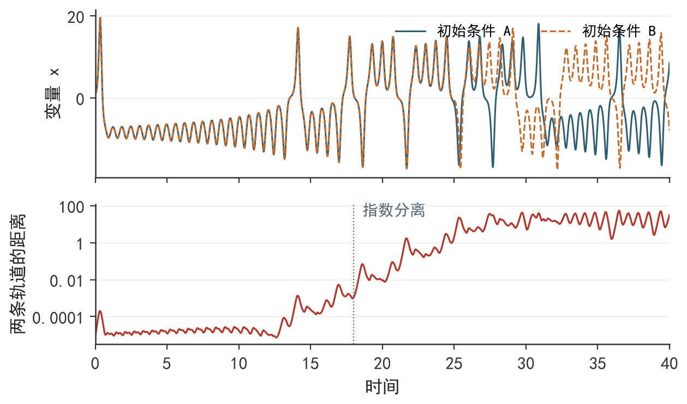
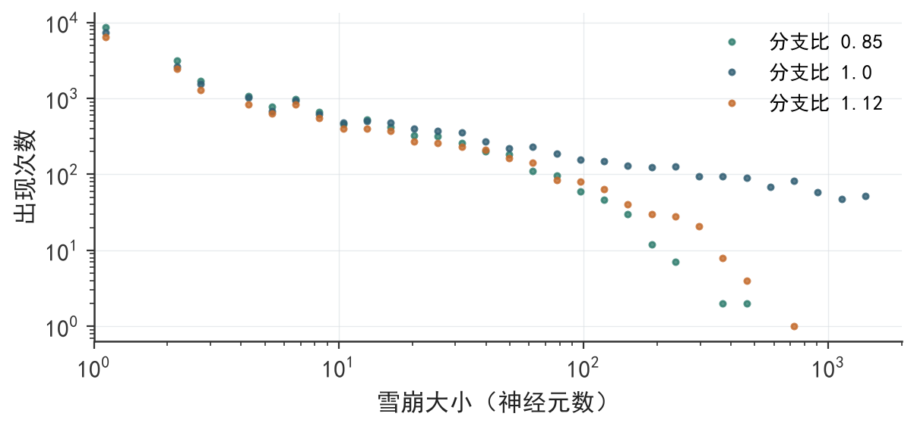

# 第 7 章　混沌、临界与储备池

第六章讨论的是稳定状态，网络最终停在一个不动点或者一个周期性轨道上。这一章讨论另一类行为，系统永远不重复，对初始条件极其敏感，却仍然有统计规律。

这类行为在神经系统里是否存在，有什么功能，是过去三十年争论最激烈的问题之一。

## 7.1 混沌的定义

一个确定性系统，如果满足三个条件，就叫混沌。

第一，轨道有界，不会发散到无穷。第二，轨道不收敛到不动点或周期轨道。第三，对初始条件敏感，两条初始条件相差很小的轨道，会以指数速度分离。

第三个条件用李雅普诺夫指数衡量。两条轨道的距离按

$$
\delta(t) \approx \delta(0) e^{\lambda t}
$$

演化。$\lambda$ 大于零，轨道分离，系统混沌；$\lambda$ 小于零，轨道收敛，系统稳定；$\lambda$ 等于零，距离线性增长，系统处于临界。

混沌系统的一个著名例子是 Lorenz 方程，三个变量，两个二次项，却能产生复杂的蝴蝶形吸引子。神经网络的速率模型在特定参数下也能产生混沌，这最早由 Sompolinsky、Crisanti 和 Sommers 在 1988 年证明。

## 7.2 神经网络的混沌

考虑一个随机连接的速率网络，每个神经元的状态是连续的，连接矩阵的元素是随机的高斯变量。当连接强度超过某个临界值，网络从稳定状态进入混沌。

临界值由连接矩阵的谱半径决定。谱半径小于一，网络稳定；大于一，网络混沌。这个结论对大型随机网络普遍成立，被称为动态平均场理论。

混沌网络有几个特征。第一，活动不重复，即使没有外部输入，网络也会持续产生复杂的时空模式。第二，对输入敏感，一个微小的扰动可以改变整个轨迹。第三，相关性衰减，两个神经元的活动的相关性随时间指数下降，衰减时间由最大李雅普诺夫指数决定。

这些特征让混沌网络看起来像一个糟糕的计算装置，因为它的行为不可预测。但事情没有这么简单。

## 7.3 混沌计算

1990 年代，一些研究者提出，混沌可以用于计算。

第一个想法是，混沌系统对输入敏感，可以把输入编码到轨道的微小偏移里，然后用读取层解码。这种方法叫混沌计算或储备池计算的前身。

第二个想法是，混沌系统有丰富的内部动力学，可以作为一组基函数，把输入映射到高维空间，让线性读取层容易分类。这就是储备池计算的核心思想。

储备池是一个随机连接的循环网络，连接固定，不训练。输入投射到储备池，网络产生高维的瞬态响应，输出层用线性回归拟合目标。只有输出权重需要训练，训练成本很低。

储备池计算在时间序列预测、语音识别、混沌系统建模上都有应用。它的优势是简单，不需要反向传播，训练速度快。劣势是性能依赖储备池的参数，参数不好，性能会很差。

## 7.4 临界态

2003 年，Beggs 和 Plenz 在皮层切片上观察到一个现象。神经活动的雪崩，大小分布服从幂律。

$$
P(s) \propto s^{-\alpha}
$$

$s$ 是雪崩的大小，$\alpha$ 在 1.5 左右。幂律分布意味着，小雪崩很多，大雪崩很少，但没有特征尺度。这种分布在临界系统里很常见。

临界态的定义是，系统处于有序和无序的边界。在神经网络里，有序对应活动消失，无序对应活动爆炸。临界态对应活动刚好能自我维持，传播既不放大也不衰减。

临界态有几个理论上的优势。第一，动态范围最大，系统对输入的响应范围最广。第二，信息传递最优，信号可以传播最远而不失真。第三，相关性最长，不同部分的活动能保持关联。

这些优势让一些研究者认为，大脑工作在临界态附近。支持证据包括幂律分布、长程相关、以及最大化的动态范围。反对证据包括，幂律分布可能来自其他机制，比如网络异质性，不一定是临界。

这场争论至今没有定论。但临界态的概念提供了一个框架，用来理解神经网络如何在稳定和灵活之间平衡。

## 7.5 分支过程模型

临界态最简单的模型是分支过程。

每个活跃的神经元在下一步激活 $k$ 个下游神经元，$k$ 是一个随机变量，均值是 $\sigma$。$\sigma$ 叫分支比。

$\sigma$ 小于一，活动逐渐消失，系统亚临界。$\sigma$ 大于一，活动指数增长，系统超临界。$\sigma$ 等于一，活动维持，系统临界。

分支过程的雪崩大小分布可以解析计算。在临界点，分布是幂律，指数为 1.5。这个结果与实验观察吻合。

分支过程模型过于简化，忽略了时间延迟、抑制、网络结构。但它抓住了临界态的核心，也就是活动的自我维持。许多更复杂的模型，在临界点附近的行为可以用分支过程近似。

## 7.6 临界与学习

临界态和学习的关关系是近年来的热点。

一种观点认为，学习把网络推向临界。学习规则调整连接强度，让网络的活动刚好能传播，既不完全消失也不爆炸。这个过程叫自组织临界。

支持这个观点的证据来自模拟。用 STDP 规则训练的网络，会自动调整到临界点附近。突触的增强和减弱相互平衡，让分支比接近一。

另一种观点认为，临界态是学习的必要条件。只有处于临界，网络才能同时保持稳定和灵活，既能记住旧模式，又能学习新模式。太有序，网络无法改变；太无序，网络无法维持记忆。

这些观点目前还是理论假说，缺乏直接实验证据。但它们提供了一个统一的角度，把网络结构、动力学、学习联系在一起。

## 7.7 果蝇网络的临界性

果蝇的连接组能不能告诉我们它是否处于临界。

2024 年的一项研究分析了 FlyWire 的连接矩阵，计算了它的谱半径和分支比。结果显示，果蝇网络的连接强度处在临界点附近，兴奋和抑制大致平衡。

这个结果需要谨慎解读。连接矩阵的谱半径依赖于权重的定义，用突触数量作为权重是一种选择，用其他定义可能得到不同结果。而且，静态的连接矩阵不能完全决定动态的临界性，神经元的参数和输入也很重要。

尽管如此，这个结果提示，果蝇的脑可能被演化调到了一个有利于信息处理的区域。这个区域既不是完全随机的，也不是完全有序的，而是处在两者之间。

全脑仿真可以检验这个假说。如果模型在临界点附近运行，它的行为应该表现出幂律分布、长程相关、最大动态范围。如果模型偏离临界，这些特征会消失。这类分析还没有系统开展，是未来值得做的方向。
